# Echo: Desktop + Android Plan

This plan covers turning Echo Web into two apps, built **in order**:

- **Part A: Echo Desktop** (Windows, macOS, Linux). The React UI and Express server we already have, packaged as one installable app. On first run it downloads **FFmpeg** and a **Whisper** model, so it can make subtitles for free on the computer's own CPU or GPU. It ships and is useful by itself before any phone work starts.
- **Part B: Mobile connectivity.** The desktop app opens a safe door for phones. Then **Echo for Android** browses and plays the same sources on a phone, and gets subtitles in one of two ways:
  1. **On the paired computer**: the phone asks the desktop app to do the work. This is free and fast.
  2. **On the phone itself**: only when the phone has passed a speed test, using `whisper.cpp`.

> **Diagrams.** The diagrams use [Mermaid](https://mermaid.js.org/). GitHub shows them as pictures. In VS Code, install the
> "Markdown Preview Mermaid Support" extension to see them in the preview.

---

## Contents

**Overview**

1. [The plan in one minute](#1-the-plan-in-one-minute)
2. [Phases at a glance](#2-phases-at-a-glance)
3. [Words used in this plan](#3-words-used-in-this-plan)
4. [The big picture (end state)](#4-the-big-picture-end-state)
5. [What already exists](#5-what-already-exists)
6. [How a subtitle is made](#6-how-a-subtitle-is-made)

**Part A: Desktop app**

7. [Phase 1 · Desktop app](#7-phase-1--desktop-app)

**Part B: Mobile connectivity**

8. [Phase 2 · Open the desktop to phones (Compute API)](#8-phase-2--open-the-desktop-to-phones-compute-api)
9. [Phase 3 · Shared core (prepare the code for Android)](#9-phase-3--shared-core-prepare-the-code-for-android)
10. [Phase 4 · Android app: browse and play](#10-phase-4--android-app-browse-and-play)
11. [Phase 5 · Subtitles from the computer](#11-phase-5--subtitles-from-the-computer)
12. [Phase 6 · Whisper on the phone](#12-phase-6--whisper-on-the-phone)
13. [Phase 7 · Polish](#13-phase-7--polish)

**Reference**

14. [Where data is stored](#14-where-data-is-stored)
15. [Building and releasing](#15-building-and-releasing)
16. [Risks](#16-risks)
17. [Open decisions](#17-open-decisions)
18. [References](#18-references)

---

## 1. The plan in one minute

| Question | Answer |
|---|---|
| Does the idea work? | Yes. The subtitle engine already exists in `web/backend-express`. Most of the work is packaging and connecting the apps. |
| What comes first? | **The desktop app (Phase 1).** It wraps today's server with almost no code changes and is useful on its own. Phone work starts only after it ships. |
| Desktop technology | **Electron**. Our server is Node.js, and Electron runs Node.js out of the box. |
| Android technology | **Capacitor** (the same React UI inside an Android app) plus a few small Kotlin parts for audio, networking and Whisper. |
| Can Android run our Express server as-is? | **No.** The only maintained way to run Node.js on Android (nodejs-mobile) is stuck on Node 18 and appears abandoned, and our server needs Node 20+. So in Phase 3 we move the server's logic into a **shared TypeScript core** that both apps use. |
| How does the phone find the computer? | Automatically on the same Wi-Fi (mDNS). Pairing is a one-time QR code scan. |
| Is it safe? | The phone part of the desktop server is off by default. When turned on, it uses an encrypted connection checked against the QR code, needs a per-phone key, and exposes only the subtitle features. |
| Can every phone run Whisper? | No. Each phone runs a 30-second speed test first, and the option only appears when the phone is fast enough. |

---

## 2. Phases at a glance

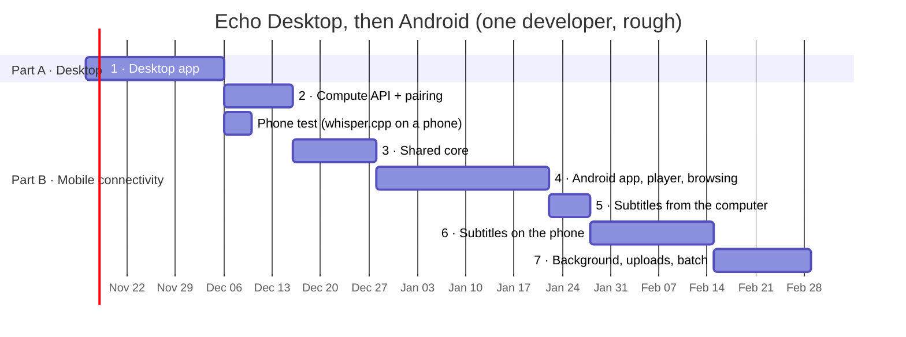

| Part | Phase | What gets built | "Done" means | Rough time |
|---|---|---|---|---|
| **A** | **1 · Desktop app** | Electron shell, tray, tool downloads, speed test, model picker, installers, signing, auto-update | A new user installs the app and gets subtitles without using a terminal | 3–4 weeks |
| **B** | **2 · Compute API** | Door 2, mDNS, QR pairing, certificate pinning, event stream (desktop side only) | `curl` from another device can pair, create a job and receive lines | 1–2 weeks |
| B | *Phone test* | whisper.cpp demo on your own phone with a real ASMR clip | We know how fast and accurate phone subtitles are | 2–4 days |
| B | **3 · Shared core** | Monorepo, ports (`HttpPort`, etc.), controllers as plain functions, remove old root `backend/` and `frontend/` copies | Desktop app works exactly as before; all tests pass | 1–2 weeks |
| B | **4 · Android app** | Capacitor app, in-process core, Http/Image/Player plugins | Browse, search and play on the phone with no computer | 3–4 weeks |
| B | **5 · Remote subtitles** | Subtitle router, phone cache, handoff, waiting list | Lines appear on the phone while the computer works | ~1 week |
| B | **6 · Phone Whisper** | JNI whisper, decoder, speed test, model download, battery rules | Offline subtitles on phones that pass the test | 2–3 weeks |
| B | **7 · Polish** | Background service, uploads for phone-only files, "make subtitles for my whole queue" on the computer | — | ongoing |

**Why this order:**

- **Phase 1 needs no refactor.** Electron runs today's Express server as-is, so the desktop app ships quickly and gets real users testing the tool downloads and Whisper builds.
- **Phase 2 comes before the Android app** because it can be built and tested with `curl` alone, and it finishes all desktop-side work in one go.
- **Phase 3 (the code split) waits until it's needed.** Only Android needs the ports. Doing it after the desktop app ships means we refactor working, released code with tests to catch regressions.
- **The phone test** runs early in Part B because its result decides how much effort Phase 6 deserves.

---

## 3. Words used in this plan

| Word | Meaning |
|---|---|
| **Whisper** | OpenAI's speech-to-text model. We run it with **whisper.cpp**, a fast free version that runs on any computer or phone. |
| **whisper-server** | A small program from whisper.cpp. It loads the model once and transcribes the audio we send it. |
| **Model** | The Whisper "brain" file (190–550 MB). Bigger models are more accurate but slower. |
| **VAD** | Voice Activity Detection. It skips silence and breathing, where Whisper tends to make up text. |
| **FFmpeg** | A program that opens any audio format or stream and turns it into the plain audio Whisper needs (16 kHz mono). |
| **Source** | A website we browse: asmr.one, japaneseasmr.com, jasmr.net, hentaiasmr.moe. |
| **Core** | The shared TypeScript code that knows how to talk to the sources. Both apps use it (from Phase 3). |
| **Compute API** | The small set of web addresses the desktop opens to the phone so the phone can request subtitles. |
| **Pairing** | Linking a phone to a computer once by scanning a QR code. |
| **mDNS** | How devices on the same Wi-Fi find each other without typing an IP address (Apple calls it Bonjour). |
| **Handoff** | One device continues a subtitle job where the other stopped. |
| **Speed factor** | How long transcription takes compared to the audio's length. `0.5×` means 10 minutes of audio takes 5 minutes. |

---

## 4. The big picture (end state)

This is where we are after Phase 6. Phase 1 builds the left box; Part B builds the right box and the arrow between them.

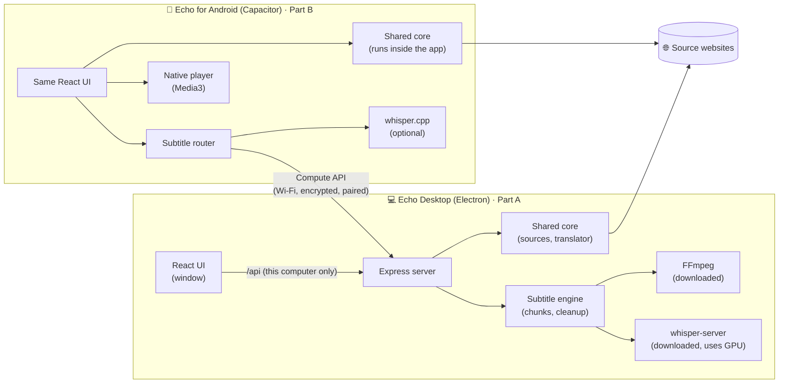

**What this shows:**

- Both apps use the **same UI** and the **same core**, so a fix to a source helps both.
- The phone browses and plays **on its own** and doesn't need the computer for that.
- The computer is needed **only for making subtitles**, and only when the phone can't or shouldn't do it.

---

## 5. What already exists

Most of the subtitle work is done. This is today's server:

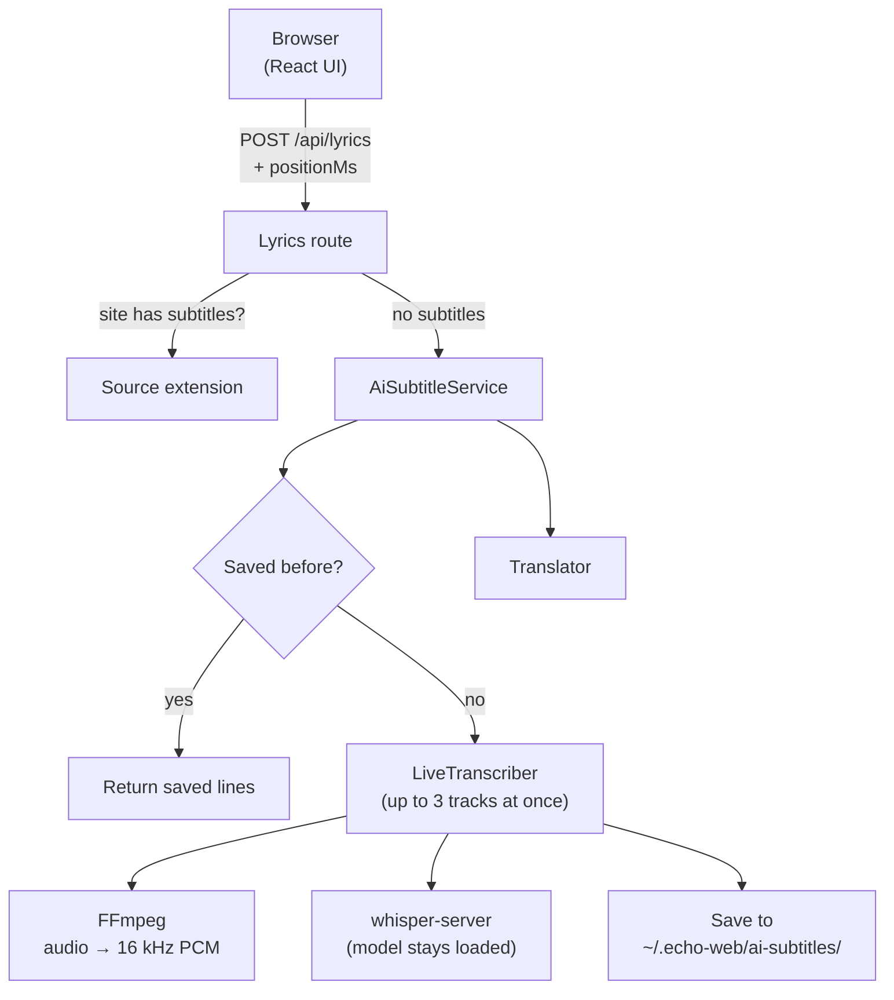

| Already built | File |
|---|---|
| Starts transcription at the listener's position and fills gaps later | [`live-transcriber.ts`](web/backend-express/src/services/ai-subtitles/live-transcriber.ts) |
| Cuts audio into 20–28 s pieces at quiet moments | [`chunk-planner.ts`](web/backend-express/src/services/ai-subtitles/chunk-planner.ts) |
| Starts and talks to whisper-server | [`whisper-server.ts`](web/backend-express/src/services/ai-subtitles/whisper-server.ts) |
| Decodes audio with FFmpeg while it downloads | [`audio-stream.ts`](web/backend-express/src/services/ai-subtitles/audio-stream.ts) |
| Removes repeats and made-up lines | [`cleanup.ts`](web/backend-express/src/services/ai-subtitles/cleanup.ts) |
| Saves finished subtitles | [`ai-subtitle.repository.ts`](web/backend-express/src/repositories/ai-subtitle.repository.ts) |

**What's missing:**

| Gap | Fixed in |
|---|---|
| FFmpeg and Whisper are installed by hand (`brew install …` and `npm run setup:whisper`) | Phase 1 |
| There's no installable app | Phase 1 |
| The server listens on this computer only (`127.0.0.1`), so a phone can't reach it | Phase 2 |
| The source code uses Node-only tools, so it can't run on Android | Phase 3 |
| There's no Android app | Phases 4–6 |

**Key design point:** the code already has a `SpeechEngine` interface ("something that turns audio into text"). Each new place that can run Whisper (computer, phone, remote computer) is just another `SpeechEngine`.

---

## 6. How a subtitle is made

The process is the same on every device. Only the parts that do the heavy work change.

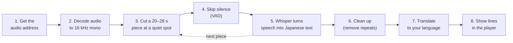

**Why pieces?** The user sees the first lines within seconds instead of waiting for a two-hour track to finish.

**Why start at the listener's position?** If the user jumps to minute 40, the next piece is made from minute 40. Earlier gaps are filled in afterwards.

```
Track:   0 min ───────────────────────────────────────────── 60 min
Listener jumps here ──────────────▶ │
Order of work:                      ①②③④⑤⑥⑦ … then go back ⑧⑨⑩ to fill 0–40 min
```

---

# Part A: Desktop app

## 7. Phase 1 · Desktop app

**Goal:** a new user installs Echo, clicks one button, and gets AI subtitles without ever opening a terminal.

**Done means:** installers for macOS, Windows and Linux; tool downloads with checksums and resume; a speed test that picks the right Whisper build and model; signed builds with auto-update.

**Rough time:** 3–4 weeks.

### 7.1 Code changes for this phase

We keep today's code where it is and add the desktop shell next to it. The big split into shared packages waits until Phase 3.

```
echo/
├── apps/
│   └── desktop/        NEW: Electron main process, tray, tool downloads, auto-update
├── web/
│   ├── backend-express/   Today's server (small changes only, see below)
│   └── frontend/          Today's React UI (adds the AI subtitles settings screen)
└── PLAN.md
```

Small changes to `web/backend-express`:

- Read the data folder, port and tool paths (FFmpeg, whisper-server, model) from environment variables set by Electron, instead of assuming `brew` or `npm run setup:whisper`.
- Add the `/api/tools*` endpoints ([7.8](#78-new-desktop-screens-and-endpoints)).
- Keep listening on `127.0.0.1` only. Nothing is reachable from the network in this phase.

### 7.2 Why Electron

| | Electron | Tauri |
|---|---|---|
| Runs our Node.js server | ✅ Built in | ⚠️ Needs a separate Node.js program bundled alongside |
| Download size | ~100 MB | ~10 MB |
| Effort for us | Low | Higher |

The decision is **Electron**. The bigger download is fine because the Whisper model alone is 190–550 MB.

### 7.3 What happens when the app opens

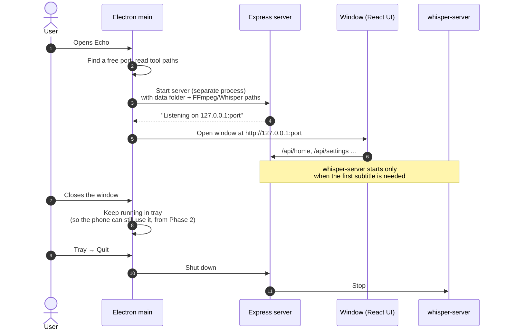

### 7.4 First-run setup: downloading the tools

The first time a user turns on AI subtitles, the app shows **"Set up AI subtitles"**.

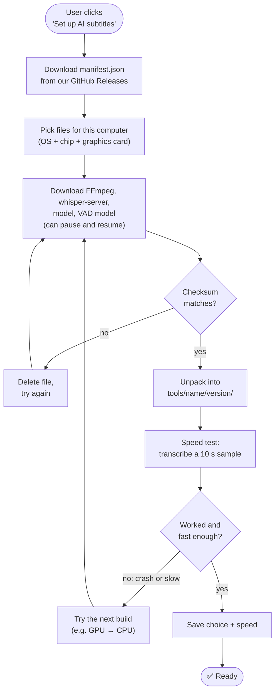

**Rules for downloads:**

- Every file is listed in `manifest.json` with its version, size and SHA-256 checksum. A file is used only if its checksum matches.
- Downloads resume where they stopped, which matters for 550 MB models on slow connections.
- Old versions are deleted after a successful update.

**Example `manifest.json`:**

```json
{
  "tools": [
    {
      "name": "whisper-server",
      "version": "1.8.0",
      "os": "win",
      "arch": "x64",
      "variant": "vulkan",
      "url": "https://github.com/<you>/echo/releases/download/tools-1.8.0/whisper-server-win-x64-vulkan.zip",
      "sha256": "…",
      "size": 12345678
    }
  ],
  "models": [
    {
      "id": "large-v3-turbo-q5_0",
      "url": "https://huggingface.co/ggerganov/whisper.cpp/resolve/main/ggml-large-v3-turbo-q5_0.bin",
      "sha256": "…",
      "size": 574000000
    }
  ]
}
```

### 7.5 Which Whisper build each computer gets

We build `whisper-server` ourselves in CI (see [section 15](#15-building-and-releasing)), so we control the versions and settings.

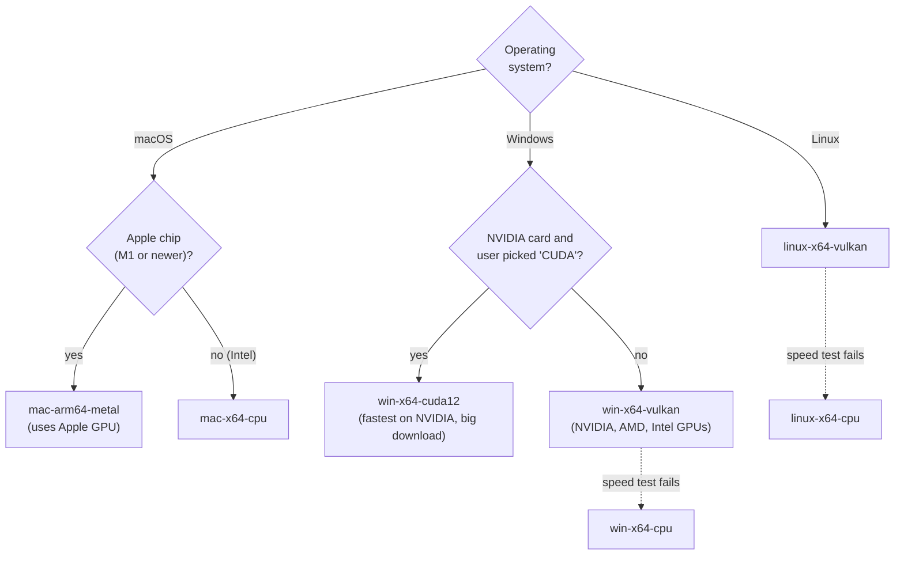

### 7.6 Which model

| Model | Size | Quality | Pick it when |
|---|---|---|---|
| `large-v3-turbo-q5_0` (today's default) | ~550 MB | Best | GPU or Apple chip |
| `medium-q5_0` | ~540 MB | Good | Strong CPU, no usable GPU |
| `small-q5_1` | ~190 MB | OK | Older or weaker computers |
| `silero-v5.1.2` (VAD) | ~1 MB | — | Always |

The app suggests a model from the speed test, and the user can change it in Settings.

### 7.7 FFmpeg

We build a **small, audio-only FFmpeg** in CI instead of downloading a full one:

- It includes only what we use: audio decoders (AAC, MP3, Opus, FLAC, Vorbis), HLS/MP4/MP3/OGG readers, and HTTPS.
- It's a few MB instead of 80+ MB.
- It's built under the **LGPL** licence, which avoids the stricter GPL rules of full builds.
- The same build recipe is reused for Android in Phase 6 ([section 12](#12-phase-6--whisper-on-the-phone)).

### 7.8 New desktop screens and endpoints

**Settings → AI subtitles**

```
┌────────────────────────────────────────────────────────┐
│ AI subtitles                                [ On  ●  ] │
│                                                        │
│ Engine        whisper-server 1.8.0 · Metal (GPU)  ✅   │
│ Model         large-v3-turbo-q5_0      [ Change ▾ ]    │
│ Speed         0.08× (1 hour of audio ≈ 5 minutes)      │
│ FFmpeg        7.1 audio-only                      ✅   │
│                                    [ Run speed test ]  │
└────────────────────────────────────────────────────────┘
```

| Method | Path | What it does |
|---|---|---|
| GET | `/api/tools` | Which tools and models are installed, and their versions |
| POST | `/api/tools/install` | Start setup; progress comes back as a live event stream |
| POST | `/api/tools/benchmark` | Run the speed test again |

These `/api/*` addresses stay **on this computer only**, as today.

### 7.9 Packaging and release

- **electron-builder** makes the installers: `.dmg` (macOS), `.exe` (Windows), `.AppImage` / `.deb` (Linux).
- **electron-updater** handles automatic updates from GitHub Releases.
- **Code signing:** without it, macOS Gatekeeper and Windows SmartScreen show scary warnings. Sign and notarize on macOS and sign on Windows.
- **CI jobs added in this phase:** tests, whisper-server builds, desktop FFmpeg build, `manifest.json`, desktop installers, signing ([section 15](#15-building-and-releasing)).

### 7.10 Phase 1 checklist

- [x] `apps/desktop` Electron shell starts the server in a separate process and opens the window
- [x] Server reads data folder and tool paths from Electron
- [ ] Tray mode and clean shutdown (server and whisper-server stop)
- [x] Resumable downloads and checksum checks (the plan dropped `manifest.json`: the model catalog and `tools.lock.json` replace it)
- [x] Whisper build picker with GPU → CPU fallback
- [x] Speed test and model suggestion
- [x] Settings → AI subtitles screen and `/api/tools*` endpoints
- [ ] CI builds of whisper-server and audio-only FFmpeg
- [ ] Installers, signing, notarizing, auto-update

---

# Part B: Mobile connectivity

Part B starts once the desktop app has shipped. It first opens the desktop to phones (Phase 2), then prepares the code (Phase 3), then builds the Android app step by step (Phases 4–7).

## 8. Phase 2 · Open the desktop to phones (Compute API)

**Goal:** the desktop app can safely accept subtitle jobs from a paired phone over Wi-Fi.

**Done means:** with phone access turned on, `curl` from another device can pair, create a job, follow its events and receive lines. With it off, nothing is reachable.

**Rough time:** 1–2 weeks. All work in this phase is on the desktop side.

### 8.1 The two doors on the desktop server

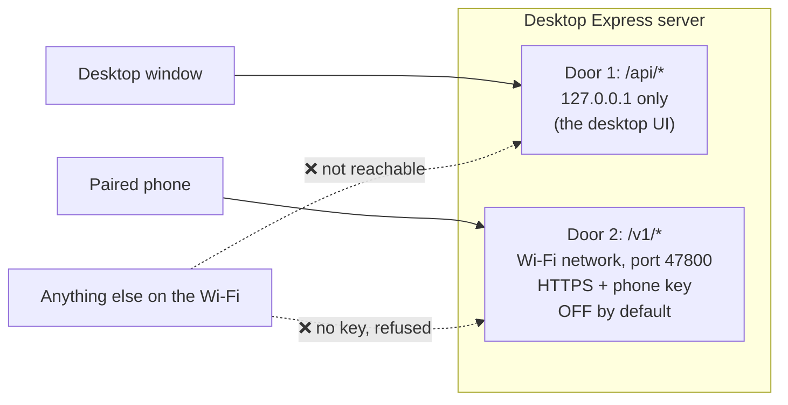

**Door 2 can only:** report its status, accept a pairing, and create, follow or cancel subtitle jobs.
**Door 2 can never:** reach the audio proxy, settings, login or browsing.

### 8.2 Finding the computer

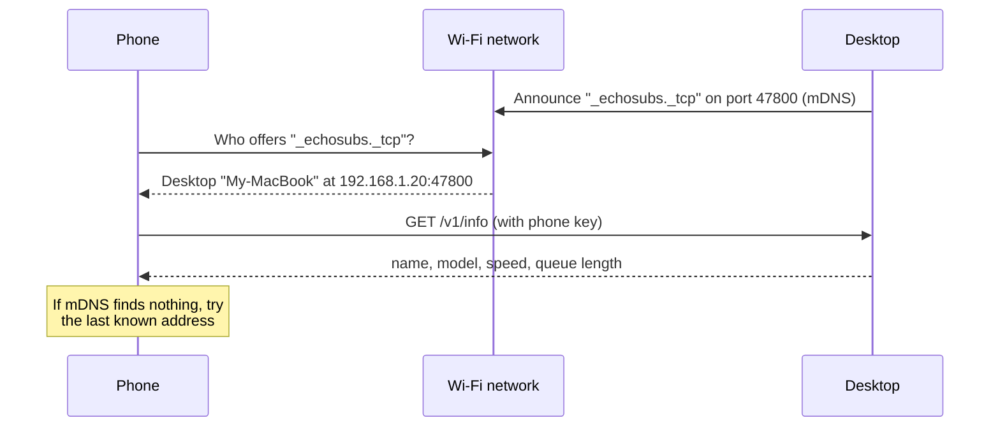

**Away from home:** if both devices are on [Tailscale](https://tailscale.com) (a free private network), the phone reaches the computer by its Tailscale address with no extra code. That covers "away from home" for version 1.

### 8.3 Pairing (one time)

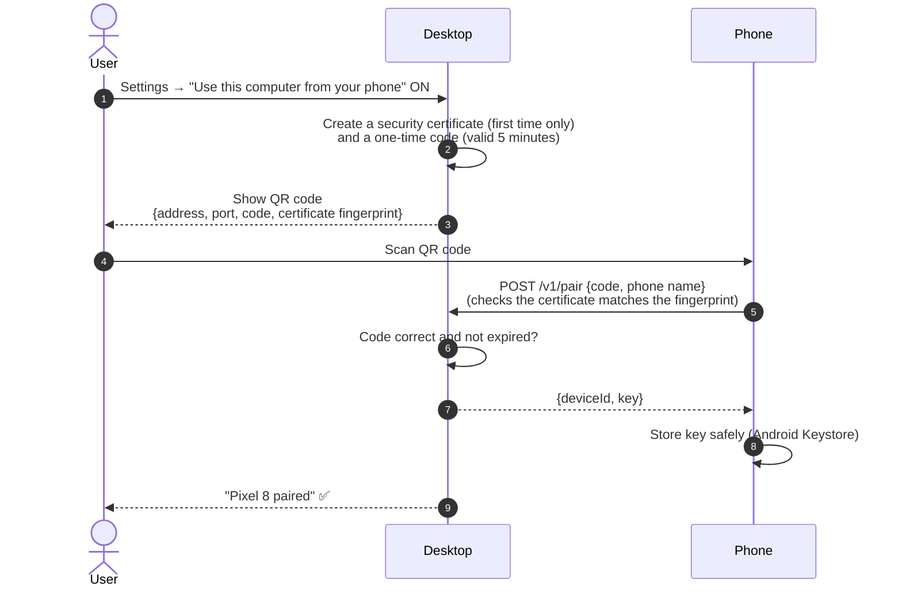

**Why the certificate fingerprint?** It proves the phone is talking to *your* computer and not another device on the Wi-Fi pretending to be it. The phone only trusts the certificate whose fingerprint came from the QR code ("pinning").

### 8.4 Making subtitles on the computer

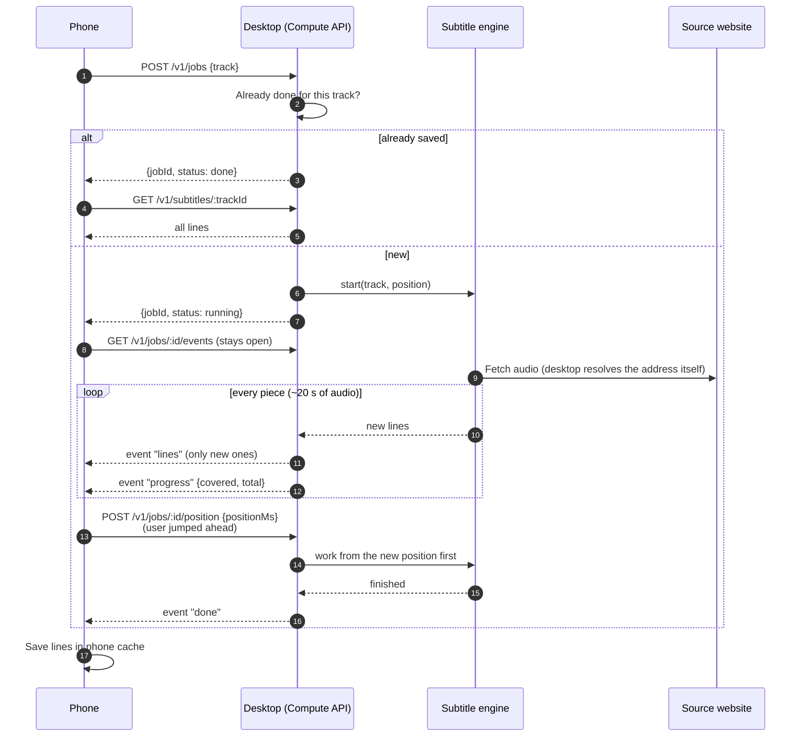

Uploads for music files stored on the phone come later, in [Phase 7](#13-phase-7--polish).

### 8.5 Compute API reference

All shapes live in a new `packages/protocol` (zod schemas) so the phone and desktop always agree. This is the first shared package; the rest follow in Phase 3.

| Method | Path | Body / reply | Purpose |
|---|---|---|---|
| GET | `/v1/info` | → `{name, version, model, accel, speedFactor, queue}` | Is the computer there, and how fast is it? |
| POST | `/v1/pair` | `{code, deviceName}` → `{deviceId, key}` | One-time pairing |
| POST | `/v1/jobs` | `{track}` → `{jobId, status}` | Start (or reuse) a job |
| POST | `/v1/jobs/:id/position` | `{positionMs}` | "Work from here first" |
| GET | `/v1/jobs/:id/events` | event stream | Live `progress`, `lines`, `done`, `failed` |
| GET | `/v1/subtitles/:trackId` | → `{lines, model}` or WebVTT | Finished result |
| DELETE | `/v1/jobs/:id` | — | Cancel |

### 8.6 Security rules

| Rule | Why |
|---|---|
| Door 2 is **off** until the user turns it on | Nothing is open by surprise |
| HTTPS with a **pinned** certificate | Nobody on the Wi-Fi can read or fake the traffic |
| A **separate key per phone**, removable from Settings | A lost phone can be cut off |
| Pairing code works **once** and lasts **5 minutes** | Stops guessing |
| The phone sends a **track**, never a web address | The desktop can't be tricked into fetching arbitrary sites |
| Upload size limit + per-phone rate limit | Stops abuse and full disks |

### 8.7 Desktop screen and endpoints added in this phase

The Settings screen from Phase 1 gains a phone section:

```
├────────────────────────────────────────────────────────┤
│ Use this computer from your phone           [ Off ○ ]  │
│   (turning on shows a QR code to scan)                 │
│                                                        │
│ Paired phones                                          │
│   Pixel 8 · last seen 2 min ago          [ Remove ]    │
└────────────────────────────────────────────────────────┘
```

| Method | Path | What it does |
|---|---|---|
| GET / PUT | `/api/compute` | Turn phone access on or off; get the QR code data |
| GET / DELETE | `/api/devices`, `/api/devices/:id` | List or remove paired phones |

### 8.8 Side task: the phone test

During this phase, spend 2–4 days running a whisper.cpp demo on your own phone with a real ASMR clip. Its speed and accuracy decide how much effort [Phase 6](#12-phase-6--whisper-on-the-phone) deserves, or whether to skip it.

---

## 9. Phase 3 · Shared core (prepare the code for Android)

**Goal:** split the code so the Android app can reuse the sources, translator and subtitle logic without Node.js.

**Done means:** the desktop app works exactly as before and all tests pass. No user-visible change.

**Rough time:** 1–2 weeks.

### 9.1 New code layout

```
echo/
├── apps/
│   ├── desktop/        Electron (from Phase 1)
│   └── android/        Capacitor Android project + Kotlin plugins (Phase 4)
├── packages/
│   ├── core/           Sources, models, translator, services (no Node-only code)
│   ├── subtitles/      LiveTranscriber, chunk planner, cleanup, engine interfaces
│   ├── server/         Express routes (today's backend-express, made thinner)
│   ├── ui/             React app (today's frontend)
│   └── protocol/       Shared shapes for the Compute API (from Phase 2)
└── PLAN.md
```

The old root `backend/` and `frontend/` copies are removed in this phase.

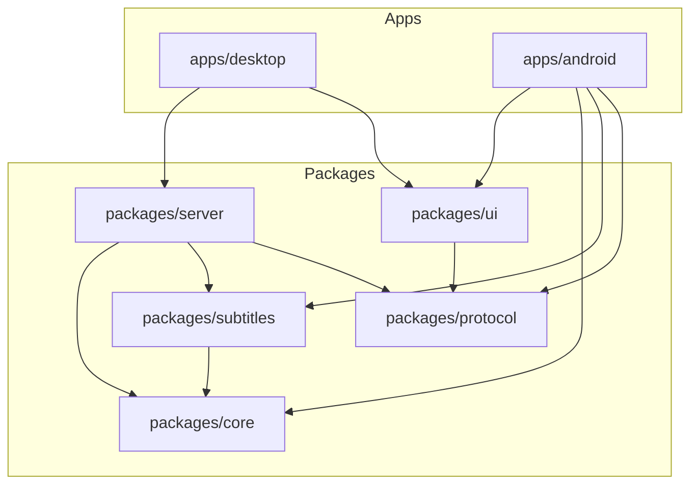

### 9.2 The main change: "ports" (plug-in points)

Today the source code calls Node.js tools (`undici`, `node:fs`, `node:dns`) directly, and those don't exist on Android. We replace each one with a small interface, and each app plugs in its own version.

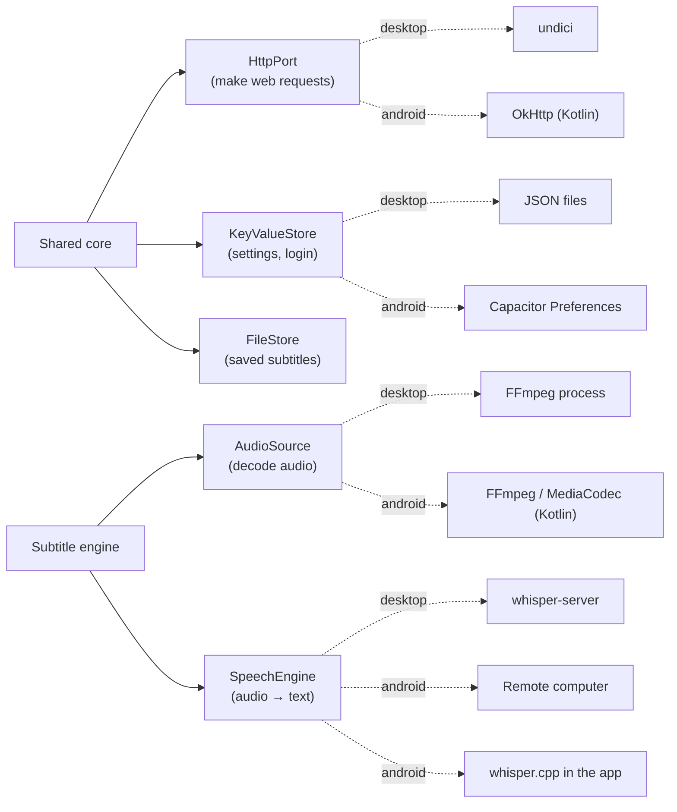

| Port | Desktop version | Android version |
|---|---|---|
| `HttpPort` | undici (keeps the IPv6-first lookup) | OkHttp via a Capacitor plugin (any header, no browser CORS limits) |
| `KeyValueStore` | atomic JSON files (today's repositories) | Capacitor Preferences or SQLite |
| `FileStore` | `<data>/ai-subtitles/` | the app's private files folder |
| `AudioSource` | `FfmpegAudioStream` (today) | Kotlin decoder plugin |
| `SpeechEngine` | `WhisperServerEngine` (today) | `RemoteDesktopEngine` or `JniWhisperEngine` |

In this phase only the desktop versions are written. The Android versions come in Phases 4–6.

### 9.3 Controllers become plain functions

We turn each controller into a **plain function** (input in, JSON out). Express wraps these functions on the desktop. The Android app calls them directly, with no server in between.

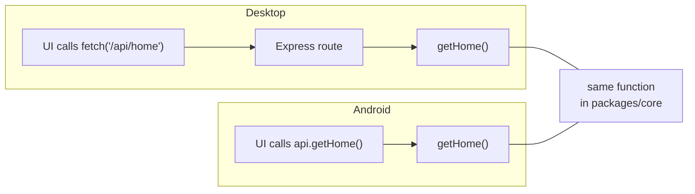

The UI gets an `ApiTransport` setting: **HTTP** on the desktop, **in-process** on Android. Pages don't change.

---

## 10. Phase 4 · Android app: browse and play

**Goal:** an Android app that browses, searches and plays all sources with no computer involved.

**Done means:** browse, search and play on the phone, with lock-screen controls and screen-off playback. No subtitles yet (except ones the source site provides).

**Rough time:** 3–4 weeks.

### 10.1 Why Capacitor

| Option | Reuse | Effort | Feel |
|---|---|---|---|
| **Capacitor** (React UI + Kotlin plugins) ✅ | UI + all 4 sources + subtitle logic | Medium | Good (player, background and notifications are native) |
| Native Kotlin / Jetpack Compose | Nothing in TS; only the asmr.one extension (already Kotlin) | High: rewrite 3 scrapers and the UI | Best |
| Run the Express server on the phone (nodejs-mobile) | Everything | Low | ❌ Not possible: stuck on Node 18 and unmaintained |

The decision is **Capacitor**. With one developer, one copy of each source scraper beats two.

### 10.2 Inside the Android app

The full app after Phase 6. This phase builds the UI, core, Http, Image and Player parts; Discovery comes in Phase 5 and Decoder/Whisper in Phase 6.

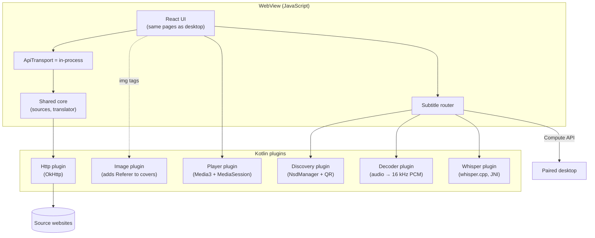

| Plugin | Phase | Why it must be native |
|---|---|---|
| **Http** | 4 | The WebView blocks requests to other sites (CORS) and won't let us set `Referer` or `User-Agent`. OkHttp can. |
| **Image** | 4 | `` tags can't send a `Referer`. The plugin catches cover requests and adds it. |
| **Player** | 4 | Audio must keep playing with the screen off, show lock-screen and Bluetooth controls, play HLS, and send headers. Media3 does all of this. |
| **Discovery** | 5 | Finding the computer (mDNS) and scanning QR codes need Android APIs. |
| **Decoder / Whisper** | 6 | Heavy native code; too slow in JavaScript. |

### 10.3 Playing audio

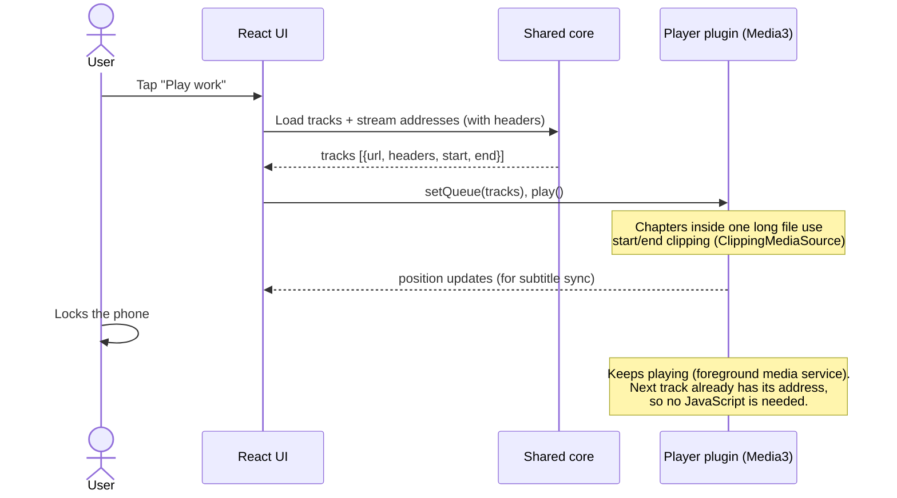

---

## 11. Phase 5 · Subtitles from the computer

**Goal:** the phone finds the paired computer and shows AI subtitles made there.

**Done means:** lines appear on the phone while the computer works; jumping ahead moves the work; finished subtitles are cached on the phone.

**Rough time:** ~1 week (the desktop side was done in Phase 2).

**What gets built:** Discovery plugin (mDNS + QR scanning), pairing screen, `RemoteDesktopEngine`, subtitle router, phone cache, waiting list.

### 11.1 Choosing where a subtitle is made

In this phase, the "Make on phone" branch doesn't exist yet: everything goes to the computer or the waiting list. Phase 6 adds the phone branch.

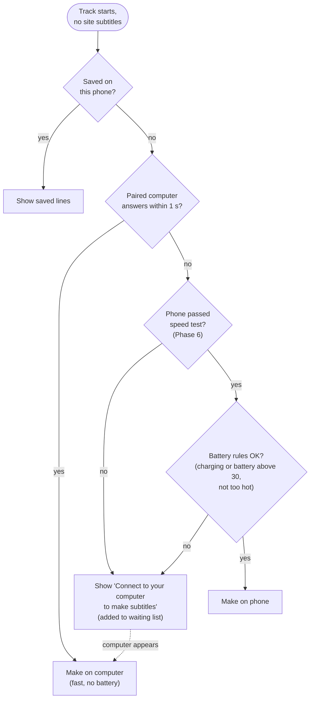

The user can override this in Settings: **Auto** (above), **Computer only**, or **Phone only**.

### 11.2 Handoff: switching devices mid-track

Both sides record which time ranges are done (the existing `aiCovered` field), so work never restarts from zero.

```
Track:        0 ───────────────── 30 ───────────────── 60 min

Phone home:   [■■■■■■■■■■■■■] made on the computer (0–22 min)
User leaves the house, computer out of reach:
Phone alone:                 [▒▒▒▒▒▒] phone continues (22–31 min)
Back home, computer found again:
Computer:                           [■■■■■■■■■■■■■■■■■■■■] finishes (31–60 min)

Result:       [■■■■■■■■■■■■■▒▒▒▒▒▒■■■■■■■■■■■■■■■■■■■■] merged by time
```

The "phone continues" part works once Phase 6 is done. Until then, the gap waits for the computer.

**Quality rule:** each saved result remembers its model. A result from a better model (for example turbo on the computer) replaces a weaker one (for example small on the phone) the next time the computer is available.

---

## 12. Phase 6 · Whisper on the phone

**Goal:** offline subtitles on phones that are fast enough.

**Done means:** phones that pass the speed test make subtitles with no computer, within the battery and heat rules.

**Rough time:** 2–3 weeks (adjust after the phone test in Phase 2).

### 12.1 How it is built

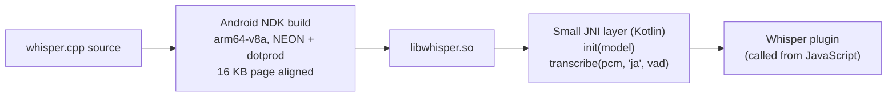

- **CPU only at first.** Mobile GPU support in whisper.cpp is less reliable.
- **16 KB page alignment** is required for apps on Android 15 and newer.
- **arm64 only.** Nearly every phone that can run Whisper is arm64.

### 12.2 Turning audio into Whisper input on Android

FFmpegKit, the usual Android FFmpeg package, was retired in 2025. There are two options:

| Option | How | Pros | Cons |
|---|---|---|---|
| **A. Our own small FFmpeg** ✅ | Same audio-only recipe as desktop (Phase 1), built for Android in CI. Kotlin downloads the bytes (with headers), FFmpeg only decodes. | Same chapter-cutting logic as desktop; FFmpeg needs no HTTPS. | One more CI build |
| B. Android's built-in decoders | MediaExtractor + MediaCodec, plus our own HLS segment download (`lib/hls.ts` already reads playlists) | No FFmpeg | More edge cases (HLS, chapter seeking) |

### 12.3 The speed test

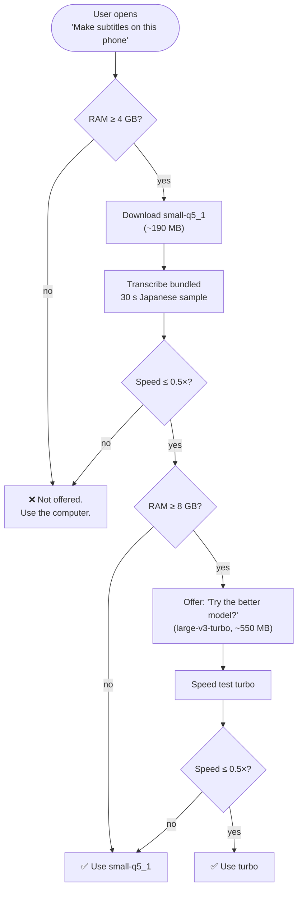

> **Why test instead of guessing:** we found no published measurements of whisper.cpp turbo on Android phones, and whispered
> Japanese is harder than normal speech. Measuring on the actual phone is the only reliable check.

### 12.4 Battery and heat rules

| Setting | Default |
|---|---|
| Only while charging | Off |
| Pause below battery level | 30 % |
| Pause when the phone gets hot (Android thermal status "severe") | On |

In this phase, phone transcription runs **only while the app is open**. Background running comes in Phase 7.

---

## 13. Phase 7 · Polish

**Goal:** fill the remaining gaps. Ongoing, in any order.

| Item | What it adds |
|---|---|
| **Background transcription on the phone** | A foreground service with a notification, so phone Whisper keeps going with the app closed (Android 14+ needs a declared service type) |
| **Uploads for phone-only files** | Music stored on the phone can get subtitles from the computer (see below) |
| **Batch on the computer** | "Make subtitles for my whole queue" runs on the desktop overnight |

**Uploading music stored on the phone** (the desktop can't reach these files):

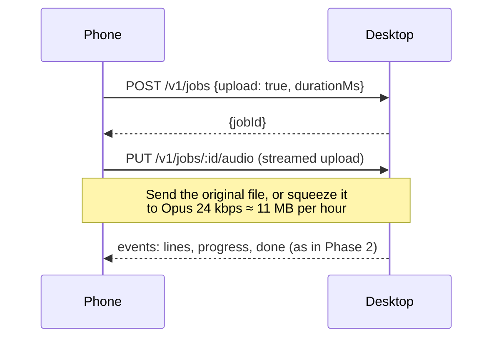

This adds two things to the Compute API: the `{upload: true, durationMs}` form of `POST /v1/jobs`, and `PUT /v1/jobs/:id/audio`. The upload size limit from [8.6](#86-security-rules) applies.

---

# Reference

## 14. Where data is stored

| What | Desktop | Android |
|---|---|---|
| Settings, login | `<data>/settings.json`, `user.json` | Capacitor Preferences (login in Android Keystore) |
| Downloaded tools | `<data>/tools/<name>/<version>/` | Inside the app (`.so` files ship with the app) |
| Models | `<data>/models/` | App files folder `/models/` |
| Finished subtitles | `<data>/ai-subtitles/<trackId>.json` | App files folder `/subtitles/` |
| Paired phones | `<data>/devices.json` (keys stored as hashes) | — |
| Paired computer | — | Preferences (address, fingerprint) + Keystore (key) |
| Certificate | `<data>/tls/` | — |

`<data>` is the app data folder: `~/Library/Application Support/Echo` on macOS, `%APPDATA%\Echo` on Windows, `~/.config/Echo` on Linux. `ECHO_WEB_DATA` still overrides it, as today.

---

## 15. Building and releasing

```mermaid
flowchart LR
    subgraph CI["GitHub Actions"]
        direction TB
        T["Tests<br/>(core, server, ui)"]
        BW["Build whisper-server<br/>mac-metal · win-vulkan · win-cuda<br/>win-cpu · linux-vulkan · linux-cpu"]
        BF["Build audio-only FFmpeg<br/>(desktop; Android arm64 in Phase 6)"]
        BA["Build Android<br/>APK (Phase 4) + libwhisper.so (Phase 6)"]
        BD["Build desktop installers<br/>.dmg · .exe · .AppImage"]
        SIGN["Sign + notarize"]
        MAN["Write manifest.json<br/>(urls + checksums)"]
        T --> BD
        BW --> MAN
        BF --> MAN
        BD --> SIGN
    end
    MAN --> REL[("GitHub Releases")]
    SIGN --> REL
    BA --> REL
    REL --> U1["Desktop users<br/>(auto-update)"]
    REL --> U2["Android users<br/>(APK / Obtainium)"]
```

| CI job | Added in |
|---|---|
| Tests, whisper-server builds, desktop FFmpeg, `manifest.json`, desktop installers, signing | Phase 1 |
| Android APK | Phase 4 |
| Android FFmpeg + `libwhisper.so` | Phase 6 |

- **Tool releases** (`tools-x.y.z`) are separate from **app releases** (`vX.Y.Z`), so updating Whisper doesn't need a new app version.
- **Android is distributed outside Google Play** (GitHub Releases, installed with [Obtainium](https://github.com/ImranR98/Obtainium) for updates). See [risks](#16-risks).

---

## 16. Risks

| Risk | Matters from | Impact | What we do |
|---|---|---|---|
| **Licence:** the asmr.one extension uses the *Unabandon Public License* (GPLv3 + publish-source rule) | Phase 1 (first public desktop release) | Sharing the apps with anyone means **publishing all our source** under the same terms | Decide before the first public release; keep a `LICENSE` and source link in both apps |
| **Unsigned desktop builds** | Phase 1 | OS warnings scare users away | Budget for Apple Developer ID and a Windows signing certificate |
| **Desktop must be running** | Phase 5 | Remote subtitles fail if the computer is off | Tray mode, clear "waiting for computer" state, waiting list |
| **Google Play** likely rejects an app that scrapes third-party sites and plays this kind of content | Phase 4 | Can't rely on Play | Distribute APKs via GitHub Releases / Obtainium |
| **Two devices browsing the same sites** | Phase 4 | More requests to small sites | Keep the existing request spacing and back-off inside the shared core, so both apps obey them |
| **Phone speed and quality unknown** | Phase 6 | Phone subtitles may be slow or poor for whispered Japanese | Early phone test (Phase 2); speed test gate; better computer results replace phone ones |
| **FFmpegKit retired** | Phase 6 | No ready-made FFmpeg for Android | Build our own small FFmpeg (or use Android decoders) |
| **Android background limits** (Android 14+ needs a declared service type and limits long jobs) | Phase 6–7 | Phone transcription may stop in the background | Phase 6 works while the app is open; Phase 7 adds a proper foreground service |

---

## 17. Open decisions

These choices affect the work. The ✅ option is assumed in this plan unless we decide otherwise.

| # | Question | Needed by | Options |
|---|---|---|---|
| 1 | Public release? | Phase 1 | Decides whether we must publish source now (see licence risk) |
| 2 | Remote access outside home | Phase 2 | ✅ Same Wi-Fi + Tailscale · Build our own relay server (more work, costs money) |
| 3 | Android framework | Phase 3 | ✅ Capacitor + shared core · Native Kotlin/Compose (would make Phase 3 unnecessary) |
| 4 | "Media libraries" on Android | Phase 4 | ✅ Online sources first, phone files in Phase 7 · Both from the start |
| 5 | Android audio decoding | Phase 6 | ✅ Our own small FFmpeg · Android MediaCodec |

---

## 18. References

- whisper.cpp: <https://github.com/ggml-org/whisper.cpp>
- Whisper models (ggml): <https://huggingface.co/ggerganov/whisper.cpp>
- Electron `utilityProcess`: <https://www.electronjs.org/docs/latest/api/utility-process>
- electron-builder: <https://www.electron.build>
- Capacitor: <https://capacitorjs.com>
- Android Media3 (ExoPlayer + MediaSession): <https://developer.android.com/media/media3>
- Android NSD (mDNS): <https://developer.android.com/develop/connectivity/wifi/use-nsd>
- Android 16 KB page size: <https://developer.android.com/guide/practices/page-sizes>
- nodejs-mobile status: <https://github.com/nodejs-mobile/nodejs-mobile/releases>
- FFmpegKit retirement: <https://dev.to/lucquebec/ffmpegkit-is-retired-heres-how-to-fix-your-android-build-ndk-r26c-patch-35j0>
- On-device speech benchmark: <https://voiceping-landingpage-prod.pages.dev/en/blog/research-offline-speech-transcription-benchmark/>
