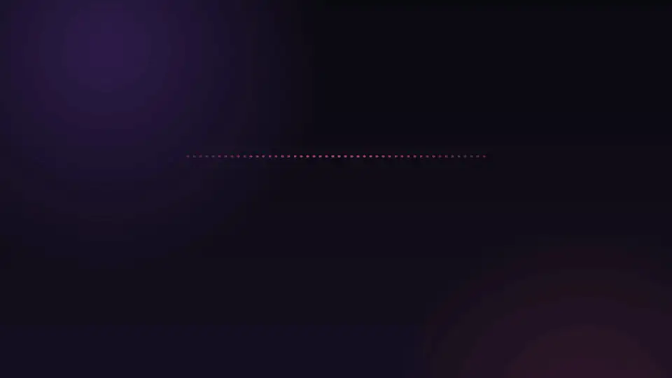

<div align="center">

<a href="https://github.com/PrathameshBelvalkar/web-asmrone/releases/latest">
  
</a>

# Echo

### An ASMR player for your Mac

Play asmr.one and Japanese ASMR with synced subtitles, and let AI write subtitles for tracks that have none.
The AI runs on your Mac, it is free, and nothing is uploaded.

[](https://github.com/PrathameshBelvalkar/web-asmrone/releases/latest)
[](https://github.com/PrathameshBelvalkar/web-asmrone/actions/workflows/ci.yml)
[](#download)
[](LICENSE.md)

[Download](#download) · [Features](#features) · [AI subtitles](#ai-subtitles) · [FAQ](#faq) · [Developing](docs/DEVELOPMENT.md)

<a href="https://github.com/PrathameshBelvalkar/web-asmrone/raw/main/docs/media/echo-promo.mp4">
  
</a>

_[Download the full-quality video (MP4)](https://github.com/PrathameshBelvalkar/web-asmrone/raw/main/docs/media/echo-promo.mp4)_

</div>

## Download

<div align="center">

[-7B3FC4?style=for-the-badge&logo=apple&logoColor=white&labelColor=2B1D3F)](https://github.com/PrathameshBelvalkar/web-asmrone/releases/latest)
[](https://github.com/PrathameshBelvalkar/web-asmrone/releases/latest)

_Mac only. Pick `…-mac-arm64.dmg` for an Apple chip or `…-mac-x64.dmg` for Intel._

</div>

Not sure which Mac you have? Open the Apple menu → **About This Mac**. If it says **Chip: Apple M…**, take the Apple chip
version. If it says **Processor: Intel…**, take the Intel one.

> [!IMPORTANT]
> Echo isn't signed by Apple yet, so macOS stops it the first time. Open the `.dmg`, drag Echo to
> **Applications**, then open it. If macOS blocks it, go to **System Settings → Privacy & Security** and click
> **Open Anyway**. You only do this once.

## Features

- **asmr.one, HASMR and JASMR** in one library: browse, search, and open any work with its full track list.
- **Synced subtitles and lyrics** that follow the audio, with translation into your language.
- **AI subtitles** for tracks without any, made on your Mac with Whisper. See [below](#ai-subtitles).
- **Music-player controls**: a queue that's saved between launches, shuffle, repeat, and a mini player.
- **Your asmr.one account**: log in to see your playlists and favourites. Browsing works without one.
- **Manga & Doujinshi**: browse and search galleries by tag, artist and language, and read them in a built-in reader.
- **Private by design**: the server inside Echo listens only on your Mac, and your data never leaves it.
- **Update checks**: Echo tells you when a new version is out (**Help → Check for updates…**).

## AI subtitles

Open **Settings** and turn on **AI subtitles**. Echo downloads what it needs once (190 to 550 MB, depending on
the model) and tells you when it's ready.

- **Pause** a download and resume it later, or **cancel** it, which deletes the partial file.
- See the models you have, pick one, and run a **speed test** to check it keeps up on your Mac.
- **Delete** a model you don't need. If it was the one in use, Echo switches to another downloaded model. If it
  was the last one, AI subtitles turn off.

Apple-chip Macs run Whisper on the GPU (Metal). Intel Macs use the CPU, which is slower.

## FAQ

<details>
<summary><b>Where is my data?</b></summary>

<br>

Everything is in `~/Library/Application Support/Echo` (**Help → Open data folder**): settings, your login, the
saved queue, subtitles and AI models. The log is in its `logs` folder (**Help → Open log folder**).

</details>

<details>
<summary><b>macOS says Echo "is damaged" or "can't be opened".</b></summary>

<br>

This happens because Echo isn't signed yet. Try **System Settings → Privacy & Security → Open Anyway** first. If
that button isn't there, run this in Terminal once:

```bash
xattr -cr /Applications/Echo.app
```

</details>

<details>
<summary><b>Does Echo work on Windows or Linux?</b></summary>

<br>

Not as an app. Echo Desktop is Mac only. There's a browser version you can run yourself; see
[Developing Echo](docs/DEVELOPMENT.md#echo-web-the-browser-version).

</details>

<details>
<summary><b>How do I uninstall Echo?</b></summary>

<br>

Drag **Echo** from **Applications** to the Trash. To remove your data and AI models too, delete
`~/Library/Application Support/Echo`.

</details>

## Contributing

Bug reports and ideas are welcome in [Issues](https://github.com/PrathameshBelvalkar/web-asmrone/issues). When
you report a bug, include your Echo version (**Echo → About Echo**), your Mac type, and the steps that cause it.
For larger changes, open an issue before a pull request.

Building, running and releasing Echo are covered in [Developing Echo](docs/DEVELOPMENT.md).

## Credits

- [Echo](https://github.com/brahmkshatriya/echo) by brahmkshatriya, the Android music app this project grew out of.
- [echo-asmr-one](https://github.com/rebelonion/echo-asmr-one) by rebelonion, the asmr.one extension.
- [whisper.cpp](https://github.com/ggml-org/whisper.cpp) for AI subtitles, and [FFmpeg](https://ffmpeg.org) for audio.
- [Electron](https://www.electronjs.org), [React](https://react.dev) and [Express](https://expressjs.com).

## Disclaimer

Echo is not affiliated with asmr.one, HASMR, JASMR, or any other site it can read from, and it hosts no content.
Everything you see comes from those sites. Some of it is for adults only (18+).

## License

Echo is released under the [Unabandon Public License](LICENSE.md). The bundled FFmpeg is LGPL 2.1; its licence
texts are inside the app (**Help → Licences**).
