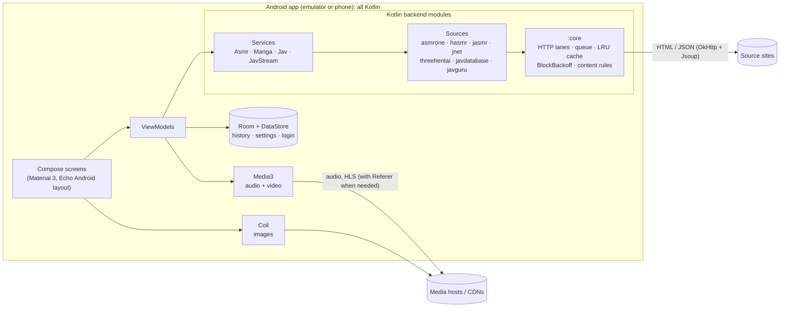
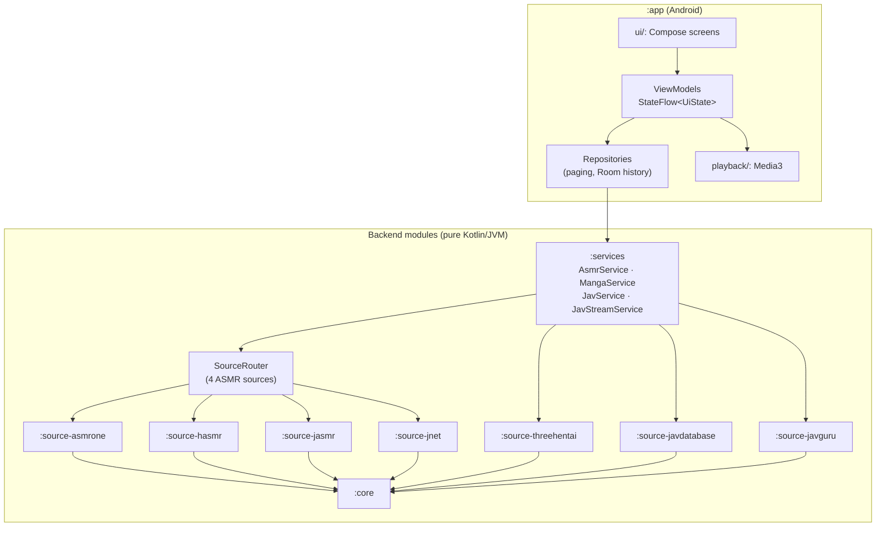
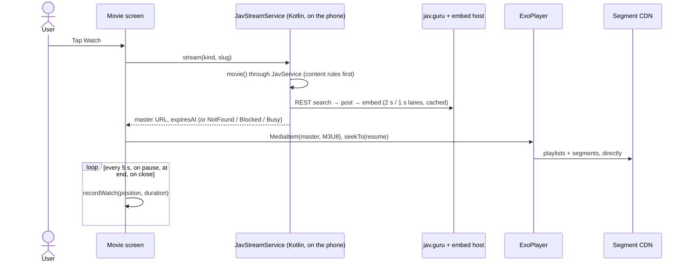

# NekoHub: Android App Plan (Phase 1)

A native Android app that does everything NekoHub does today: **listen** to ASMR, **read** manga and **watch** JAV.
It is written **entirely in Kotlin**, scrapers included. **No Node.js, and no server or computer is needed.** The UI
is Jetpack Compose + **Material 3**, laid out like the original **Echo Android app** by brahmkshatriya
([github.com/brahmkshatriya/echo](https://github.com/brahmkshatriya/echo)). The manga reader follows **Mihon's reader**.

| Phase | Scope | Status |
|---|---|---|
| **1** | All 7 sources ported to Kotlin and running on the phone. Browse, search, listen, read, watch, Library, asmr.one login and settings. Everything except AI subtitles. | **This document** |
| 2 | AI subtitles (Whisper) on Android | Later. Not planned here. |

This plan replaces the **Capacitor** decision in [`PLAN.md` §10.1](../PLAN.md#101-why-capacitor) and open decision 3 in
[`PLAN.md` §17](../PLAN.md#17-open-decisions).

## Contents

1. [The plan in one minute](#1-the-plan-in-one-minute)
2. [What we start from](#2-what-we-start-from)
3. [Architecture](#3-architecture)
4. [The Kotlin backend: porting every scraper](#4-the-kotlin-backend-porting-every-scraper)
5. [Emulator first: can we skip a real phone?](#5-emulator-first-can-we-skip-a-real-phone)
6. [Tech stack](#6-tech-stack)
7. [Project layout](#7-project-layout)
8. [UI: Material 3, laid out like Echo for Android](#8-ui-material-3-laid-out-like-echo-for-android)
9. [Navigation and screens](#9-navigation-and-screens)
10. [ASMR: listening](#10-asmr-listening)
11. [Manga: browsing and the Mihon-style reader](#11-manga-browsing-and-the-mihon-style-reader)
12. [JAV: watching](#12-jav-watching)
13. [Library, history and resume](#13-library-history-and-resume)
14. [Settings and account](#14-settings-and-account)
15. [Errors and content rules](#15-errors-and-content-rules)
16. [Milestones](#16-milestones)
17. [Testing](#17-testing)
18. [Building and installing](#18-building-and-installing)
19. [Risks](#19-risks)
20. [Open decisions](#20-open-decisions)
21. [Phase 1 checklist](#21-phase-1-checklist)

---

## 1. The plan in one minute

| Question | Answer |
|---|---|
| What is it? | A new Android app in `apps/android/`, all in **Kotlin**. It has three sections, **ASMR**, **Manga** and **JAV**, plus a Library. |
| Where does the data come from? | From the **phone itself**. Every scraper in `web/backend-express/src/extension/` (asmr.one, HASMR, JASMR, J-NET, 3hentai, javdatabase, jav.guru) is **rewritten in Kotlin** and runs inside the app. No Express, no Node and no Mac. |
| How is the "backend" organised? | As plain Kotlin/JVM Gradle modules: **`:core`** (models, HTTP, queue, cache, back-off, content rules) and one **`:source-*`** module per site. The modules have no Android code, so they also run in plain JVM tests and could back a Ktor server later. |
| What replaces the Node libraries? | `undici` → **OkHttp**, `cheerio` → **Jsoup**, `zod` → **kotlinx.serialization**, `pino` → **Timber/Logcat**, `Mutex`/timers → **coroutines `Mutex` + `delay`**. `/api/proxy` and HLS rewriting are **no longer needed**: the phone sends `Referer` headers itself. |
| What does the UI look like? | **Plain Material 3** (Material You: dynamic colour from the wallpaper, Material shapes and type), with the screen layout of the **original Echo Android app**: a bottom bar with **Home · Search · Library**, a source switcher in the top bar, shelves of covers, and a **bottom-sheet player** that drags up from a mini player. Built in Compose ([§8](#8-ui-material-3-laid-out-like-echo-for-android)). The web UI's look (`web/frontend`) is **not** copied. |
| Manga reader? | Modelled on **Mihon's reader** ([mihon.app reader settings](https://github.com/mihonapp/website/blob/main/website/src/docs/guides/reader-settings.md)): its reading modes, tap-zone layouts, scale types and settings sheet ([§11](#11-manga-browsing-and-the-mihon-style-reader)). |
| Can we build it all on the Android Studio emulator? | **Yes, and it's simpler now.** No server is involved, so the emulator only needs internet. A real phone is needed only for a final check ([§5](#5-emulator-first-can-we-skip-a-real-phone)). |
| Players | **Media3 (ExoPlayer)** for audio and video: background playback, lock screen, HLS and headers. |
| Time | About **11–14 weeks** for one developer. Porting the scrapers is about 5 of those ([§16](#16-milestones)). |



---

## 2. What we start from

| We have | Use in the Android app |
|---|---|
| **7 TypeScript scrapers** in `web/backend-express/src/extension/` (about 7,200 lines) plus `source-router.ts` | **Ported to Kotlin**, one module each ([§4](#4-the-kotlin-backend-porting-every-scraper)) |
| `backend/asmrone/`: the original **Kotlin** asmr.one extension (about 2,600 lines, OkHttp + kotlinx.serialization) | **The starting point for `:source-asmrone`.** It's already Kotlin. We bring over what the TS version added since (translation, lyrics, media tree, settings). |
| Services, `lib/` and `stores/` in `web/backend-express/src/` (about 1,500 lines): `MangaService`, `JavService`, `JavStreamService`, `BlockBackoff`, `LruCache`, `Mutex`, `content-rules`, `hls` | **Ported to `:core` and the service layer** |
| **Recorded HTML/JSON fixtures** in `web/backend-express/tests/fixtures/` (hasmr, jasmr, jnet, threehentai, javdatabase, javguru) and the unit tests that use them | **Reused as-is.** The Kotlin parser tests read the same files, so both versions must give the same output ([§17](#17-testing)). |
| The **Echo Android app** by brahmkshatriya ([`main`](https://github.com/brahmkshatriya/echo): XML Views + Material 3 Expressive; [`compose`](https://github.com/brahmkshatriya/echo/tree/compose): the author's Compose Multiplatform remake) | **The UI reference.** Its navigation, shelves, media pages, bottom-sheet player and appearance settings, rebuilt in Compose Material 3 ([§8](#8-ui-material-3-laid-out-like-echo-for-android)). |
| The web UI in `web/frontend/src` (pages, `components/`) | **A feature list only:** which screens, filters and actions exist. Not its look. |
| [`MANGA.md`](MANGA.md), [`JAV.md`](JAV.md) | Site behaviour, limits and content rules. These rules apply unchanged. |
| `web/frontend/src/lib/history.ts`, `lib/manga.ts`, `lib/jav.ts` | Logic ported to Kotlin with its tests |
| Compose / Material 3 code of our own | **None yet.** The only Compose code in the repo is whisper.cpp's sample app under `apps/desktop/.build/`, which is third-party build output. |

---

## 3. Architecture

Kotlin all the way down, in layers. Each layer only calls the one below it.



Rules:

- **Backend modules have no Android dependencies** (`kotlin("jvm")` modules). They take a `Storage` interface
  for settings and login, which `:app` implements with DataStore. That keeps them fast to test on the JVM and reusable
  in a Ktor server later.
- **The services return the same shapes the Express views return** (`FeedDto`, `MangaGallery`, `JavMovie`, …), as
  Kotlin data classes. The screens are then built to the same contracts as the web pages.
- **Content rules live in `:core` and the services**, exactly as they do on the server. The UI can't skip them
  ([§15](#15-errors-and-content-rules)).
- **One shared `OkHttpClient`** with an honest `User-Agent` (`APP_USER_AGENT`, the same as the server's). Each site
  gets its own **request lane**: a queue, a minimum gap and a `BlockBackoff`.
- **Coroutines everywhere**: `suspend` functions in the backend, `Flow`/`StateFlow` in the UI, `Dispatchers.IO` for
  network and parsing.
- **DI by hand** with an `AppContainer`, the same pattern as the server's `container.ts`.

---

## 4. The Kotlin backend: porting every scraper

### 4.1 Library mapping

| Node / TS | Kotlin |
|---|---|
| `undici` dispatcher, `http-client.ts` | **OkHttp** (one client: timeouts from `limits.ts`, redirects off where the TS code turns them off) |
| `cheerio` / `domhandler` | **Jsoup** (`Jsoup.parse(html, baseUrl)`, CSS selectors are almost the same) |
| `zod` schemas | `@Serializable` data classes + `Json { ignoreUnknownKeys = true }`, plus manual checks where zod did more than shape checks |
| `lib/mutex.ts` + request gaps | `kotlinx.coroutines.sync.Mutex` + `delay()`, in a `RequestLane` class |
| `lib/lru-cache.ts` (with TTLs) | A small `TtlLruCache` on `LinkedHashMap` (or `androidx.collection.LruCache` in `:app`), same TTLs as the TS code |
| `lib/block-backoff.ts` | `BlockBackoff`, same rule: 403/429/503, `cf-mitigated: challenge` or challenge HTML → pause, doubling |
| `lib/content-rules.ts`, `BLOCKED_GENRES`, `BLOCKED_JAV_TITLE`, manga rules | Kotlin constants in `:core`, **same values** |
| `lib/hls.ts`, `ProxyService`, `IssuedUrls` | **Dropped.** They exist only because a browser can't send headers or read cross-site playlists. ExoPlayer and Coil send headers themselves. |
| `node:crypto` | `java.security.MessageDigest` / `javax.crypto` |
| `atomic-file.ts`, JSON stores | DataStore / Room in `:app`, behind the `Storage` interface |
| `pino` logs | `Logger` interface in `:core`, Timber in `:app` |
| `source-router.ts` | `SourceRouter` with the same source IDs: `asmrone`, `hasmr`, `jasmr`, `jnet` |

### 4.2 Modules and what each port involves

| Module | From (TS) | Size (TS lines) | Notes |
|---|---|---|---|
| `:core` | `lib/`, `models/`, `stores/`, `extension/common/` | ~1,500 | Models (Echo feed model: `Shelf`, `Feed`, `Track`, `Album`, `Streamable`, `Lyrics`, `Settings`), `RequestLane`, `BlockBackoff`, `TtlLruCache`, `ApiError` → `EchoError` (`NotFound`, `Blocked` (451), `Busy` (503), `Upstream`) |
| `:source-asmrone` | `extension/asmrone/` | 2,369 | **Start from `backend/asmrone/*.kt`**, which is already Kotlin. Port the TS additions: `features/` (account, catalog, home, lyrics, playlist, radio, search), `media-tree/`, `translation/`, `lyrics/`, `settings-definitions.ts`, `languages.ts`. |
| `:source-hasmr` | `extension/hasmr/` | 903 | Jsoup parsers + fixtures |
| `:source-jasmr` | `extension/jasmr/` | 1,250 | **Keep the 10 s crawl delay** (`JASMR_CRAWL_DELAY_MS`, from the site's `robots.txt`) |
| `:source-jnet` | `extension/jnet/` | 880 | |
| `:source-threehentai` | `extension/threehentai/` | 593 | Manga. Allow-list, queue, caches as in [`MANGA.md` §4](MANGA.md#4-how-nekohub-talks-to-the-site) |
| `:source-javdatabase` | `extension/javdatabase/` | 895 | Allow-list (`isAllowedAddress`), 1 s gap, caches as in [`JAV.md` §4](JAV.md#4-how-nekohub-talks-to-the-site) |
| `:source-javguru` | `extension/javguru/` | 333 | Two lanes (jav.guru 2 s, embed host 1 s), `token.ts` and **`packer.ts`** (the p,a,c,k,e,d unpacker, done by hand, never runs the site's code), REST search only, never `/?s=` ([`JAV.md` §11.3](JAV.md#113-staying-unblocked-without-getting-around-anything)) |
| `:services` | `services/manga.service.ts`, `jav.service.ts`, `jav-stream.service.ts`, `media.service.ts`, `feed.service.ts`, `playlist.service.ts`, `auth.service.ts`, `settings.service.ts`, `presentation.service.ts` | part of ~1,500 | Same functions, same caching and "one lookup shared by concurrent callers" rule (`Deferred` in a map) |

**Not ported:** `services/ai-subtitles`, `tools`, `tools.repository`, `ai-subtitle.repository` (Phase 2), Express
`controllers/`, `routes/`, `middlewares/`, `views/` (there's no HTTP server; ViewModels call services directly),
`ProxyService`, `storage.service` (replaced by app storage).

### 4.3 Porting rules

1. **Port one module at a time, fixtures first.** Copy the TS unit tests for that source to Kotlin, pointed at the same
   fixture files, and make them pass before writing UI for it.
2. **Same behaviour, not a redesign.** Keep the TS function names, the error cases and the cache TTLs. When the TS code
   has a comment explaining a site quirk, copy the comment.
3. **The limits are not optional.** Allow-lists, gaps, `BlockBackoff`, the jasmr crawl delay and "resolve a JAV stream
   only when Watch is pressed" are ported with tests. On a phone each user has their own IP, so the per-site load
   is the same as one desktop user's.
4. **Never get around a block.** Same as [`JAV.md` §11.3](JAV.md#113-staying-unblocked-without-getting-around-anything):
   honest User-Agent, no WebView challenge solving, no browser User-Agent.
5. **Keep the TS version working.** NekoHub Desktop and NekoHub Web still use `web/backend-express`. When a site changes,
   fix both, and re-record the shared fixture so both test suites check it.

### 4.4 What gets simpler on the phone

| On the server | On the phone |
|---|---|
| Audio with a `Referer` goes through `/api/proxy` | ExoPlayer sends the header itself |
| JAV master and quality playlists are rewritten by `ProxyService` | ExoPlayer loads them directly with the right headers. No rewriting. |
| Covers fall back to `/api/proxy?url=` | Coil loads with headers. No fallback route. |
| jav.guru `hls2` links are tied to the network that asked for them (`asn=`) | The scraper and the player are the same device, so this always matches |
| asmr.one login stored in the server's data folder | Stored on the phone (DataStore, token encrypted with an Android Keystore key) |

---

## 5. Emulator first: can we skip a real phone?

**Yes. All of Phase 1 can be built and tested on the Android Studio emulator.** Nothing runs on the Mac except
Android Studio, and the emulator uses the Mac's internet connection. A real phone is only needed for a final check.

### 5.1 Set up the emulator (once)

1. Install **Android Studio** (latest stable). Let it install the SDK, platform tools and the emulator.
2. **Device Manager → Create virtual device → Pixel 8**.
3. System image: the newest stable API level, **arm64-v8a** (Apple-chip Mac; x86_64 on Intel), **Google APIs**.
4. RAM 4 GB or more, storage 8 GB, **Graphics: Hardware**.
5. Add a **Pixel Tablet** too, for the navigation rail, landscape and double-page reading.

### 5.2 Daily loop

```bash
cd apps/android
./gradlew :core:test :source-javdatabase:test   # backend modules: plain JVM tests, no emulator
./gradlew installDebug                           # or press Run in Android Studio
```

Most backend work (parsers, services) is tested on the JVM in seconds. The emulator is for the UI and playback.

### 5.3 What the emulator can and can't test

| Feature | Emulator | Notes |
|---|---|---|
| All scrapers, browsing, search, paging, images | ✅ | Real sites, through the Mac's connection |
| Audio, queue, chapters, background, notification, lock screen | ✅ | Lock with the power button in the toolbar |
| HLS video, quality, seek, fullscreen, rotation, PiP | ✅ | 1080p may stutter on slower Macs. Check 720p. |
| Manga gestures, pinch zoom, volume-key turning | ✅ | Pinch: hold ⌘ and drag. Volume buttons are in the toolbar. |
| Tablet / landscape | ✅ | Pixel Tablet |
| Audio focus (incoming call) | ✅ | Extended controls → Phone |
| Bluetooth buttons, real speed, battery, heat, mobile data | ❌ | Real phone, final check only |

A real phone needs nothing special: **USB debugging** on, plug it in, and `./gradlew installDebug`. It works on Wi-Fi or
mobile data, with no computer around.

---

## 6. Tech stack

Use the latest **stable** version of each library when the project is created, and pin them in
`gradle/libs.versions.toml`.

| Area | Library |
|---|---|
| Language / build | **Kotlin 2.x**, JDK 17, AGP, Gradle **wrapper** (committed), version catalog |
| Backend modules | `kotlinx-coroutines-core`, `kotlinx-serialization-json`, **OkHttp**, **Jsoup**, `com.github.rebelonion:translator` (already used by `backend/asmrone`) |
| UI | Jetpack Compose (BOM), **Compose Material 3** (with its Expressive components where they're stable, matching Echo's `Theme.Material3Expressive`), `material3-adaptive-navigation-suite`, Navigation Compose (type-safe routes), lifecycle-compose |
| Font | Material 3's default type scale (Roboto / system font). No custom font. |
| Lists | Paging 3 (`paging-compose`) |
| Images | **Coil 3** (`coil-compose`, `coil-network-okhttp`), Palette for the player accent |
| Reader images | **Telephoto** (`zoomable-image-coil3`, with sub-sampling for very tall/large pages) |
| Playback | **Media3**: `exoplayer`, `exoplayer-hls`, `session`, `ui-compose` (+ `ui` `PlayerView` if needed) |
| Storage | **Room** (history, queue, per-gallery reader settings), **DataStore** (settings, source settings, login), Android Keystore (login token encryption) |
| Tests | JUnit, kotlinx-coroutines-test, Turbine, **MockWebServer**, Compose UI tests, optional Roborazzi screenshots |
| Quality | ktlint or detekt, Android Lint |

App settings: `minSdk 26`, `targetSdk`/`compileSdk` newest stable, **no cleartext HTTP** (all sites are HTTPS),
permissions `INTERNET`, `FOREGROUND_SERVICE`, `FOREGROUND_SERVICE_MEDIA_PLAYBACK`, `POST_NOTIFICATIONS`, `WAKE_LOCK`.

---

## 7. Project layout

```text
apps/android/
├── settings.gradle.kts          # includes every module below
├── gradle/libs.versions.toml
├── gradlew, gradle/wrapper/
├── core/                        # kotlin("jvm"): models, http lanes, cache, backoff, content rules
├── services/                    # kotlin("jvm"): AsmrService, MangaService, JavService, JavStreamService, SourceRouter
├── sources/
│   ├── asmrone/                 # starts from backend/asmrone
│   ├── hasmr/
│   ├── jasmr/
│   ├── jnet/
│   ├── threehentai/
│   ├── javdatabase/
│   └── javguru/
│       └── src/test/            # tests read ../../../../web/backend-express/tests/fixtures/javguru/*
└── app/                         # Android application
    └── src/main/java/app/echo/android/
        ├── EchoApp.kt  MainActivity.kt  AppContainer.kt
        ├── storage/             # DataStore Storage impl, Room (history, queue, reader prefs), Keystore
        ├── data/                # repositories + PagingSources over the services
        ├── playback/            # PlaybackService (audio), VideoPlayer (JAV), MediaItems
        └── ui/
            ├── theme/           # EchoTheme: Material 3, dynamic colour, custom colour, AMOLED
            ├── components/      # shelves, cards, media header, states (Echo Android's patterns)
            ├── nav/
            ├── asmr/  manga/  manga/reader/  jav/  library/  settings/  player/
```

Fixture paths are set once in a Gradle property (`echoFixtures = ../web/backend-express/tests/fixtures`), so tests
don't hard-code relative paths.

---

## 8. UI: Material 3, laid out like Echo for Android

The app is a **standard Material 3 app**, so it looks at home on Android. Its screen structure copies the **original
Echo Android app** by brahmkshatriya, the app this project grew out of. Echo's `main` branch uses XML Views with
`Theme.Material3Expressive.DynamicColors.DayNight`. We build the same patterns in **Compose Material 3**. The author's
[`compose` branch](https://github.com/brahmkshatriya/echo/tree/compose) is a Compose remake and is worth reading for
how each part maps to Compose. The web UI's colours, font and layouts are **not** used.

### 8.1 Theme

| Setting (Echo's "Look and Feel") | How |
|---|---|
| **Dynamic colour** (Material You, from the wallpaper) | **On by default.** `dynamicLightColorScheme` / `dynamicDarkColorScheme` on Android 12+. |
| **Custom theme colour** | A colour picker. `MaterialTheme` colour scheme generated from one seed colour (material-color-utilities `DynamicScheme`). It's also the fallback below Android 12. |
| Theme | Light / Dark / System |
| **Pure black (AMOLED)** | Dark scheme with `background` / `surface` set to `#000000` |
| **Dynamic player colour** | Player colours from the cover (Palette → seed → scheme), on by default |
| Player background | Blurred cover behind the full player (on/off) |
| Bigger covers | Larger cards on shelves (for tablets) |
| Animations | Shared-element and scroll animations on/off |

Type and shapes are Material 3's defaults. There's no custom font.

### 8.2 Layout patterns taken from Echo Android

| Echo Android (`main`) | Compose Material 3 |
|---|---|
| `MainActivity`: one activity, a `BottomNavigationView` with **Home · Search · Library** (animated icons) | `NavigationSuiteScaffold` with the same three destinations: `NavigationBar` on phones, `NavigationRail` on tablets and in landscape |
| Extension selector at the top of Home and Search | **Source switcher** in the `TopAppBar`: an avatar-style button that opens a `ModalBottomSheet` listing the sources ([§9.1](#91-top-level)) |
| Home built from **shelves** (`item_shelf_*`: header, cover, big cover, grid, three-track list, category, login-required, empty, error) | `ShelfList` (`LazyColumn`) with one composable per shelf type: `ShelfHeader`, `CoverRow` (`LazyRow`), `BigCoverCarousel` (Material 3 `HorizontalMultiBrowseCarousel`), `GridShelf`, `TrackListShelf`, `CategoryChips`, `LoginShelf`, `EmptyShelf`, `ErrorShelf`. **Manga and JAV listings use the same shelves**, so the whole app looks like one Echo. |
| Feed tabs shown as categories ("show tabs of the extensions") | `PrimaryScrollableTabRow` under the top bar |
| Search: search bar, quick-search queries and media | Material 3 `SearchBar` (expanded = suggestions from quick search), then a shelf list of results |
| Media page (`fragment_media`, `item_media_header`, "More by…", "… Radio") | `MediaScreen`: `LargeTopAppBar` that collapses, a header with the cover, title, subtitle and **Play / Shuffle / Like / More** buttons, then the track list, then related shelves. Used for works, artists, playlists, manga galleries, JAV movies and idols. |
| Player in a **bottom sheet** (`BottomSheetBehavior`, peek height = collapsed player, hideable) | `PlayerSheet`: an anchored draggable sheet over the content. **Collapsed** = mini player above the navigation bar; **expanded** = full player; swipe down to collapse, swipe the mini player down to stop. |
| Full player (`fragment_player`, `item_player_controls`) with **Up Next** queue and **Lyrics** | Big cover (swipe left/right = previous/next), title and artist, slider, controls, and a bottom row that opens **Up Next** (reorderable queue, "Playing From") and **Lyrics** as pages inside the sheet |
| Player extras (sleep timer, quality, info, "more") | `ModalBottomSheet` menus from the player |
| Library (`fragment_library`) | Library destination ([§13](#13-library-history-and-resume)) in the same style: chips to filter (Listening · Reading · Watching), shelves for "Continue" |
| Settings as `SettingsBottomSheet` + Look and Feel / Playback / Behaviour / About | Settings opened from the top-bar avatar menu, with the same groups ([§14](#14-settings-and-account)) |
| Snackbars, loading shimmer, error shelves with retry | `SnackbarHost`, shimmer placeholders, `ErrorShelf` with **Retry** |

Screens Echo Android doesn't have (manga reader, JAV theater, JAV filters) use plain Material 3 components:
`ModalBottomSheet`, `FilterChip`, `SingleChoiceSegmentedButtonRow`, `Slider`, `TopAppBar`.

### 8.3 Licence

Echo Android is under the **Unabandon Public License** (GPLv3 plus a rule that derivative work's source must be
public). The asmr.one extension we already ship uses the same licence, so we're already bound by it. We copy Echo's
**design**. If we also copy code from it (for example the player colour logic in `PlayerColors.kt`), keep its notice
and credit Echo on the About screen.

**How to work:** keep Echo Android installed on the emulator (its GitHub release APK) next to our app, and match
navigation, spacing and gestures screen by screen. Add `@Preview`s in light, dark, AMOLED and dynamic colour.

---

## 9. Navigation and screens

### 9.1 Top level

Echo Android's three destinations, with a **source switcher** in the top bar, the way Echo switches extensions:

| Destination | Shows (for the selected source) |
|---|---|
| **Home** | ASMR source: its home feed. **Manga**: Browse, with tabs Browse · Tags · Artists. **JAV**: tabs News · Latest · Movies · Idols · Genres. |
| **Search** | Search in the selected source (ASMR feed search, manga search, JAV movies/idols search) |
| **Library** | Continue · Listening · Reading · Watching (all sources), plus the asmr.one account library when logged in |

**Source switcher** (bottom sheet, grouped):

| Group | Sources |
|---|---|
| ASMR | asmr.one · HASMR · JASMR · J-NET |
| Manga | 3hentai |
| JAV | javdatabase (+ jav.guru streams) |

The selected source is remembered. Each destination keeps its own back stack. The player sheet sits over every
screen except the manga reader and the JAV theater, which are full screen.

### 9.2 Screen map (web route → Compose screen → Kotlin service)

| Web route | Compose screen | Service call |
|---|---|---|
| `/` | `AsmrHomeScreen` | `AsmrService.home()`, `page(id)` |
| `/search` | `AsmrSearchScreen` | `quickSearch(q)`, `search(q)` |
| `/library` | `AsmrAccountLibraryScreen` | `library()` (login) |
| `/feed/:feedId` | `AsmrFeedScreen` | `openFeed(id)`, `page(id)` |
| `/work/:id` | `AsmrWorkScreen` | `albumLoad`, `albumTracks`, `albumFeed` |
| `/artist/:id` | `AsmrArtistScreen` | `artistLoad`, `artistFeed` |
| `/playlist/:id` | `AsmrPlaylistScreen` | `playlistLoad`, `playlistTracks`, `playlistFeed`, playlist edits |
| `/history` | `LibraryScreen` | Room |
| `/settings` | `SettingsScreen` | `SettingsService`, `AuthService` |
| `/manga` | `MangaBrowseScreen` | `MangaService.browse(sort, page)` |
| `/manga/search` | `MangaSearchScreen` | `search(q, page)` |
| `/manga/tags`, `/manga/artists` | `MangaIndexScreen(kind)` | `index(kind, letter, sort, page)`, `indexSearch(kind, q)` |
| `/manga/:kind/:slug` | `MangaListScreen` | `byTag(kind, slug, sort, page)` |
| `/manga/g/:id` | `MangaGalleryScreen` | `gallery(id)` |
| `/manga/g/:id/read/:page?` | `MangaReaderScreen` | (gallery already loaded) |
| `/jav` | `JavNewsScreen` | `JavService.news(category, page)` |
| `/jav/news/...` | `JavNewsPostScreen` | `newsPost(...)` |
| `/jav/latest` | `JavLatestScreen` (+ Upcoming) | `latest(kind, page)`, `upcoming(page)` |
| `/jav/movies` | `JavMoviesScreen` | `movies(kind, sort, page)` |
| `/jav/movies/:by/:slug` | `JavMovieListScreen` | `moviesBy(by, slug, page)` |
| `/jav/movie/:kind/:slug` | `JavMovieScreen` + `JavTheater` | `movie(kind, slug)`, `JavStreamService.stream(...)` |
| `/jav/idols` | `JavIdolsScreen` | `idols(sort, filters, page)` |
| `/jav/idol/:slug` | `JavIdolScreen` | `idol(slug, page)` |
| `/jav/genres` | `JavGenresScreen` | `genres()` |
| `/jav/search` | `JavSearchScreen` | `search(q, type, kind, page)` |
| `/jav/library` | `LibraryScreen` (Watching) | Room |

---

## 10. ASMR: listening

### 10.1 Browsing

- The 4 ASMR sources go through `SourceRouter` and the Echo feed model (`Feed` → tabs → shelves → items, paged).
- **Home**: shelves. **Search**: a search bar with quick-search suggestions (debounced 300 ms), then the results feed.
- **Work**: `MediaScreen` header (cover, title, circle, voice actors, Play, Shuffle), the track list with folders as expandable
  groups and chapters as separate tracks, and "more like this".
- **Like** and **Add to playlist** when logged in. Playlist create, edit, delete and privacy.

### 10.2 Playback

| Need | How |
|---|---|
| Background, notification, lock screen | `PlaybackService : MediaSessionService`, `foregroundServiceType="mediaPlayback"` |
| Headers (`Referer` etc.) | From the source's `Streamable` request. They're put on each `MediaItem` and applied by a `ResolvingDataSource`. |
| HLS audio | `exoplayer-hls` when `source.type == HLS` |
| Chapters inside one file | `MediaItem.ClippingConfiguration` from `extras.start` / `extras.end` |
| Resolving stream URLs | The tapped track right away. Each next track when it becomes next (`AsmrService.trackMedia`), cached per track for the session. A track that fails is skipped, with a snackbar. |
| Queue, shuffle, repeat | ExoPlayer's own. The queue is saved to Room and restored on start. |
| Audio focus, headphones unplugged | `handleAudioFocus = true`, `setHandleAudioBecomingNoisy(true)` |
| Listen history | `onMediaItemTransition` + every 10 s → Room |

### 10.3 Player UI (Echo Android's bottom-sheet player)

- **Collapsed** (the sheet's peek): cover, title, artist, play/pause, a thin progress line. Tap or drag up to expand.
  Swipe it down to stop and clear the queue.
- **Expanded**: big cover (swipe sideways for previous/next), title and artist, slider, previous / play / next,
  shuffle, repeat. Colours come from the cover (dynamic player colour), with a blurred cover background if turned on.
- **Up Next**: queue page inside the sheet. Drag to reorder, swipe to remove, "Playing From".
- **More** sheet: speed, sleep timer (optional), track info, go to work / artist, add to playlist.
- **Lyrics/subtitles from the source** (`AsmrService.lyrics`): synced, auto-scrolling, tap a line to seek, translated
  with the asmr.one translation setting. **No AI subtitles in Phase 1.**

---

## 11. Manga: browsing and the Mihon-style reader

### 11.1 Browsing

The same features as the web ([`MANGA.md` §6](MANGA.md#6-frontend)), built with Echo Android's shelves and media page:

- **Browse**: sort `new` / `popular`, language chip, paged grid.
- **Search**: query + paged grid.
- **Tags / Artists** (and characters, parodies, groups): A–Z strip, `az` / `popular`, name search.
- **Tag list**: sorts `new` / `24h` / `7d` / `all`.
- **Gallery**: cover, title, tag chips by kind, page count, **Read** / **Continue p. 34**, page-thumbnail grid.

### 11.2 The reader, modelled on Mihon

The reader copies **Mihon's** reader: the layout, reading modes, tap zones and settings. The source is Mihon's reader
settings guide (`mihonapp/website`,
[`reader-settings.md`](https://github.com/mihonapp/website/blob/main/website/src/docs/guides/reader-settings.md)).
In Echo, one gallery = one chapter, so Mihon's chapter features (chapter transitions, skipping read chapters,
next/previous chapter) are left out.

**Layout**

- Full-screen pages. A **tap in the middle** shows or hides the menus.
- **Top bar**: back, gallery title, page N / M.
- **Bottom bar**: a **page slider** with first/last-page buttons, and a row of quick buttons: **Reading mode**,
  **Rotation**, **Crop borders**, **Settings** (gear). This follows Mihon's bottom bar.
- **Settings** open in a `ModalBottomSheet` with tabs (**Reading mode · General · Filter**), as in Mihon.
- Optional **page number** at the bottom while the menus are hidden.

**Reading modes** (Mihon's names). There's a default in settings and an override **for this gallery** (Mihon's
"Viewer for this series"):

| Mode | Built with |
|---|---|
| Paged (right to left) | `HorizontalPager`, reversed |
| Paged (left to right) | `HorizontalPager` |
| Paged (vertical) | `VerticalPager` |
| Long strip | `LazyColumn` |
| Long strip with gaps | `LazyColumn` + spacing |

**Default** is Paged (right to left) for Japanese galleries and left to right when the category is Western. This is the
"Auto" rule from `lib/manga.ts`, shown as a suggestion that the user can change.

**Paged-mode settings**

| Setting | Options |
|---|---|
| Tap zones | Default, L shaped, Kindle-ish, Edge, Right and Left, Disabled |
| Invert tap zones | None, Horizontal, Vertical, Both |
| Show tap zones overlay | On/off (shows the zones briefly when opening) |
| Scale type | Fit screen, Stretch, Fit width, Fit height, Original size, Smart fit |
| Zoom start position | Automatic, Left, Right, Center |
| Crop borders | Off, On |
| Wide pages | Split wide pages, Rotate wide pages to fit (one of them, or neither) |
| Double page | Echo extra (from [`MANGA.md` §7](MANGA.md#7-the-reader), not in Mihon's guide): **two pages** in landscape, cover on its own, wide pages alone |
| Animate page transitions | On/off |

**Long-strip settings**

| Setting | Options |
|---|---|
| Side padding | 0–25 % |
| Hide menus on scroll | Highest, High, Low, Lowest sensitivity |
| Double tap to zoom | On/off |
| Crop borders | Off, On |

**General**

| Setting | Options |
|---|---|
| Background colour | Black, Gray, White, Automatic |
| Show page number | On/off |
| Fullscreen | On/off (draws under the status and navigation bars) |
| Show content in cutout area | On/off |
| Keep screen on | On/off |
| Rotation | Free, Portrait, Landscape, Locked portrait, Locked landscape, Reverse portrait |
| Volume keys | Turn pages with the volume keys, invert volume keys |
| Double tap animation speed | No animation, Normal, Fast |
| Show actions on long tap | Copy to clipboard, Share, Save (to `Pictures/NekoHub`) |
| Show reading mode | Briefly shows the mode when the reader opens |

**Filter tab** (colour filter, custom brightness, grayscale, invert colours): Mihon has these in the app, but the guide
doesn't describe them. They're **optional** and come last if there's time.

**Echo behaviour kept from the web reader**

- Page boxes are sized from the gallery's `w` and `h` before the image loads (no layout jumps).
- Preload the next 3 pages and the one before (Coil).
- **Pages sheet**: a thumbnail grid. Tap to jump.
- **End of gallery** screen: Back to gallery, More by the artist, Read again.
- **Resume** at the last page (Room `read` entry).
- Each page: load, then **Try again** on failure.
- Zoom: pinch and double-tap (Telephoto). Page swipes are off while zoomed.

**Licence note.** Mihon's app is **Apache-2.0**. The website/docs repo is **MPL-2.0**. This plan copies Mihon's **design
and settings**, writing the code ourselves in Compose. If we copy any code from `mihonapp/mihon` (for example the
crop-borders detection or the tap-zone shapes), keep its Apache-2.0 header and add Mihon to the About screen and to
`NOTICE`.

---

## 12. JAV: watching

### 12.1 Browsing

As on the web ([`JAV.md` §6](JAV.md#6-frontend)): **News** (category chips, post screen), **Latest** (censored /
uncensored + **Upcoming**), **Movies** (sorts), **by genre / studio / director**, **Idols** (sort + facet filters in a
`FacetSheet`, chips to clear), **Idol page** (Only her, upcoming movies when nothing is released), **Genres** (10 groups of
chips), **Search** (movies / idols).

### 12.2 Movie page

Cover (tap = Watch), title, DVD ID, release date, runtime, studio, director, cast, genres. Actions: **Watch** / **Resume
42:07** + **Start over**, **Trailer**, **Copy DVD ID**, **Open on javdatabase** (Custom Tab). There are no Watch buttons
for upcoming movies. Sample images open a zoomable pager. Similar movies.

### 12.3 The theater



| Need | How |
|---|---|
| Player | Its own `ExoPlayer`. Starting a video pauses the audio. |
| Controls | `PlayerSurface` (media3-ui-compose) + Material 3 controls: play/pause, seek bar, double-tap ±10 s, speed, quality (1080p / 720p / 480p / Auto), fullscreen, PiP |
| Resume | From Room. The last 2 min or 5 % counts as finished (`isFinished`). |
| Expiry | On HTTP 403/410 during play, resolve once more and continue from the same place |
| Errors | NotFound → the service's message; Blocked → "This title isn't available in NekoHub"; Busy → "The stream source is busy" + **Try again**; player error → "This stream could not be played" |
| Trailer | `JavMovie.trailer` → the same theater, no history |

**Spike on day 1 of the JAV milestone: PNG-prefixed segments.** The CDN sends each segment as a 70-byte PNG followed by
MPEG-TS ([`JAV.md` §11.1](JAV.md#111-how-a-stream-sb-video-is-found)). ExoPlayer's TS extractor looks for the
sync byte and will probably play them as they are. If not, add `PngPrefixDataSource`, which skips bytes up to the first
`0x47` on segment requests.

---

## 13. Library, history and resume

Room, with the same entries and rules as `web/frontend/src/lib/history.ts`:

| Table | Used by |
|---|---|
| `listen` (work, track, position, duration, updatedAt) | Library → Listening, "Continue" on the work page |
| `read` (gallery, page, pageCount) | Library → Reading, "Continue p. N" |
| `watch` (kind, slug, dvdId, position, duration) | Library → Continue watching / Watched, Resume |
| `queue` | Restore the audio queue |
| `reader_prefs` (per gallery, plus the default) | Reading mode override and reader settings |

Library sections: **Continue** (mixed, newest first) · Listening · Reading · Watching · **Account** (asmr.one playlists and
favourites). Long-press to remove. Settings → Clear history.

---

## 14. Settings and account

| Section | Contents |
|---|---|
| **Account** | asmr.one login (form from `AuthService.forms()`), user, logout. Token stored with Keystore encryption. |
| **Sources** | The source settings from `SettingsService` (switches, lists, sliders), the same list as the web settings page. AI-subtitle settings hidden. |
| **Look and feel** (as in Echo Android) | Theme (system / light / dark), dynamic colour (on by default), custom theme colour, pure black, dynamic player colour, player background, bigger covers, animations |
| **Playback** | Default speed, skip lengths, resume |
| **Reader** | The Mihon-style settings ([§11.2](#112-the-reader-modelled-on-mihon)) as defaults |
| **Storage** | Image cache size + clear, source caches clear, clear all data (with a confirmation) |
| **About** | Version, licences (Unabandon Public License for the asmr.one extension and Echo Android's design/code, Mihon Apache-2.0 if code is used), credit to brahmkshatriya's Echo, source link |

---

## 15. Errors and content rules

The content rules from [`MANGA.md` §2](MANGA.md#2-content-rules) and [`JAV.md` §2](JAV.md#2-content-rules) are ported
into `:core` and the services **with the same values and the same tests**. Nothing in the UI can turn them off.

| Backend error | App shows |
|---|---|
| `NotFound` | "Not found", with Back |
| `Blocked` (451) | "This title isn't available in NekoHub". No retry. |
| `Busy` (BlockBackoff active) | "The source is busy, try again later" + Try again (enabled when the back-off ends) |
| `Upstream` (site changed, parser failed) | "This source isn't working right now". Logged with the parser and selector that failed. |
| No internet | "You're offline" + Try again |

---

## 16. Milestones

One developer. Each milestone ends with something that runs in the emulator or in JVM tests.

| # | Milestone | Work | Done when | Time |
|---|---|---|---|---|
| **M0** | Setup | Android Studio + emulators, `apps/android/` with all modules, version catalog, wrapper, fixture path, CI job for JVM tests | `./gradlew test` and the empty app run | 2–3 days |
| **M1** | `:core` + app shell | Models, `RequestLane`, `BlockBackoff`, `TtlLruCache`, errors, content rules (+ tests). Material 3 `EchoTheme` (dynamic, custom colour, pure black), Home · Search · Library scaffold, source switcher, shelf composables, `MediaScreen` header, empty player sheet, with previews | Core tests pass. The shell feels like Echo Android side by side on the emulator. | 1 week |
| **M2** | Manga backend + UI | `:source-threehentai` + `MangaService` (fixture tests). Browse, Search, Index, Tag list, Gallery. | Manga browsing works in the emulator on the live site | 1.5 weeks |
| **M3** | Mihon-style reader | 5 reading modes, tap zones, scale types, crop borders, wide pages, double page, settings sheet, volume keys, slider, pages sheet, end screen, resume | Read a full gallery in each mode, portrait and landscape. Resume after killing the app. | 1.5–2 weeks |
| **M4** | ASMR backend | `:source-asmrone` (from `backend/asmrone` + TS additions), `:source-hasmr`, `:source-jasmr`, `:source-jnet`, `SourceRouter`, `AsmrService` with fixture tests | All 4 sources pass their tests and return feeds, works, tracks and streams on the JVM | 2–2.5 weeks |
| **M5** | ASMR UI + playback | Home, Search, Feed, Work, Artist, Playlist. `PlaybackService`, headers, HLS, chapters, mini player, Now Playing, queue, lyrics, lock screen | Play a work from each source, lock the emulator, control it, and come back to the right place | 1.5 weeks |
| **M6** | JAV backend + UI | **Day 1: segment spike.** `:source-javdatabase`, `:source-javguru` (token, packer, parsers), `JavService`, `JavStreamService`. All JAV screens, theater, trailer | Watch a movie at 720p, switch to 1080p, seek to 1:00:00, leave, Resume | 2 weeks |
| **M7** | Library, account, settings | Room history for all three, Library, asmr.one login, Account library, likes, playlists, settings, storage | Everything in the [checklist](#21-phase-1-checklist) works | 1 week |
| **M8** | Polish + release | Tablet/landscape pass, every empty and error state, accessibility (TalkBack, 48 dp targets), R8 rules for kotlinx.serialization/Jsoup, signed release APK, real-phone check on Wi-Fi and mobile data | A signed APK passes `MANUAL-TESTS.md` on the emulator and a real phone | 1 week |

Total: about **11–14 weeks**. Manga goes first because it's the smallest backend (one source) and proves the whole
stack: port → service → Compose → reader. M2–M3, M4–M5 and M6 are independent of each other once M1 is done.

---

## 17. Testing

| Layer | What | Where |
|---|---|---|
| **Parser parity** | Every TS unit test for a source gets a Kotlin twin that reads **the same fixture** from `web/backend-express/tests/fixtures/` and expects the same output. When a site changes, re-record once, and both suites check it. | `sources/*/src/test` |
| Request rules | Allow-lists, gaps, back-off, "no second request while paused", cache TTLs (with a fake clock, like `lib/clock.ts`) | `core/`, `sources/*` (MockWebServer) |
| Services | Content rules (451), JAV stream resolve + cache + host fallback (the cases in `tests/integration/jav-stream.test.ts`), concurrent callers sharing one lookup | `services/src/test` |
| Logic | Manga page pairing and the Auto direction (from `lib/manga.ts` and its tests), `isFinished` / `resumeAt`, tap-zone hit tests, crop-border detection, PNG prefix skip | JVM tests |
| Live checks (manual, not in CI) | One test per source against the real site, run by hand before a release (like `tests/live/`) | `@Tag("live")` |
| UI | Compose UI tests: states, player sheet drag, reader tap zones and settings, filter sheet. Optional screenshots in light, dark, pure black and a fixed custom colour. | `app/src/androidTest` |
| Manual | `apps/android/MANUAL-TESTS.md`, one row per checklist item | |

CI: `./gradlew lint test assembleDebug` on GitHub Actions. All backend tests are JVM, so they're fast. UI tests stay
local.

---

## 18. Building and installing

```bash
cd apps/android
./gradlew test                      # all JVM tests (backend modules + app unit tests)
./gradlew installDebug              # emulator or connected phone
./gradlew lint
./gradlew assembleRelease           # signed with the keystore in local.properties (never committed)
```

Distribution: a **signed APK on GitHub Releases** (or Obtainium). Google Play would very likely reject this app.
[`DEVELOPMENT.md`](DEVELOPMENT.md) gets an **Android app** section in M0.

---

## 19. Risks

| Risk | Impact | What we do |
|---|---|---|
| **Two copies of every scraper** (TS for desktop/web, Kotlin for Android) | A site change must be fixed twice | Shared fixtures and parity tests make it a quick, checked change. Later, desktop could move to the Kotlin backend too (open decision 2). |
| **Port takes longer than planned** (asmr.one is the biggest) | Phase 1 slips | Start from the existing Kotlin `backend/asmrone`. Ship manga first (M2–M3). |
| **Sites react differently to phone traffic** (Cloudflare, mobile IPs, CGNAT on mobile data) | More `Busy` errors | Same honest User-Agent and limits. Back off and show Busy. Never get around a block. Test on mobile data in M8. |
| **ExoPlayer and PNG-prefixed segments** | JAV video doesn't play | Day-1 spike in M6. `PngPrefixDataSource` fallback. |
| **R8 removes serialization or Jsoup classes** | Release build crashes | Keep rules from the libraries. Run the manual tests on the **release** build. |
| **Large manga pages on low-memory phones** | Out-of-memory errors | Telephoto sub-sampling, Coil size limits, preload only 3 ahead |
| **Background limits** | Audio stops | Proper `mediaPlayback` foreground service. 30-minute screen-off test. |
| **Licences**: asmr.one extension and Echo Android (Unabandon Public License), Mihon (Apache-2.0) if code is copied | Sharing the APK means publishing source and notices | About screen + `NOTICE`. Same decision as desktop ([`PLAN.md` §16](../PLAN.md#16-risks)). |
| **Echo's UI is XML, ours is Compose** | Some Echo patterns (bottom-sheet player, collapsing media header) take more work in Compose | Read the author's `compose` branch for how they did it. Use `AnchoredDraggable` for the sheet and `LargeTopAppBar` + `exitUntilCollapsedScrollBehavior` for headers. |
| **Scope**: the web UI has many small details | Phase 1 slips | The checklist is the scope. Everything else goes on a "later" list. |

---

## 20. Open decisions

✅ marks the option this plan assumes.

| # | Question | Needed by | Options |
|---|---|---|---|
| 1 | Where do the scrapers run? | M0 | ✅ **On the phone, in Kotlin** (decided) |
| 2 | Should NekoHub Desktop / Web move to the Kotlin backend too? | After Phase 1 | ✅ Not now; desktop keeps `web/backend-express` · Later: wrap `:services` in a Ktor server (the `backend/server` Ktor app already exists) and drop Node, so there's one copy of each scraper |
| 2b | UI reference branch | M1 | ✅ Echo `main` (XML, released, can be installed to compare) for the layout + `compose` branch for Compose techniques · `compose` branch only |
| 3 | Mihon code or our own code | M3 | ✅ Our own Compose code, Mihon's design · Copy parts of Mihon (Apache-2.0, with notices) |
| 4 | Reader Filter tab (colour filter, brightness, grayscale, invert) | M3 | ✅ Optional, last · Required |
| 5 | DI | M0 | ✅ Manual `AppContainer` · Hilt |
| 6 | History sync with desktop | Later | ✅ None in Phase 1 |
| 7 | App ID | M0 | `app.echo.android` (placeholder) |

---

## 21. Phase 1 checklist

**Setup**
- [ ] Android Studio, phone and tablet emulators, `apps/android/` with `:core`, `:services`, 7 `:source-*` modules and `:app`
- [ ] Fixture path to `web/backend-express/tests/fixtures`, CI for JVM tests, `DEVELOPMENT.md` Android section

**Kotlin backend**
- [ ] `:core`: models, `RequestLane`, `BlockBackoff`, `TtlLruCache`, errors, content rules (same values, tests)
- [ ] `:source-asmrone`, `:source-hasmr`, `:source-jasmr` (10 s crawl delay), `:source-jnet`, `SourceRouter`
- [ ] `:source-threehentai`, `:source-javdatabase`, `:source-javguru` (token, packer, REST search only)
- [ ] Services: Asmr (feeds, media, lyrics, playlists, likes, auth, settings), Manga, Jav, JavStream
- [ ] Parity tests on the shared fixtures, all passing

**UI (Material 3, Echo Android layout)**
- [ ] Material 3 theme: dynamic colour, custom colour, light/dark/system, pure black, dynamic player colour
- [ ] Home · Search · Library with bottom bar / rail, source switcher sheet, shelves, `MediaScreen`, bottom-sheet player

**ASMR**
- [ ] Home, Search (quick search), Feed, Work, Artist, Playlist
- [ ] Play from all 4 sources (headers, HLS, chapters); background, notification, lock screen, audio focus
- [ ] Player sheet (collapsed/expanded), Up Next, Lyrics page, shuffle, repeat, speed, source lyrics (no AI), queue restored

**Manga**
- [ ] Browse, Search, Index (letter, sort, name search), Tag list, Gallery
- [ ] Mihon-style reader: 5 reading modes + per-gallery override, tap zones + invert + overlay, scale types, zoom start,
      crop borders, wide pages, double page, background, page number, fullscreen, cutout, keep screen on, rotation,
      volume keys, long-tap actions, slider, pages sheet, end screen, preload, resume

**JAV**
- [ ] News + post, Latest + Upcoming, Movies, by genre/studio/director, Idols + filters, Idol page, Genres, Search
- [ ] Movie page, theater (Watch / Resume / Start over, quality, seek, fullscreen, PiP, errors, expiry retry), trailer

**Library, account, settings**
- [ ] Library (Continue, Listening, Reading, Watching), remove, clear
- [ ] asmr.one login, Account library, likes, playlists, source settings (AI hidden), storage, About + licences

**Quality**
- [ ] Phone + tablet, portrait + landscape, light + dark; all loading/empty/error states
- [ ] Signed release APK passes `MANUAL-TESTS.md` on the emulator and on a real phone (Wi-Fi and mobile data)
