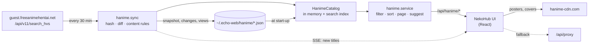
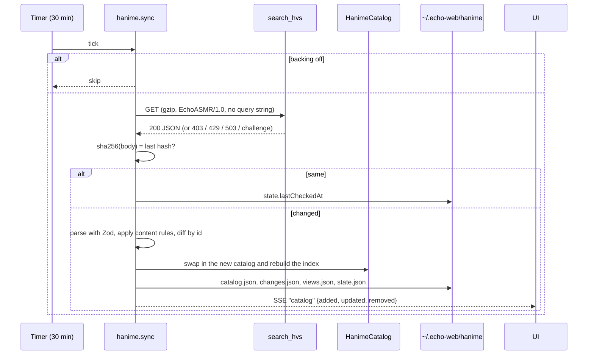

# NekoHub: Hanime Plan

This plan adds a **Hanime** section to NekoHub. It sits in the sidebar below **JAV** and above **Account**. It has six screens: **Home**, **Browse**, **Tags**, **Studios**, **Search** and a **title page**. A tag page and a studio page reuse the Browse list.

The source is **hanime.tv**. We have a licence from the site to use its data. The site serves its **whole catalog as one JSON file** (section 3.2), so NekoHub doesn't read HTML pages as it does for JAV. NekoHub downloads the catalog, keeps it on the computer, and answers every list, filter and search from its own copy.

NekoHub lists the catalog: titles, posters, covers, descriptions, tags, studios, dates and counts. A title page's **Watch** plays the title's video from its episode page on **hentaibros.net** (section 12).

> **Diagrams.** The diagrams use [Mermaid](https://mermaid.js.org/). GitHub shows them as pictures. In VS Code, install the
> "Markdown Preview Mermaid Support" extension to see them in the preview.

---

## Contents

1. [The plan in one minute](#1-the-plan-in-one-minute)
2. [Content rules](#2-content-rules)
3. [How the site works](#3-how-the-site-works)
4. [Storage: why no database](#4-storage-why-no-database)
5. [Syncing](#5-syncing)
6. [Backend](#6-backend)
7. [Search and suggestions](#7-search-and-suggestions)
8. [Frontend](#8-frontend)
9. [Phases](#9-phases)
10. [Testing](#10-testing)
11. [Open questions and risks](#11-open-questions-and-risks)
12. [Watching (hentaibros.net)](#12-watching-hentaibrosnet)

---

## 1. The plan in one minute

- The Express server gets a new source, `hanime`. A **sync job** downloads the catalog (`search_hvs`, about 3,500 titles, 1 MB compressed) at start-up and then every 30 minutes, compares it with the copy it has, and records what's new, changed or gone.
- The catalog lives **in memory**, with a copy on disk in `~/.echo-web/hanime/`. That's enough: the whole catalog is 4.5 MB of JSON. **No database** (section 4).
- Every list, filter, sort and search runs on NekoHub's copy. Opening a page never sends a request to hanime, so pages are instant and the site sees one download every 30 minutes no matter how much NekoHub is used.
- **Search** matches English, Romaji, Japanese, Korean and Chinese titles, the studio and the tags, in memory (1–3 ms a query). Suggestions appear as you type, as they do for JAV, but after 120 ms instead of 300 ms (section 7).
- New uploads reach the UI **live**: the server pushes a "3 new titles" event (Server-Sent Events) and the open pages refresh themselves.
- Posters and covers are on `hanime-cdn.com` and load without a Referer, so the browser loads them directly, with `/api/proxy` as a fallback.



---

## 2. Content rules

These rules are written into the code. They are not settings. They keep out titles that present characters as children, and nothing else (decided 2026-11-17: "all content" otherwise).

- **Blocked series.** `BLOCKED_SERIES` in `src/extension/hanime/constants.ts` names the series that do: the "LO" magazine titles (`Lo Re:`, `Lolipaco`), *Kodomo no Jikan* (`A Forbidden Time`) and *Gaki ni Modotte*. They're matched in `name` and `search_titles` and removed during sync. On 2026-11-17 this removed 12 of 3,474 titles.
- **Blocked tags.** Any tag matching `BLOCKED_WORD` (`loli`, `shota`, `toddler`). The site has none of these tags today, but the check is there in case it adds them.
- **No title-word rule.** `BLOCKED_TITLE` (Manga and JAV) is **not** used. Across five languages it matched dozens of unrelated titles: エロリーマン ("Eroriman") holds ロリ, and "Adventure Kid" and "Child-Making Permit" hold `kid` and `child`.
- **`school girl` stays** (decided 2026-11-17). It's in the **Characters** tag group.
- **Search.** A query matching `BLOCKED_WORD` returns no results and no suggestions.
- **Titles that disappear.** A blocked title is dropped before it reaches the catalog. Asking for its slug answers **451**, the same as JAV.
- **Ads.** The catalog answer has an `ads` key (banners and off-site links). NekoHub throws it away unread.
- **Polite access.** One catalog download every 30 minutes, with NekoHub's honest `EchoASMR/1.0` user agent. On a block or a Cloudflare check, NekoHub keeps its last copy, stops asking for a while, and never tries to get past the block.

---

## 3. How the site works

Mapped with curl on 2026-11-17.

### 3.1 Addresses

The page holds the addresses in `window.AppConfig`:

| Key | Value | Used? |
|---|---|---|
| `search_hvs_url` | `https://guest.freeanimehentai.net/api/v11/search_hvs` | **Yes: the whole catalog** |
| `guest_api_base_url` | `https://guest.freeanimehentai.net` | No. Its video endpoints answer 403 (3.5). |
| `authed_api_base_url` | `https://auth.hanime.tv` | No. Logged-in features. |
| `csrf_token_url` | `https://ct.hanime.tv/csrf-token` | No |
| `turnstile_public_site_key` | Cloudflare Turnstile | No |
| `image_upload_url` | `https://imgup.freeanimehentai.net` | No |

### 3.2 The catalog (`search_hvs`)

`GET https://guest.freeanimehentai.net/api/v11/search_hvs` returns **every title in one answer**: `{ data: Video[], ads: {…} }`. A `POST` with search options answers 404. All searching and filtering is up to the client, so NekoHub does it itself.

| Field | Type | Example | NekoHub uses it as |
|---|---|---|---|
| `id` | int | `5` | the key for diffs |
| `name` | string | `Yabai! Fukushuu Yami Site 2` | the title |
| `search_titles` | string | the name in English, Romaji, Japanese, Korean and Chinese, joined by spaces | the search index |
| `slug` | string | `yabai-fukushuu-yami-site-2` | the address (`/hanime/title/:slug`) |
| `description` | HTML string | `<p>A mysterious fire …</p>` | turned into plain text paragraphs on the server |
| `views`, `likes`, `dislikes`, `downloads` | int | `3326381` | counts and sorting |
| `cover_url` | URL | `hanime-cdn.com/images/covers/…-cover_….webp` | the **portrait** cover art (268 × 394): what hanime.tv shows on every card and beside the player |
| `poster_url` | URL | `hanime-cdn.com/images/posters/…-poster_….webp` | the **landscape** video frame (16:9): the player's poster; NekoHub uses it for the title page's colour wash |
| `brand`, `brand_id` | string, int | `Suzuki Mirano`, `92` | the studio |
| `tags` | string[] | `["bondage", "censored", "hd", …]` | tags and the censored filter |
| `created_at_unix`, `created_at` | int, ISO | `1399380969` | when it was added to the site ("New uploads") |
| `released_at_unix`, `released_at` | int, ISO | `1398384005` | the original release date |

The numbers on 2026-11-17:

| | |
|---|---|
| Titles | 3,474, with no repeated slugs, and every one has a poster and a cover |
| Studios | 174. Top: Pink Pineapple (507), MS Pictures (329), PoRO (186), Queen Bee (149) |
| Tags | 61. Top: blow job (2,552), hd (2,453), big boobs (2,256), creampie (2,195), censored (2,191), uncensored (1,253) |
| Release years | 1986 to 2026 |
| New uploads | About 2 to 5 a week (17 Nov: 2, 16 Nov: 1, 14 Nov: 2) |
| Upcoming titles | None. The catalog lists released titles only. |
| Size | 4.5 MB of JSON, about 1 MB gzipped |

There is **no series field**. 1,105 names repeat with a trailing episode number (`Ane Koi 1`, `Ane Koi 2`), so NekoHub groups a series by its name with that number removed (section 6.4).

### 3.3 Caching and change detection

| Check | Result |
|---|---|
| `cache-control` | `max-age=3600, public`. Cloudflare keeps the answer for **up to 1 hour** (`cf-cache-status: HIT`, `age: 3574`). |
| `ETag` | `W/"…"` is sent, but `If-None-Match` still gets 200, never 304. NekoHub hashes the body instead (section 5). |
| Query strings | `?page=1` gets `cf-cache-status: MISS`: it goes past the cache to the site's own server. **NekoHub must not add query strings**, so it always reads the cached copy. |
| User agents | NekoHub's `EchoASMR/1.0`, curl's default and a browser user agent all get 200. |

So the freshest data anyone outside the site can get is **up to 1 hour old**. Checking every 30 minutes means a new upload shows up in NekoHub within about 1.5 hours at worst, usually much sooner.

### 3.4 Other pages

| Page | URL | Used? |
|---|---|---|
| Sitemap | `https://hanime.tv/sitemap.xml.gz` | Once a day, to check the catalog (5.4): 3,472 `/videos/hentai/{slug}` pages, 61 `/browse/tags/…`, 182 `/browse/brand/…` |
| Title page | `https://hanime.tv/videos/hentai/{slug}` | **Yes, when a title is opened** (3.6). Also the **Open on hanime.tv** link. |
| Browse | `https://hanime.tv/browse` | **Once a day**, for each tag's one-line description and tall picture (3.7) |
| `robots.txt` | `Disallow:` with nothing after it, so everything is allowed | |

### 3.5 Cloudflare and video (why playing is out of scope)

- The site and the catalog host are behind Cloudflare (Cloudflare name servers, `server: cloudflare`, `cf-ray`). The catalog, the sitemap and the title pages load with no bot check.
- **Video data is protected.** `guest.freeanimehentai.net/api/v8/video` and `/api/v11/video` answer **403 "Attention Required! | Cloudflare"**. The player asks for streams with a CSRF token, an `x-signature` / `x-time` pair made by WebAssembly code in the page (`x-signature-version: web2`), a "handshake" call, and playlist links that expire. Turnstile is on the page.
- NekoHub **does not** reverse the signature or get past Turnstile. hanime's own download menu also refuses an automated browser (a Cloudflare check on the title page, and sessions ended). Videos come from hentaibros.net instead (section 12).

### 3.6 The title page

Mapped with Playwright on 2026-11-17 (`hitori-tsuma-1`, `ane-koi-1`). The page is server-rendered: a plain GET with NekoHub's user agent returns all of this, with no bot check. Sections in order: the player, the badges and counts, **Synopsis**, **Alternate Names**, **Preview**, **Next Video**, **More from {series}**, **Related Playlists** (not used: users' playlists), comments (not used).

| Field | Where |
|---|---|
| Preview storyboard | The player's `astro-island` `props`: `storyboard_url` (`/images/storyboards/…jpg`), `storyboard_columns` (5), `storyboard_rows` (36), `storyboard_tile_count` (180). One 800 × 3240 sprite of 160 × 90 frames. hanime.tv's Preview shows 14 of them spread evenly through the video, each a CSS background position on the sprite. |
| Length | JSON-LD `VideoObject.duration`: `PT23M14S` |
| Badges | `span.badge`: `FHD 1080p`, `23 min`, `Sub EN`, `Dub JP` |
| Alternate names | The **Alternate Names** section's `h3` texts (or "None available"). These are exact, so NekoHub shows them instead of splitting `search_titles` (`altTitles`, kept as the fallback). |
| Synopsis | The **Synopsis** section's paragraphs. The catalog's `description` is the same text; it's the fallback. |

### 3.7 The Browse page

`/browse` has four big cards (Trending, Seasons, Random, Images), then a tall card per tag (`a[href^="/browse/tags/"]`: `.tile-title`, `.tile-description`, and the picture in `.tile-icon`'s `background:url(…)`, for example `/images/tags/anal-vertical.min.jpg`; names are irregular, like `2kdragon-tall-banner.webp`, so they're read, not built), then the studios as chips with counts, sorted A–Z or by uploads. **Seasons** (`/browse/seasons?year=2026`) is a year picker over Fall / Summer / Spring / Winter rows; NekoHub works it out from release dates. **Images** is the site's user image uploads, not part of the video catalog, and isn't used.

---

## 4. Storage: why no database

| Option | Fits? | Why |
|---|---|---|
| **Memory + JSON files** (chosen) | **Yes** | 3,474 titles is 4.5 MB. Filtering and sorting the lot in plain TypeScript takes about a millisecond. NekoHub already stores everything else as JSON files in `~/.echo-web` (`settings.json`, `user.json`, `tools.json`) with `writeFileAtomic`. No new dependency. Works the same on desktop, the web server and the future shared core for Android (PLAN.md, phase 3). |
| SQLite (`better-sqlite3`, `node:sqlite`) | Not needed | `better-sqlite3` is a native module that has to be rebuilt for Electron 45 on both Mac types and wouldn't run on Android. `node:sqlite` is still experimental in Electron's Node. Its full-text search would be nice, but section 7's index does the job at this size. |
| Postgres, MongoDB, Redis | No | A separate server to install and run, for 3,500 rows on a desktop app. |

**Revisit the choice** if any of these become true: the catalog grows past about 100,000 titles; NekoHub runs as one shared server for many users; or we need searches the in-memory index can't answer. Then pick SQLite with FTS5, behind the same `HanimeCatalog` interface, so nothing above it changes.

### 4.1 Files

All in `~/.echo-web/hanime/` (`config.dataDir`), written with `writeFileAtomic`:

| File | Contents | Size |
|---|---|---|
| `catalog.json` | The last good catalog after content rules: `{ fetchedAt, hash, titles: HanimeTitle[] }` | about 3 MB |
| `changes.json` | The newest 500 changes: `{ at, kind: 'added' \| 'updated' \| 'removed', id, slug, fields? }` | small |
| `views.json` | One views count per title per day, for 14 days. Gives **Trending** (6.4). | about 400 KB |
| `tags.json` | Each tag's description and picture from Browse (3.7), by tag name | small |
| `state.json` | `lastCheckedAt`, `lastChangedAt`, `lastError`, `lastSitemapAt`, `lastTagArtAt`, `catalogUrl` | tiny |

If `catalog.json` is missing or unreadable, NekoHub starts with an empty catalog, shows "Getting the catalog…" and syncs straight away.

---

## 5. Syncing

### 5.1 The loop



| Rule | How |
|---|---|
| When | Once at start-up (after loading `catalog.json`, so the UI has data straight away), then every **30 minutes** (`hanimeSyncIntervalMs`). Checking more often only returns Cloudflare's copy again (3.3). |
| Request | `GET` the `search_hvs` URL exactly as given, with `Accept-Encoding: gzip` and `APP_USER_AGENT`, through the shared undici dispatcher. Timeouts in `src/config/limits.ts`. |
| Unchanged | If the body's sha256 equals the last one, only `state.json` is written. No parsing. |
| Parsing | A Zod schema for one title. A title that fails is skipped and logged. If more than 5% fail, or the list has fewer than 50% of the last catalog's titles, the whole download is rejected and the old catalog stays (protection against a broken or empty answer). |
| Blocks | A 403, 429, 503, `cf-mitigated: challenge` or a `Just a moment` body starts `BlockBackoff` (15 minutes, doubling up to 2 hours). NekoHub keeps serving the last catalog and the UI shows "Catalog last updated 3 h ago". |
| One at a time | A `Mutex` around the sync, so a manual **Refresh** and the timer can't overlap. |
| Manual refresh | `POST /api/hanime/sync` runs it now, at most once every 5 minutes. |

### 5.2 Diffing

Titles are matched by `id`:

| Case | What NekoHub does |
|---|---|
| A new id | **Added.** Goes into `changes.json`, appears in **New uploads**, and is counted in the live event. |
| A known id with a different `name`, `slug`, `description`, `tags`, `brand`, `poster_url`, `cover_url` or `released_at` | **Updated.** The changed field names are recorded. |
| A known id where only `views`, `likes`, `dislikes` or `downloads` changed | Saved quietly. These change on every download, so they aren't changes. |
| A known id that's missing | **Removed.** Recorded in `changes.json`, and the title is dropped from lists. Its page answers 404. |
| A title the content rules now block | Treated as removed, and its slug answers 451. |

### 5.3 Live updates

`GET /api/hanime/events` is a Server-Sent Events stream. After a sync that changed something, it sends:

```
event: catalog
data: {"added":2,"updated":1,"removed":0,"at":"2026-11-17T11:30:00Z"}
```

The frontend opens it while a Hanime page is shown. On an event it invalidates the `['hanime']` queries, and on Home it shows a toast: "2 new titles". If the stream drops, the browser reconnects by itself.

### 5.4 Daily check

Once a day the sync also reads `sitemap.xml.gz` and compares its `/videos/hentai/{slug}` list with the catalog. Differences are only **logged** (a slug in the sitemap but not in the catalog, or the other way round), so we notice if `search_hvs` ever stops listing everything. Two slugs differed on 2026-11-17 (3,472 in the sitemap, 3,474 in the catalog).

---

## 6. Backend

The code goes in `web/backend-express`. Hanime is its own area, like Manga and JAV.

### 6.1 Files

| File | Job |
|---|---|
| `src/models/hanime.ts` | Types (6.2) |
| `src/extension/hanime/constants.ts` | The catalog URL, image host, `BLOCKED_TAGS`, the tag groups (6.5), the sort and filter allow-lists |
| `src/extension/hanime/hanime.client.ts` | Downloads the catalog and sitemap, and reads title pages and Browse (one at a time, 1 s apart). Allows only those addresses and the home page. `BlockBackoff`. |
| `src/extension/hanime/parsers.ts` | `parseTitlePage` (3.6) and `parseBrowseTags` (3.7). Fixtures: `tests/fixtures/hanime/title-ane-koi-1.html` and `browse.html`, trimmed from the real pages. |
| `src/extension/hanime/schema.ts` | Zod schema for one catalog title |
| `src/extension/hanime/mappers.ts` | Raw title → `HanimeTitle`: description HTML to paragraphs, `isCensored`, `seriesKey`, `episode` |
| `src/services/hanime/catalog.ts` | `HanimeCatalog`: the titles in memory, maps by slug, tag, studio and series, search, similar titles and the trending score. Pure: no requests, no files. |
| `src/services/hanime/search-index.ts` | Section 7 |
| `src/services/hanime/sync.service.ts` | Section 5: the timer, hash, diff, files, events |
| `src/repositories/hanime.repository.ts` | Reads and writes the files in 4.1 |
| `src/services/hanime.service.ts` | Lists, filters, sorts, pages, trending, content rules on queries |
| `src/controllers/hanime.controller.ts` | Zod schemas for every query |
| `src/views/hanime.view.ts` | Shapes the JSON answers |
| `src/container.ts`, `src/routes/index.ts`, `src/config/limits.ts` | Wiring, routes, the sync interval and timeouts. The sync timer stops when the server stops. |

### 6.2 Models

```ts
interface HanimeRef { slug: string; name: string; count?: number }

interface HanimeCard {
  id: number; slug: string; name: string;
  poster: string; cover: string;
  studio: HanimeRef;
  releasedAt: string; uploadedAt: string;   // ISO
  views: number; likes: number;
  isCensored: boolean;                       // the `censored` tag; `uncensored` makes it false
  episode?: number;                          // the trailing number of the name
  isNew: boolean;                            // uploaded in the last 7 days
}
interface HanimeTitle extends HanimeCard {
  titles: string[];                          // search_titles, split by language where possible
  description: string[];                     // plain text paragraphs
  tags: HanimeRef[];
  dislikes: number; downloads: number;
  seriesKey: string;                         // the name without the episode number, lower-case
  episodes: HanimeCard[];                    // the same series, by episode
  similar: HanimeCard[];                     // 12 titles sharing the most tags
  siteUrl: string;                           // https://hanime.tv/videos/hentai/{slug}
}
interface HanimeList<T> { items: T[]; page: number; lastPage: number; total: number; hasMore: boolean }
interface HanimeStatus { titles: number; lastCheckedAt?: string; lastChangedAt?: string; paused: boolean; error?: string }
```

### 6.3 Endpoints

| Method | Path | Query | Returns |
|---|---|---|---|
| GET | `/api/hanime/home` | none | Shelves: **New uploads** (12, newest upload first), **Trending** (12), **Most viewed** (12), **Top rated** (12), and a shelf for each of 4 popular tags |
| GET | `/api/hanime/titles` | the filters in 6.4, `page`, `size` (24, max 60) | `HanimeList<HanimeCard>` |
| GET | `/api/hanime/title/:slug` | none | `HanimeTitle`. 404 if unknown or removed, 451 if blocked. |
| GET | `/api/hanime/title/:slug/details` | none | `HanimeDetails` from the title page (3.6): `durationSec`, `badges`, `altNames`, `synopsis`, `storyboard`. Read once and kept a day; pages are read one at a time, 1 s apart. 404 / 451 as above, 503 while backing off. |
| GET | `/api/hanime/seasons` | `year` | `{ years, year, seasons: [{ season, items }] }`: Winter is January to March. Without `year`, the newest. |
| GET | `/api/hanime/random` | none | One `HanimeCard`, `Cache-Control: no-store` |
| GET | `/api/hanime/tags` | none | `{ group, tags: [{ slug, name, count, description, image }] }[]` (6.5, 3.7) |
| GET | `/api/hanime/studios` | `sort` (`count`, `name`) | `HanimeRef[]` with counts |
| GET | `/api/hanime/suggest` | `q`, `limit` (8, max 20) | Section 7 |
| GET | `/api/hanime/changes` | `since` (ISO), `limit` | The newest changes, as cards, for "What's new" |
| GET | `/api/hanime/status` | none | `HanimeStatus` |
| GET | `/api/hanime/events` | none | The SSE stream (5.3) |
| POST | `/api/hanime/sync` | none | Runs a sync now. 429 if one ran in the last 5 minutes. |

Errors use the existing `ApiError` shape. 503 means the catalog has never been downloaded and the source is backing off. The fixed paths go before `/hanime/title/:slug` in the route table.

### 6.4 Filters and sorts

All of them run on NekoHub's copy, so any mix works and every list shows its total.

| Query key | Values | Meaning |
|---|---|---|
| `q` | text | Section 7 matching. With `q`, the default sort is relevance. |
| `tags` | slugs, comma-separated | Titles with **all** these tags |
| `tagMode` | `and` (default), `or` | `or`: titles with **any** of them |
| `exclude` | tag slugs | Titles with **none** of these (the site calls this a blacklist) |
| `studios` | studio slugs | Titles from any of these studios |
| `censored` | `all` (default), `censored`, `uncensored` | From the tags |
| `year` | `2015,2026` | Release year range |
| `series` | a `seriesKey` | One series, by episode |
| `sort` | `uploaded` (default: newest upload), `released`, `views`, `likes`, `rating`, `downloads`, `trending`, `name`, `relevance` | |
| `order` | `desc` (default), `asc` | |

- **rating** is likes ÷ (likes + dislikes), with titles under 100 votes ranked below the rest.
- **trending** is views a day: those gained since the snapshot nearest 7 days ago in `views.json` (any snapshot at least a day old will do). Until there's one, it's the average views a day since upload. Both are views a day, so new and old titles compare fairly.
- Tag and studio slugs are made by NekoHub (`blow job` → `blow-job`, `Pink Pineapple` → `pink-pineapple`) and checked against the catalog's lists. Unknown values answer 400. A blocked tag answers 451.

### 6.5 Tag groups

The site lists 61 tags without groups. NekoHub groups them in `constants.ts` so the Tags page and the filter sheet are easier to scan. A new tag the list doesn't know goes into **Other** until it's added.

| Group | Tags |
|---|---|
| Format | `hd`, `censored`, `uncensored`, `3d`, `filmed`, `pov`, `x-ray`, `softcore` |
| Story | `plot`, `comedy`, `horror`, `fantasy`, `vanilla`, `harem`, `ntr`, `incest`, `mind break`, `mind control` |
| Characters | `milf`, `teacher`, `nurse`, `maid`, `glasses`, `dark skin`, `nekomimi`, `tsundere`, `futanari`, `trap`, `monster`, `ugly bastard`, `2000-year-old dragon girl`, `big boobs`, `pregnant` |
| Pairing | `yuri`, `yaoi`, `threesome`, `orgy`, `gangbang`, `virgin` |
| Acts | `blow job`, `boob job`, `hand job`, `foot job`, `rimjob`, `anal`, `creampie`, `facial`, `masturbation`, `public sex`, `lactation`, `ahegao` |
| Fetish | `bondage`, `bdsm`, `toys`, `tentacle`, `cosplay`, `swimsuit`, `watersports`, `scat`, `inflation` |

`school girl` is in **Characters**.

### 6.6 Images

Covers, posters, storyboards, tag pictures and the Browse artwork (all under `https://hanime-cdn.com/images/`) loaded with status 200 without a Referer. The browser loads them directly. The proxy's allow-list gets a **host and path rule** for `hanime-cdn.com/images/` instead of registering about 7,000 addresses in `IssuedUrls`, so the `/api/proxy` fallback works without filling that store.

---

## 7. Search and suggestions

### 7.1 Matching

`search-index.ts`. With about 3,500 titles a query simply looks at every title (1–3 ms), so there's no inverted index to build or keep. When the catalog changes, each title's fields are normalised once:

| Step | How |
|---|---|
| Fields | **name**; **other** (`search_titles` in every language + the studio); **tags** |
| Normalise | NFKD, accents removed, NFKC (full-width → normal), lower-case, anything that isn't a letter or digit → a space |
| Latin words | A query word matches the **start** of a word, so `fuku` finds `Fukushuu` |
| Japanese, Chinese, Korean | No spaces to split on, so the query word matches **anywhere** in the field with spaces removed. `復讐` finds `ヤバい! -復讐・闇サイト-`. |
| All words | A title must match every word of the query |

Other-language titles for the title page are pulled out of `search_titles` by script (`altTitles` in `mappers.ts`): runs of kana/kanji, Hangul, Han or Cyrillic. Latin runs mix Romaji and English with no separator, so they stay in search only.

### 7.2 Ranking

Each query word scores 300 when found in the name, 200 in the other titles or studio, and 100 in the tags. The whole name (or slug) being the query adds 2,000, and the name starting with it adds 1,000. Ties go to more views. So `ane koi 2` puts *Ane Koi 2* first, and `tentacle fantasy` finds titles that only have those as tags, below titles that say them in the name.

Spelling mistakes aren't forgiven in phase 1. If testing shows we need it, add a one-letter-off check (edit distance 1) for words of 5 letters or more.

### 7.3 Suggestions in the top bar

As for JAV, Hanime pages have no search box of their own: the top bar search becomes a Hanime search (`src/components/hanime/HeaderSearch.tsx`), built on the JAV `SearchBox.tsx`. ↑ and ↓ move, Enter picks, Esc closes, and an empty field lists recent searches (kept on the device, `echo:jav:recent:hanime:titles`, the same store as JAV's).

`/api/hanime/suggest?q=` answers in one go, grouped:

| Group | Up to | Picking it opens |
|---|---|---|
| Titles | 6, with posters | the title page |
| Series | 2: "Ane Koi · 3 episodes" | Browse with `series=` |
| Tags | 3 | Browse with that tag |
| Studios | 2 | Browse with that studio |
| "Search for …" | always last | Browse with `q=` |

The answer comes from memory, so the box waits only **120 ms** after typing stops (JAV waits 300 ms for the site). `SearchBox`'s `SuggestSource` has a `{ type: 'hanime' }` source; each row says what it is in its second line ("Series · 4 episodes", "Tag · 392 titles", "Studio · 507 titles").

| Page | The top bar searches |
|---|---|
| Home, All titles, Seasons, a title | the whole catalog, with suggestions |
| Browse | narrows its tags and studios as you type (`/hanime/browse?q=`), suggesting them with their pictures |
| Search | the full results, with the title list's filters |

---

## 8. Frontend

The code goes in `web/frontend`.

### 8.1 Sidebar

In `src/components/app-sidebar.tsx`, add a **Hanime** group after **JAV** and before **Account**, with the same pattern:

| Item | URL | Icon (lucide) |
|---|---|---|
| Home | `/hanime` | `House` |
| Browse | `/hanime/browse` | `LayoutGrid` |
| All titles | `/hanime/titles` | `Film` |
| Seasons | `/hanime/seasons` | `CalendarRange` |
| Search | `/hanime/search` | `Search` |

A title page counts as All titles.

### 8.2 Routes

Added to `src/App.tsx`, inside `<Shell/>`:

| Route | Page |
|---|---|
| `hanime` | `HanimeHomePage`: shelves from `/home` (`ShelfBlock`). New uploads get a **New** badge. A small "Updated 12 min ago" line with a **Refresh** button. |
| `hanime/browse` | `HanimeGalleryPage`, laid out like hanime.tv's Browse (3.7): four big cards with hanime's artwork (**Trending** → All titles by trending, **Seasons**, **Random**, **All titles**), then **Categories & tags** as tall picture cards with the description and count (a chip row picks a tag group), then **Studios & brands** as chips with counts, sorted by uploads or A–Z. `#tags` and `#studios` jump to the sections; the old `/hanime/tags` and `/hanime/studios` addresses redirect there. |
| `hanime/titles` | `HanimeBrowsePage`: every title in a grid with infinite scroll. Above it: sort chips, the **All / Censored / Uncensored** switch, the order, and a **Filters** sheet (tags in their groups with a tri-state chip: include, exclude, off; AND / OR; studios with a filter box; a year range). Active filters show as removable chips with the total ("214 titles"). Everything is kept in the address (`?tags=yuri,maid&exclude=ntr&sort=views`). |
| `hanime/seasons` | `HanimeSeasonsPage`: a year chip row, then a grid per season (`?year=2014`) |
| `hanime/random` | `HanimeRandomPage`: asks for a random title and replaces itself with it, so Back skips it |
| `hanime/title/:slug` | `HanimeTitlePage` (8.4) |
| `hanime/search` | `HanimeSearchPage`: the Browse page with `q` set and **Relevance** as the sort |

Tag and studio pages are All titles with one filter set (`/hanime/titles?tags=yuri`, `?studios=pink-pineapple`), with a `DetailHero` heading when exactly one tag or studio is chosen. Breadcrumbs go in `src/lib/crumbs.tsx`. The music player becomes the `MiniPlayer` on `/hanime` pages, as on `/jav` pages.

### 8.3 Data

- `src/api/client.ts`: `api.hanime.home/titles/title/details/seasons/random/tags/studios/suggest/changes/status/sync`.
- `src/api/queries.ts`: lists use `useInfiniteQuery`. `staleTime` 10 minutes for everything, since the server is the cache and SSE invalidates on change.
- `src/api/types.ts`: the types from 6.2.
- `src/lib/hanime-events.ts`: opens `/api/hanime/events` while a Hanime page is shown and invalidates `['hanime']` on `catalog`.

### 8.4 The title page

| Part | Detail |
|---|---|
| Hero | The portrait **cover** (as on hanime.tv) beside the details; the landscape **poster** colours the header wash. **Censored** / **Uncensored** and the episode above the name; the badges from the page (`FHD 1080p`, `23 min`, `Sub EN`, `Dub JP`); studio link, release date and date added |
| Stats | Views, likes, rating and downloads, in a row, with short numbers (3.3M) |
| Synopsis | The page's synopsis (the catalog's description until it arrives), collapsed after 5 lines |
| Alternate Names | The page's names as chips (the names split from `search_titles` until it arrives), or "None available" |
| Preview | `PreviewFrames`: 14 frames of the storyboard, evenly spread, each with its time (`3:41`). Clicking one opens it large (portalled to `<body>`) with ← / →, Esc to close and a counter "3 / 14". Skeletons while the page is read; "The preview couldn't be loaded from hanime.tv" when it can't be; "No preview for this title" when there's no storyboard. |
| Tags | Chips linking to `/hanime/titles?tags=…` |
| More from {series} | The other episodes, in order, the current one marked, with **All N episodes** |
| Similar | A grid without infinite scroll |
| Header | **Copy name** and **Open on hanime.tv** |
| No Watch button | Not until section 11 is settled |
| Errors | 451: "This title isn't available in NekoHub." 404: the not-found state. 503: "The source is busy, try again later" with **Try again**. |

### 8.5 Components (`src/components/hanime/`)

| Component | Notes |
|---|---|
| `HanimeCard` | The portrait cover in a fixed 2:3 box (the poster as a fallback), the name cut to two lines, studio and year, a **New** badge and a views count. Falls back to the proxy. |
| `HanimeGrid` | The JAV `grid.tsx`; share it if the props line up |
| `FilterSheet` | The Browse filters. Built from `FacetSheet.tsx`, plus the tri-state tag chip. |
| `HeaderSearch` | 7.3 |
| `PreviewFrames` | 8.4 |
| `StatusLine` | "Updated 12 min ago", **Refresh**, and "Paused: the source asked us to wait" while backing off |

Reuse `Segmented.tsx` for the switches and sort chips.

---

## 9. Phases

| # | Phase | Done when |
|---|---|---|
| 0 | This document | Done |
| 1 | Client, schema, mappers, fixtures | Done. `tests/fixtures/hanime/catalog.json`: 43 real titles (series, censored, uncensored, yuri, yaoi, 3D) and two made-up blocked ones. |
| 2 | Catalog, search, service | Done. `tests/unit/hanime.test.ts`. |
| 3 | Sync and storage | Done. Start-up from `catalog.json`, hash skip, diff, rejecting a broken answer, backoff, the files in 4.1, SSE. |
| 4 | Routes and controllers | Done. `tests/integration/hanime.test.ts`. |
| 5 | Sidebar, Home, Browse, Tags, Studios | Done, checked against the live catalog on 2026-11-17 |
| 6 | Title page and top bar search | Done. A suggestion request answers in under 10 ms. |
| 7 | Live updates | Done. The integration test reads the `catalog` event from a real connection. |
| 7b | Like hanime.tv | Done (2026-11-17, checked with Playwright against the site): portrait covers on cards; title page Synopsis, Alternate Names, Preview and badges from the title page; Browse as a gallery with tag pictures; Seasons; Random. |
| 8 | Desktop | To do: rows in `apps/desktop/MANUAL-TESTS.md`, run on the packaged app (first run with no files, offline start from `catalog.json`). |

---

## 10. Testing

| Where | Command | What it covers |
|---|---|---|
| Backend | `cd web/backend-express && npm run lint && npm run typecheck && npm test` | Schema and mappers on the fixture. Content rules (blocked title, blocked tag, blocked query, 451). Every filter, sort and the paging totals. Search ranking and Japanese bigrams. Sync: unchanged hash, added / updated / removed, views-only changes not counted, an answer with half the titles rejected, backoff on a challenge page, no query string on the request. Files written atomically and read back. |
| Backend live | `npm run test:live` | One catalog download: it parses, has more than 3,000 titles, and every title passes the schema |
| Frontend | `cd web/frontend && npm run typecheck && npm test && npm run build` | Sidebar position. Filters round-trip through the address. Suggestion keys. The SSE event invalidating queries. 451, 404 and 503 states. |
| Desktop | `cd apps/desktop && npm test`, then the manual tests | The packaged app |

---

## 11. Open questions and risks

- **`ECHO_HANIME_SYNC=0`** turns the timer off. Tests use it; the app never sets it.
- **Video.** hanime's stream endpoints are behind Cloudflare and a signed request scheme (3.5), and NekoHub won't work around them. Watch uses hentaibros.net (section 12); about a third of the catalog has no page there.
- **Faster updates.** 30-minute checks against a 1-hour cache are as fresh as public data gets. For anything faster, ask hanime for a webhook or a "changed since" feed.
- **The catalog address changes.** `v11` and the `freeanimehentai.net` host can change. If the URL starts answering 404, the client reads `window.AppConfig.search_hvs_url` from the hanime.tv home page once, and uses that if it's on an allowed host. A failure shows in `/status` and the UI, and the last catalog keeps working.
- **The catalog stops being complete.** The daily sitemap check (5.4) logs it.
- **Cloudflare.** Today there's no bot check on the catalog. If one appears, NekoHub backs off and keeps its copy. It doesn't try to get around it.
- **Licence on file.** Keep a copy. It should cover downloading the catalog regularly, keeping a copy, and hot-linking `hanime-cdn.com/images/`.
- **Android.** The catalog, index and filters are plain TypeScript with no Node-only parts except the file reads, so they can move into the shared core (PLAN.md, phase 3) as they are.

---

## 12. Watching (hentaibros.net)

Added 2026-11-17. The rights to stream these files are covered (decided 2026-11-17). Mapped with curl and Playwright on the live site.

### 12.1 The site

- WordPress behind Cloudflare, as a cache only (`cf-cache-status: HIT`): no bot check on pages or videos, and plain requests with NekoHub's `EchoASMR/1.0` user agent get the real pages. `robots.txt` allows everything.
- `sitemap_index.xml` lists four post sitemaps (`post-sitemap.xml` … `post-sitemap4.xml`) with 3,199 posts: 2,695 are `{name}-episode-{n}`, the rest one-offs (3D, ASMR, motion anime). Newest change 2026-11-10.
- An episode page's player is an FV Player box with the video as JSON in `data-item`: `{"sources":[{"src":"https://cdn.vintageporno.stream/Can%20Can%20Bunny%2002%20Sub.mp4","type":"video/mp4"}]}`. One MP4 per episode, English subtitles burned in. The other `<video>`s on the page (`bkcdn.net`, `bxcdn.net`, 10–30 s) are ads.
- 13 sampled pages, old and new: all had the `data-item` player, no iframes. Hosts: `cdn.vintageporno.stream` (11) and `povblowjob.net` (2); one address had unescaped spaces (`/1Ldk 08 Sub.mp4`).
- The files are plain MP4s on Cloudflare (157–505 MB in the sample) that answer byte ranges (206) with or without a Referer: no hotlink check. They play and seek in NekoHub's player straight from the host.

### 12.2 What NekoHub does

`GET /api/hanime/title/{slug}/stream` → `{ file, page, title }`.

1. The title goes through the catalog first, so the content rules apply (451) and unknown titles answer 404.
2. The site's post list is read from the four post sitemaps (one request a second) and kept for a day; a failed refresh keeps the old list.
3. The title is matched to a post by name and episode (12.3). No match answers 404 "hentaibros.net has no video for this title."
4. The post's slug and the page's heading go through the content rules again (`BLOCKED_SERIES`, `BLOCKED_WORD`): 451.
5. The episode page is read and the `data-item` source taken (https, `.mp4` or `.m3u8` only).
6. The answer is kept for a week, a miss for 6 hours; requests for one title at once share one lookup.

A 403, 429, 503 or Cloudflare check page pauses all requests to the site (`BlockBackoff`: 15 minutes, doubling to 2 hours). NekoHub never tries to get past one.

The title page's **Watch** (`?play=1`) opens the JAV theater's Vidstack player across the top with the file, plus **Source** (the episode page) and **Close**. The first lookup after a start takes about 8 s (the sitemaps); later ones about 1 s.

### 12.3 Matching titles

The two sites spell titles differently (`boku-ni-sefure-ga-dekita-riyuu-3` and `boku-ni-sexfriend-ga-dekita-riyuu-episode-3`; `luna` and `runa`; an added subtitle; "the animation"). `src/services/hanime/stream-match.ts`:

- The episode number must be equal: `-episode-N` on the post; the trailing number (`-3`, `-ep-3`) of the title's slug or name. No number counts as 1.
- Names (the title's slug, name and other titles, against the post's slug) become word sets without filler words (`the`, `animation`, `ova`, `no`, `ga`, …). The score is shared words ÷ all words; one name containing the other whole counts 0.85.
- The best post at 0.6 or more wins. Tuned on the whole catalog: **2,322 of 3,462 titles** find a page. Every match checked between 0.6 and 0.75 was right (other romanisations); below 0.6 they weren't. Matching takes about 0.2 ms a title.
- About a third of the catalog isn't on the site at all (for example *Romance wa Tsurugi no Kagayaki*), and the site has titles hanime doesn't (*Reginetta-san no Bouken*); neither is listed (12.5).

### 12.5 Only titles with a video are listed

Added 2026-11-18. NekoHub lists only the titles that find a post (12.3), about 2,322 of 3,462.

- `src/services/hanime/availability.service.ts` (`HanimeAvailability`) holds the post list and matches it against the catalog once for each new catalog or post list (about 0.7 s), giving a smaller `HanimeCatalog` (`catalog.only()`). Every answer comes from it: Home, Browse, the title list, search, suggestions, tags and their counts, studios, Seasons, Random, a series' episodes, Similar, and the title count in the status.
- A title the catalog has but without a video answers **404** "hentaibros.net has no video for this title.", on its page and its stream.
- The post list is saved in `~/.echo-web/hanime/hentaibros-posts.json`, so a restart lists the same titles at once. It is read again once a day in the background while the old one is used; at start-up when NekoHub syncs, it is loaded straight away.
- **No list at all** (first start with the site down): every title is listed rather than none, and the site is asked again after 15 minutes (`hentaibrosPostsRetryMs`).
- A match found here can still fail when the episode page is read (no player on the page): Watch then says there's no video. The page itself is only read when Watch is pressed.

### 12.4 Files

| File | What |
|---|---|
| `src/extension/hentaibros/hentaibros.client.ts` | Sitemaps and episode pages, one at a time, 1 s apart, `BlockBackoff` |
| `src/extension/hentaibros/parsers.ts` | Post sitemaps, post slugs, the player's `data-item` video |
| `src/services/hanime/stream-match.ts` | Title → post (12.3) |
| `src/services/hanime/availability.service.ts` | The post list (saved on disk) and which titles have a video (12.5) |
| `src/services/hanime/stream.service.ts` | 12.2, with its caches |
| `web/frontend/src/components/hanime/HanimeTheater.tsx` | The player on the title page |
| Tests | `tests/unit/hentaibros.test.ts`, `tests/integration/hanime-stream.test.ts`, `HanimePages.test.tsx` |

