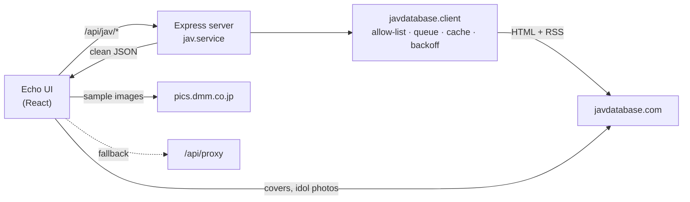
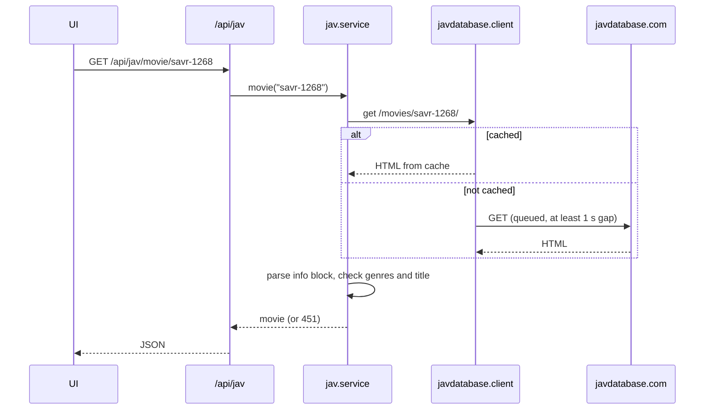

# Echo: JAV Plan

This plan adds a **JAV** section to Echo. It sits in the sidebar below **Manga & Doujinshi** and above **Account**. It has six screens: **News**, **Latest**, **Movies**, **Idols**, **Genres**, and a **movie detail** page. An idol page and a genre page reuse the movie list.

The source is **javdatabase.com**. We have a licence from the site to use its data. The site's WordPress REST API is closed to the public (`/wp-json/` answers 401), so Echo reads its HTML pages and its RSS feed, the same way the `threehentai` manga source works ([MANGA.md](MANGA.md)).

Echo shows **metadata only**: titles, covers, sample images, cast, studio, genres and dates. The site doesn't host full movies, and neither does Echo. Trailers are hosted by DMM or the studio: the user's browser loads them directly, and Echo's server never fetches or proxies them (decided 2026-11-16, section 10).

> **Diagrams.** The diagrams use [Mermaid](https://mermaid.js.org/). GitHub shows them as pictures. In VS Code, install the
> "Markdown Preview Mermaid Support" extension to see them in the preview.

---

## Contents

1. [The plan in one minute](#1-the-plan-in-one-minute)
2. [Content rules](#2-content-rules)
3. [How the site works](#3-how-the-site-works)
4. [How Echo talks to the site](#4-how-echo-talks-to-the-site)
5. [Backend](#5-backend)
6. [Frontend](#6-frontend)
7. [The movie page](#7-the-movie-page)
8. [Phases](#8-phases)
9. [Testing](#9-testing)
10. [Open questions and risks](#10-open-questions-and-risks)

---

## 1. The plan in one minute

- The Express server gets a new **video source**, `javdatabase`. It reads the RSS feed and the listing, idol, genre and movie pages, and turns them into clean JSON.
- **News** comes from the blog pages (`/blog/?paged=N`, `/category/{slug}/page/N/`), which carry a picture for each post that the RSS feed lacks. These are the site's weekly "Top JAV Movies" and "New JAV Idol Debuts" posts.
- **Latest** and **Movies** come from `/movies/` and `/uncensored/`, which list newest first. **Idols** comes from `/idols/`, which has filters and sorts that work as plain query strings. **Genres** comes from `/genres/`: 256 genres in 10 groups.
- One request to `/movies/{slug}/` gives the whole movie page: the info block, the cast, up to about 20 sample images and similar movies.
- Covers and idol photos are on `www.javdatabase.com`. Sample images are on `pics.dmm.co.jp`. Both load without a Referer, so the browser loads them directly, with `/api/proxy` as a fallback.
- The section is always in the sidebar. There's no setting for it.



---

## 2. Content rules

These rules are written into the code. They are not settings. They follow the same idea as the manga rules: nothing that presents performers as children.

- **Blocked genres.** Movies with any of these genres are never listed, opened or searched for, and the genres never appear in the genre browser:
  `shotacon`, `schoolgirl`, `school`, `school-uniform`, `school-swimsuits`, `sailor-uniform`.
  The list is a fixed constant (`BLOCKED_GENRES` in `src/extension/javdatabase/constants.ts`). `adopted-daughter` and `youthful` were considered and left out (2026-11-16).
- **Blocked titles.** Cards carry no genres, so titles are checked with `BLOCKED_JAV_TITLE` (`src/lib/content-rules.ts`): the manga words (`loli`, `shota`, `elementary school`, `middle school`, `junior high`, `JC`/`JS`, `child`, `kid`, `小学`, `中学`, `幼女`, `ロリ`, `ショタ` and the rest) plus the school roles whose genres are blocked: `schoolgirl`, `school girl`, `school uniform`, `sailor uniform`, `school swimsuit`, `JK`, `女子校生`, `女子高生`, `セーラー服`, `スク水`.
  - **Listings.** Cards carry the title but not the genres. Cards with a blocked title are removed before the UI sees them.
  - **Movie page.** If the movie has a blocked genre or title, the API answers **451** and sends no images. Its slug goes into a small in-memory blocked set, so later listings drop that card too, the same way manga remembers blocked tag ids.
  - **Genre pages.** Asking for a blocked genre returns 451.
  - **Search.** A query that names a blocked genre or matches the title pattern returns no results.
- **Idol filters.** The site has a `body_type=loli` idol filter. Echo doesn't offer it, and refuses a request that names it.
- **Ads.** List pages mix in sponsored cards that link off-site (`rel="sponsored"`, for example `cospuri.com`). The parser drops every card whose link isn't a `javdatabase.com/movies/` or `/uncensored/` page.
- **Polite access.** One request at a time, at least 1 second apart. Pages are cached. On a block or a Cloudflare check, Echo stops asking for a while. It never tries to get past a block.

---

## 3. How the site works

Mapped with Playwright and curl on 2026-11-16. The site runs on WordPress, with FacetWP for filters, LiteSpeed for caching and Cloudflare in front.

### 3.1 Pages

| Page | URL | Notes |
|---|---|---|
| Home | `/` | The latest weekly blog posts. Not used: News reads the feed instead. |
| Censored movies | `/movies/`, `/movies/page/{n}/` | 18 movies a page plus about 12 sponsored cards. Roughly newest release date first, **including upcoming releases**: on 2026-11-16 pages 1–11 held only announced movies and page 12 was the first with released ones. The order is not strict: blocks of announced titles also turn up deeper (pages 30, 50, 70 and 80 were all announced). About 27,000 pages. |
| Uncensored movies | `/uncensored/`, `/uncensored/page/{n}/` | Same layout. About 1,050 pages. Detail pages are `/uncensored/{slug}/`. |
| Most favourited | `/most-popular-jav-movies/` | Ranked list. |
| Movie | `/movies/{slug}/` | Section 3.6. The slug is the lower-case DVD ID: `savr-1268`. |
| Idols | `/idols/`, `/idols/page/{n}/` | 18 idols a page. About 2,250 pages. Filters in 3.4. |
| Idol | `/idols/{slug}/` | Profile, then their movies, 18 a page with `?ipage={n}`. Section 3.5. |
| Genres | `/genres/` | 256 genres in 10 groups. Section 3.7. |
| Genre | `/genres/{slug}/`, `/genres/{slug}/page/{n}/` | Same cards as Movies. `creampie` has about 8,600 pages. |
| Studio, director, series | `/studios/{slug}/`, `/directors/{slug}/`, `/jav-series-search/` | Same cards. Studios are linked from cards and the movie page. |
| Search | `/?s={q}&post_type={movies,uncensored \| movies \| uncensored \| idols}` | Same cards, `/page/{n}/` paging. |
| Blog | `/blog/`, `/blog/?paged={n}` | News posts. Section 3.8. |
| Blog category | `/category/{top-jav-movies, new-jav-debuts, top-jav-idols, idol-updates, site-updates}/` | Same layout as the blog. |
| News post | `/{yyyy}/{mm}/{dd}/{slug}/` | Section 3.8. |
| RSS | `/feed/` | The newest 10 posts, with title, link, date, categories and a summary. |
| Sitemaps | `/sitemap_index.xml` | `movies` (486 files), `uncensored` (22), `idols` (41), `series` (52), `directors` (7), `studios` (5), `genres`, `post`. |

### 3.2 What a movie card looks like

The same card is used on Movies, Uncensored, genre, studio, idol and search pages:

```html
<div class="col-md-3 col-lg-2 col-xxl-2 col-4">
  <div class="card h-100 borderlesscard"><div class="card-body d-flex flex-column">
    <p class="display-6 pcard"><a href="https://www.javdatabase.com/movies/savr-1268/" class="cut-text">SAVR-1268</a></p>
    <div class="movie-cover-thumb">
      <a href="…/movies/savr-1268/"></a>
    </div>
    <div class="mt-auto" style="text-align:center">
      <a href="…/movies/savr-1268/" class="cut-text">[VR] As a first-time customer, …</a>
      2026-12-19
    </div>
    <span class="btn btn-primary btn-sm cut-text"><a href="…/studios/kmpvr-color/" rel="tag">KMPVR-Color-</a></span>
  </div></div>
</div>
```

| Field | Where |
|---|---|
| slug and kind | first `a[href]` → `/movies/{slug}/` or `/uncensored/{slug}/` |
| DVD ID | `p.pcard a` text (`SAVR-1268`) |
| title | `.mt-auto a.cut-text` text |
| release date | the text node after that link (`YYYY-MM-DD`) |
| cover thumb | `.movie-cover-thumb img[src]` (147 × 200) |
| studio | `span.btn a[href*="/studios/"]`: name and slug |

A **sponsored card** has the same shape, but its links point off-site and carry `rel="sponsored"`. Drop it (section 2).

Paging: `ul.pagination` holds `/page/{n}/` links. The `»` link gives the last page.

### 3.3 What an idol card looks like

```html
<div class="card h-100 borderlesscard"><div class="card-body d-flex flex-column">
  <p class="display-6 pcard"><a href="…/idols/nagi-takanashi/" class="cut-text">Nagi Takanashi</a></p>
  <div class="idol-thumb"><a href="…"></a></div>
  <div class="mt-auto"><div class="idol-info"><a href="…/idols/?_birth_year=2005.00%2C2005.00" class="btn btn-primary btn-sm">21</a></div></div>
</div></div>
```

| Field | Where |
|---|---|
| slug, name | `p.pcard a` |
| photo | `.idol-thumb img[src]` (160 × 200). The full photo is `/idolimages/full/{slug}.webp`. |
| age | `.idol-info a` text |

### 3.4 Idol filters and sorts

FacetWP renders these on the server, so a plain GET with the query string returns the filtered list, and paging works as `/idols/page/{n}/?…` or `?_paged={n}`. Several values of one facet are joined with `%2C`.

| Facet | Query key | Values (count on 2026-11-16) |
|---|---|---|
| Sort | `_sort_` | default (newest debut), `oldest` (name A–Z), `top_rated`, `most_favorited`, `newest` (most recent) |
| Content | `_content_type` | `censored` (37,670), `uncensored` (4,967) |
| Age group | `_age_group` | `teen` (289), `twenties` (5,578), `milf` (4,852), `mature` (2,546) |
| Cup | `_cup_size` | `a` … `t` |
| Body type | `_body_type` | `big-tits`, `slim`, `small-tits`, `curvy`, `big-ass`, `trans`, `gal`, `tall`, `chubby`, `fat`, `athletic`, `tattoo`, `caucasian`, `half-japanese`, `foreigner`, … (`loli` is never offered, section 2) |
| Hair length | `_hair_length` | `long`, `medium`, `short` |
| Hair colour | `_hair_color` | `black`, `brown`, `blonde`, `red`, `pink`, … |
| Ranges | `_birth_year`, `_debut_year`, `_debut_age`, `_height` | `min.00%2Cmax.00`, for example `_debut_year=2025.00%2C2026.00` |

The same `_sort_` key works on `/movies/` (`?_sort_=most_favorited` was checked). The other movie sorts are expected to match the idol ones; confirm them in phase 1.

### 3.5 The idol page

`/idols/{slug}/`:

- `h1.idol-name`: "Hikaru Nagi - JAV Profile". Remove the " - JAV Profile" suffix.
- Photo: `/idolimages/full/{slug}.webp`.
- Profile: `<b>Label:</b> value` pairs. Read them by label: **Age**, **DOB**, **Debut**, **Debut Age**, **Birthplace**, **Sign**, **Blood**, **Measurements**, **Cup**, **Height**, **Shoe Size**, **Hair Length(s)**, **Hair Color(s)**, **Tags**, **JP** (the Japanese name) and **Alt** (other names). `?` means unknown.
- `h4` "… Censored JAV Movies (246)" and "… Uncensored JAV Movies (0)" give the counts.
- Movie cards (3.2), 18 a page. `?ipage={n}` pages through them, and the last `ipage` link gives the last page.
- **Biography** (`h4#Biography`) and **Related Idols** (`h4#Related`, idol cards).

### 3.6 The movie page

`/movies/{slug}/` (or `/uncensored/{slug}/`). It's static HTML, about 115 KB.

| Field | Where |
|---|---|
| Info block | `p.mb-1 > b` labels: **Title**, **JAV Series**, **DVD ID**, **Content ID**, **Release Date**, **Runtime** (`82 min.`), **Studio**, **Director**, **Genre(s)**, **Idol(s)/Actress(es)**. Links inside give the slugs: `/studios/{slug}/`, `/directors/{slug}/`, `/genres/{slug}/`, `/idols/{slug}/`, plus a series link when there is one. |
| Full cover | `https://www.javdatabase.com/covers/full/{prefix}/{contentId}pl.webp`. It's also `video#jav-player[poster]`. `og:image` gives the DMM copy: `pics.dmm.co.jp/digital/video/{contentId}/{contentId}pl.jpg`. |
| Cast | `h4` "… Actress/Idols", followed by idol cards (3.3) |
| Sample images | `.image-gallery-section a[data-image-src]`. The thumb is `img[src]` (`…/{contentId}-{n}.jpg`) and the large image is `data-image-src` (`…/{contentId}jp-{n}.jpg`), both on `pics.dmm.co.jp`. Up to about 20. |
| Similar movies | `h4` "… Similar JAV Movies", followed by movie cards |
| Trailer | `#trailer-container video source[src]`. It's empty for upcoming movies. For released ones it's an MP4 on `cc3001.dmm.co.jp/pv/…/{contentId}mhb.mp4`. See section 10. |
| Not used | Favourite button (needs a login), comments (Cloudflare Turnstile), FAQ text, share links, the off-site "full video" logo link in the player |

There is no JSON-LD. Everything comes from the info block.

Cover paths: `{prefix}` is the first two letters of the content id (`sa` for `savr01268`), or `h_` for content ids that start with `h_`. Use the `img[src]` the page gives rather than building the path.

### 3.7 The genres page

`/genres/` is one WordPress page. Each `h2.wp-block-heading` is a group, followed by `ul.list-group > li > a[href=/genres/{slug}/]`.

Groups: **Top Genres**, **Theme**, **Female Body Type**, **Female Character/Costume**, **Male Body Type**, **Male Character**, **Sex Acts**, **Fetish**, **Scenario**, **Movie Features**. A genre can appear in more than one group (Top Genres repeats some). Remove blocked genres (section 2). There are no counts on this page.

A genre page (`/genres/{slug}/`) has `h1.entry-title` "Creampie JAV Videos" and movie cards with `/page/{n}/` paging.

### 3.8 News

**Feed** (`/feed/`, RSS 2.0, hourly): for each `item`, read `title`, `link`, `pubDate`, `category` (for example "Top JAV Movies", "New JAV Debuts", "Featured") and `description` (a short summary). It gives the newest 10 posts only.

**Blog list** (`/blog/?paged={n}`, `/category/{slug}/page/{n}/`), which Echo uses for all news:

| Field | Where |
|---|---|
| link | `a[href]` around `h2.blog-post-title` |
| title | `h2.blog-post-title` |
| image | `img.wp-post-image[src]` (450 × 236, `/wp-content/uploads/…`) |
| date, author | the text after the title: "November 13, 2026 by Admin" |
| summary | the excerpt paragraph |
| category buttons | `a.btn[href*="/category/"]` |

**Post** (`/{yyyy}/{mm}/{dd}/{slug}/`): `h1` title, then `.entry-content`. The weekly posts are ranked lists:

```html
<div class="list-group-item …">
  <div …>1</div>                                            <!-- rank -->
  <div …><a href="…/movies/cawb-056/"></a></div>
  <div …>
    <h5><a href="…/movies/cawb-056/">CAWB-056</a></h5>
    <p class="mb-1"><b>Title:</b> …</p>
    <p class="mb-1"><b>Genres:</b> …</p>
    <p class="mb-1"><b>Studio:</b> …</p>
    <p class="mb-1"><b>Idol(s):</b> …</p>
  </div>
</div>
```

Echo parses these ranked lists (movie posts link `/movies/…` and idol-debut posts link `/idols/…`) into cards. For any other post, it shows the intro paragraph and a link to the post on the site. Echo doesn't render the post's HTML.

### 3.9 Things we don't use

- `/wp-json/*`: closed to anyone not logged in (401).
- `admin-ajax.php`, FacetWP's AJAX refresh, and the search autocomplete (`ep-autocomplete`). Echo uses the plain GET pages.
- Login, favourites, comments, "suggest an edit", GIFs, PinkTok.
- Sponsored cards, ads, Google Analytics, the off-site player logo link.

### 3.10 Cloudflare and robots

- The site is behind Cloudflare (Cloudflare name servers, `server: cloudflare`, `cf-ray`) with APO caching (`cf-cache-status: HIT`). Today there is no bot check: plain requests get status 200 on listings, search, idol and movie pages.
- Pages load Cloudflare's background bot script (`/cdn-cgi/challenge-platform/…`). It doesn't block. Movie pages also load Turnstile for the comment form. That isn't a page challenge, so a body match on `challenge-platform` alone **must not** count as a block here (unlike manga). Match `Just a moment`, `cf-mitigated: challenge` or a `cf-chl` form instead.
- `robots.txt` blocks only `/wp-admin/` and points to the sitemap.

---

## 4. How Echo talks to the site

The client is a copy of `ThreeHentaiClient` (`web/backend-express/src/extension/threehentai/`).

| Rule | How |
|---|---|
| Only known addresses | `isAllowedAddress(url)` allows `/feed/`, `/blog/`, `/category/{slug}/`, `/{yyyy}/{mm}/{dd}/{slug}/`, `/movies/`, `/uncensored/`, `/movies/{slug}/`, `/uncensored/{slug}/`, `/idols/`, `/idols/{slug}/`, `/genres/`, `/genres/{slug}/`, `/studios/{slug}/`, `/directors/{slug}/`, `/` (search only), each with an optional `/page/{n}/`. Query keys: `s`, `post_type`, `ipage`, `_paged`, `_sort_` and the idol facet keys in 3.4. Anything else is refused before a request is made. |
| One at a time | `Mutex` with a gap of at least 1 second between requests |
| Cache | `LruCache`. Feed 15 minutes. Listings 10 minutes. Movie and idol pages 6 hours. Genres page and news posts 1 day. |
| Blocks | A 403, a 429, a 503, a `cf-mitigated: challenge` header or a body matching `Just a moment` starts `BlockBackoff` (`src/lib/block-backoff.ts`): 15 minutes, doubling up to 2 hours. The UI shows "The source is busy, try again later". |
| User-Agent | `APP_USER_AGENT`, the same as the other sources |
| HTTP | The shared undici dispatcher from `src/lib/http-client.ts`. Timeouts are in `src/config/limits.ts`. |



---

## 5. Backend

The code goes in `web/backend-express`. JAV is its own area, like manga, because `MusicExtension` describes audio works.

### 5.1 Files

| File | Job |
|---|---|
| `src/models/jav.ts` | Types: `JavSource` (port), `JavMovieCard`, `JavMovie`, `JavIdolCard`, `JavIdol`, `JavGenreGroup`, `JavNewsItem`, `JavNewsPost`, `JavListQuery`, `JavList`. |
| `src/lib/content-rules.ts` | `BLOCKED_TITLE`, moved from `manga.service.ts` so both areas share it |
| `src/extension/javdatabase/constants.ts` | Site URL, image hosts, `BLOCKED_GENRES`, blocked idol facet values, allowed facet keys and values |
| `src/extension/javdatabase/api/javdatabase.client.ts` | HTML and RSS client (section 4) |
| `src/extension/javdatabase/parsers/movie-cards.ts` | Movie cards and paging (3.2). Drops sponsored cards. |
| `src/extension/javdatabase/parsers/idol-cards.ts` | Idol cards and paging (3.3) |
| `src/extension/javdatabase/parsers/movie.ts` | Movie page (3.6) |
| `src/extension/javdatabase/parsers/idol.ts` | Idol page (3.5) |
| `src/extension/javdatabase/parsers/genres.ts` | Genres page (3.7) |
| `src/extension/javdatabase/parsers/news.ts` | RSS, blog list and post ranked lists (3.8) |
| `src/extension/javdatabase/mappers.ts` | Parsed data → models. Absolute URLs, dates to ISO, `82 min.` → 82. |
| `src/extension/javdatabase/javdatabase.extension.ts` | Implements `JavSource` |
| `src/services/jav.service.ts` | Content rules, the blocked-slug set, registering issued image URLs |
| `src/controllers/jav.controller.ts` | Request handling. Zod schemas for every query, including the facet allow-list. |
| `src/views/jav.view.ts` | Shapes the JSON responses |
| `src/container.ts`, `src/routes/index.ts`, `src/config/limits.ts` | Wiring, route table, gaps and cache times |

HTML is parsed with the same library the `threehentai` parsers use. Each parser throws a `ParseError` naming the selector that failed, so a site change shows up as a clear error, not as empty lists.

### 5.2 Models

```ts
type JavKind = 'censored' | 'uncensored';
interface JavRef { slug: string; name: string }

interface JavMovieCard {
  slug: string; kind: JavKind; dvdId: string; title: string;
  releaseDate?: string; upcoming: boolean; cover: string; studio?: JavRef;
}
interface JavMovie extends JavMovieCard {
  contentId: string; coverFull: string; runtimeMin?: number;
  series?: JavRef; director?: JavRef; genres: JavRef[]; idols: JavIdolCard[];
  samples: { thumb: string; full: string }[];
  trailer?: string;            // only if section 10 allows it
  similar: JavMovieCard[];
}
interface JavIdolCard { slug: string; name: string; photo: string; age?: number }
interface JavIdol extends JavIdolCard {
  photoFull: string; nameJapanese?: string; altNames: string[];
  dob?: string; debut?: string; debutAge?: number; birthplace?: string; sign?: string; blood?: string;
  measurements?: string; cup?: string; heightCm?: number; shoeSize?: string;
  hairLength: string[]; hairColor: string[]; bio?: string;
  censoredCount?: number; uncensoredCount?: number;
  movies: JavList<JavMovieCard>; related: JavIdolCard[];
}
interface JavGenreGroup { name: string; genres: JavRef[] }
interface JavNewsItem {
  url: string; slug: string; title: string; date: string;
  categories: string[]; summary: string; image?: string;
}
interface JavNewsPost extends JavNewsItem {
  intro: string;
  ranked: ({ rank: number } & (JavMovieCard | JavIdolCard))[];
}
interface JavList<T> { items: T[]; page: number; lastPage?: number; hasMore: boolean }
```

`upcoming` is `releaseDate > today` (in Japan time, UTC+9), worked out on the server.

### 5.3 Endpoints

| Method | Path | Query | Returns |
|---|---|---|---|
| GET | `/api/jav/news` | `category` (`all`, `top-jav-movies`, `new-jav-debuts`, `top-jav-idols`, `idol-updates`, `site-updates`), `page` | `JavList<JavNewsItem>`. `all` comes from `/blog/?paged={n}`, a category from `/category/{slug}/page/{n}/`. |
| GET | `/api/jav/news/:yyyy/:mm/:dd/:slug` | none | `JavNewsPost` |
| GET | `/api/jav/latest` | `kind` (`censored`, `uncensored`), `page` | `JavList<JavMovieCard>` with upcoming movies removed (see 6.2) |
| GET | `/api/jav/upcoming` | `page` | `JavList<JavMovieCard>`: only upcoming movies, soonest first |
| GET | `/api/jav/movies` | `kind`, `sort` (`release`, `most_favorited`, `top_rated`), `page` | `JavList<JavMovieCard>` |
| GET | `/api/jav/movies/:by/:slug` | `page` | `JavList<JavMovieCard>` and the `JavRef`. `by` is `genre`, `studio` or `director`. |
| GET | `/api/jav/movie/:kind/:slug` | none | `JavMovie`, or 451 if blocked |
| GET | `/api/jav/idols` | `sort`, `content`, `age`, `cup`, `body`, `hairLength`, `hairColor`, `debutYear`, `page` | `JavList<JavIdolCard>`. Facets are checked against the allow-list and then mapped to the site's `_` keys. |
| GET | `/api/jav/idol/:slug` | `page` (`ipage`) | `JavIdol` |
| GET | `/api/jav/genres` | none | `JavGenreGroup[]`, with blocked genres removed |
| GET | `/api/jav/search` | `q`, `type` (`movies`, `idols`), `kind` (movies only: `censored` or `uncensored`; both when left out), `page` | `JavList` of movie or idol cards |

Errors use the existing `ApiError` shape. 404 means not found on the site. 451 means blocked by a content rule. 503 means the source is backing off. The fixed paths (`/jav/movies`, `/jav/idols`, …) go before the `:slug` routes in the route table, as manga does.

### 5.4 Latest and upcoming

`/movies/` is sorted by release date, newest first, and the first pages are movies that haven't come out yet. So:

About 60 pages of announced titles can sit at the top, so a page-by-page scan is too slow. As built:

- **The start page** is the first site page that holds a released movie. It is found by doubling the page number (1, 2, 4, 8, 16 …) until a released movie shows up, then halving the gap: about a dozen pages the first time. It's remembered for 1 hour (`javBoundaryTtlMs`); after that Echo checks the remembered page and the one before it (two pages) before searching again.
- **Latest** page `n` is site page `start + n - 1`, with announced cards removed.
- **Upcoming** reads backwards from the start page (page 1 is the start page, or the one before it when the start page has no announced movies), sorted soonest first, up to site page 1.
- **Known gap.** The site's order is only roughly by date (3.1), so announced titles that sit deeper in the list don't appear in Upcoming. Upcoming shows the announcements near the top of the list, not every one.

### 5.5 Images

Covers and idol photos (`www.javdatabase.com/covers/*`, `/idolimages/*`, `/wp-content/uploads/*`) and sample images (`pics.dmm.co.jp/digital/video/*`) all loaded with status 200 without a Referer. The browser loads them directly. Every image URL the service hands out is recorded in `src/stores/issued-urls.ts`, so `/api/proxy?url=` works as a fallback. `Cover.tsx` already falls back this way.

---

## 6. Frontend

The code goes in `web/frontend`.

### 6.1 Sidebar

In `src/components/app-sidebar.tsx`, add a **JAV** group after **Manga & Doujinshi** and before **Account**, using the same `SidebarGroup` → `SidebarMenu` → `SidebarMenuButton` → `NavLink` pattern:

| Item | URL | Icon (lucide) |
|---|---|---|
| News | `/jav` | `Newspaper` |
| Latest | `/jav/latest` | `Sparkles` |
| Movies | `/jav/movies` | `Clapperboard` |
| Idols | `/jav/idols` | `Users` |
| Genres | `/jav/genres` | `Tags` |
| Search | `/jav/search` | `Search` |

### 6.2 Routes

Added to `src/App.tsx`, inside `<Shell/>`:

| Route | Page |
|---|---|
| `jav` | `JavNewsPage`: category chips (All, Top Movies, New Debuts, Top Idols, Idol Updates, Site Updates) and a layout switch, remembered on the device: **Magazine** (default: the newest post large across two columns and rows, the next ones stacked beside it, the rest in a grid that fills top to bottom), **Grid** (even cards across the full width) or **List** (one post per row). Infinite scroll. |
| `jav/news/:yyyy/:mm/:dd/:slug` | `JavNewsPostPage`: title, date, intro, then the ranked list as numbered movie or idol cards. A **Read on site** link for posts without a ranked list. |
| `jav/latest` | `JavLatestPage`: an **Upcoming** shelf (a horizontal row, the soonest first, each with a date badge), then a **Censored / Uncensored** switch and the released movies in a grid |
| `jav/movies` | `JavMoviesPage`: **Censored / Uncensored** switch, sort (Newest, Most favourited, Top rated), grid. `?kind=` and `?sort=` keep the choice in the address. |
| `jav/movies/:by/:slug` | `JavMovieListPage`: the shared `DetailHero` with the genre, studio or director name, then the grid. Genre chips and studio links point here. |
| `jav/movie/:kind/:slug` | `JavMoviePage` (section 7) |
| `jav/idols` | `JavIdolsPage`: sort chips, then a **Filters** sheet (`ui/sheet.tsx`) with Content, Age group, Cup, Body type, Hair length, Hair colour and Debut year. Active filters show as removable chips. Filters are kept in the address (`?age=twenties&cup=d,e`). |
| `jav/idol/:slug` | `JavIdolPage`: `DetailHero` with a round photo, the Japanese name and other names, a profile grid (age, debut, height, measurements, cup, blood, hair), the bio (collapsed after 4 lines), their movies in a grid with infinite scroll (`ipage`), then **Related idols** |
| `jav/genres` | `JavGenresPage`: one section per group, genre chips, and a filter box that matches as you type (on the client: the list is small) |
| `jav/search` | `JavSearchPage`: **Movies / Idols** switch. Searches on Enter. A DVD ID that looks exact (`/^[a-z]+-?\d+$/i`) gets a **Go to SAVR-1268** button that opens the movie directly. |

JAV pages have no search box of their own: the search field in the top bar becomes a JAV search with suggestions (`src/components/jav/HeaderSearch.tsx`, built on `SearchBox.tsx`), following the page you're on. ↑ and ↓ move through the suggestions, Enter picks, Esc closes, and an empty field lists recent searches (kept on the device, per kind).

| Page | The top bar searches | Suggestions |
|---|---|---|
| News, a news post | post titles and summaries; on News it filters the posts loaded so far as you type (`/jav?q=`), since the site can't search its posts | the loaded posts, instantly |
| Latest, Movies, a movie, a studio or director list | movies, kept to the kind shown (`/api/jav/search?kind=`) | the first 8 results of the site's search, 300 ms after typing stops; a DVD ID adds "Go to SAVR-1268" |
| Idols, an idol | idols by name | the first 8 results of the site's idol search, with photos |
| Genres, a genre list | genre names; on Genres it filters the page as you type (`/jav/genres?q=`) | every genre, instantly |
| Search | the tab picked there (Movies with All, Censored or Uncensored, or Idols) | as above |

Searching for the text (Enter, or "Search for …") opens the Search page's results, or filters News and Genres.

Breadcrumbs go in `src/lib/crumbs.tsx`. The music player becomes the `MiniPlayer` on `/jav` pages, as on `/manga` pages (MANGA.md 6.4).

### 6.3 Data

- `src/api/client.ts`: `api.jav.news/newsPost/latest/upcoming/movies/moviesBy/movie/idols/idol/genres/search`.
- `src/api/queries.ts`: query options. Lists use `useInfiniteQuery`, like `FeedView.tsx`. The movie and idol pages have a `staleTime` of 1 hour. Genres have a `staleTime` of 1 day.
- `src/api/types.ts`: the types from 5.2.

### 6.4 Components (`src/components/jav/`)

| Component | Notes |
|---|---|
| `MovieCard` | Cover in a fixed 147:200 box. DVD ID in bold, then the title cut to two lines, then the date and studio. An **Upcoming** badge when `upcoming`. Falls back to the proxy. |
| `MovieGrid` | Responsive grid with infinite scroll (`IntersectionObserver`, 400px margin). Skeletons from `States.tsx`. The same grid as `MangaGrid`; share it if the props line up. |
| `IdolCard` | Photo in a 160:200 box, name, age |
| `IdolGrid` | The same grid for idols |
| `NewsCard` | 450:236 image, category badges, title, date, summary |
| `RefChips` | Genre, studio, series and director chips. Each links to `/jav/movies/:by/:slug`. |
| `FacetSheet` | The idol filters (6.2) |
| `SampleGallery` | Section 7 |

Reuse `components/manga/Segmented.tsx` for the switches and sort chips. Move it to `components/` if both areas use it.

---

## 7. The movie page

`src/pages/jav/JavMoviePage.tsx`.

| Part | Detail |
|---|---|
| Hero | The full cover (landscape, about 800 × 538) on the left, info on the right: the DVD ID large, the full title, then a definition list with Release date (and **Upcoming** when it applies), Runtime, Studio, Director, Series and Content ID. On a narrow screen the cover goes on top. |
| Genres | `RefChips` |
| Cast | A row of `IdolCard`s linking to `/jav/idol/:slug` |
| Samples | `SampleGallery`: a grid of thumbnails. Clicking one opens a full-window viewer (portalled to `<body>`) with ← / → and swipe, Esc to close, and a counter "3 / 17". It shows the `full` image and falls back to the `thumb` when the full one fails. The next and previous images are preloaded. |
| Trailer | Only if section 10 allows it. A **Trailer** button that swaps the cover for a `<video controls>`. No autoplay. |
| Similar | A `MovieGrid` without infinite scroll |
| Header | **Open on javdatabase.com** (an external link) and **Copy DVD ID** |
| Errors | 451 shows "This title isn't available in Echo." 404 shows the not-found state. 503 shows "The source is busy, try again later" with a **Try again** button. |

Box sizes are fixed before images load (147:200 cards, 160:200 idols, about 3:2 samples), so the layout doesn't jump.

---

## 8. Phases

| # | Phase | Done when |
|---|---|---|
| 0 | This document | Done |
| 1 | Client, parsers, fixtures | Done. Recorded pages are in `tests/fixtures/javdatabase/`; cards with blocked titles have their titles and covers blanked. Movie sorts confirmed: the default, `most_favorited` and `top_rated`. |
| 2 | Service, routes, content rules | Done |
| 3 | Sidebar, News, Latest, Movies, Genres | Done, checked against the live site |
| 4 | Idols and idol page | Done |
| 5 | Movie page and search | Done. Trailers load in the browser from their host; "Trailer unavailable" when the host refuses. |
| 6 | Desktop | `apps/desktop/MANUAL-TESTS.md` has rows 22–25. Still to run on the packaged Mac app. |

---

## 9. Testing

| Where | Command | What it covers |
|---|---|---|
| Backend | `cd web/backend-express && npm run lint && npm run typecheck && npm test` | Parsers on recorded HTML. Sponsored cards dropped. Upcoming split. Allow-list (a refused path, a refused facet such as `_body_type=loli`). Backoff on a challenge page, but **not** on a normal page that loads the background `challenge-platform` script. Blocked genres and titles in lists, movie pages, genre pages and search. |
| Backend live | `npm run test:live` | One feed request, one movies page and one movie page against the real site |
| Frontend | `cd web/frontend && npm run typecheck && npm test && npm run build` | Sidebar group position. Idol filters round-trip through the address. Sample viewer keys. 451 and 503 states. |
| Desktop | `cd apps/desktop && npm test`, then the manual tests | The packaged app |

---

## 10. Open questions and risks

- **Trailers (decided).** The trailer MP4s are on DMM (`cc3001.dmm.co.jp`) or the studio's host, not on javdatabase. A plain server request got **403**. Echo puts the address in a `<video>` and lets the user's browser load it; it never proxies trailers or fakes a Referer. If the host refuses, the page says "Trailer unavailable".
- **Sample images on DMM (decided).** Shown, loaded directly by the browser with the proxy as a fallback.
- **More blocked genres (decided).** `adopted-daughter` and `youthful` were not added. The `teen` idol age group means 18–19 on this site and stays.
- **Upcoming is partial.** See 5.4. A complete list would need the site to sort strictly by release date, or a feed of announced titles.
- **Site changes.** The HTML can change without notice. The parsers fail loudly with the selector name, and the fixtures make fixes quick.
- **Cloudflare.** Today there's no bot check. If the site turns one on, Echo backs off and shows a message. It doesn't try to get around it. Ask the site for an allow-listed key or a feed, since we have a licence.
- **Licence on file.** Keep a copy of the licence. It should cover reading the HTML and RSS and hot-linking `covers/`, `idolimages/` and `wp-content/uploads/` images.
- **REST API.** `/wp-json/` exists but needs a login. If the licence can include an API account, the JSON API would replace most of the HTML parsing. Worth asking.
