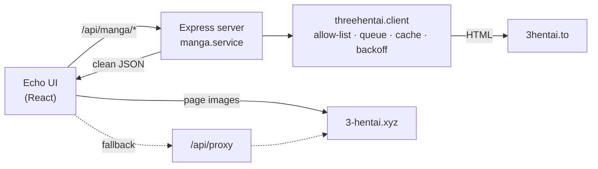
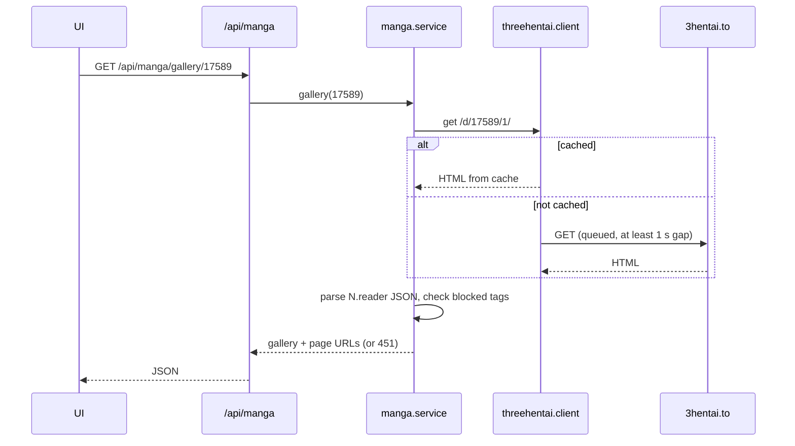

# Echo: Manga & Doujinshi Plan

This plan adds a **Manga & Doujinshi** section to Echo. It sits in the sidebar between **Browse** and **Account**. You can browse, search, filter by tag, artist, language and category, and read galleries in a built-in reader.

The first source is **3hentai.to**. We have permission from the site to use its data. The site has no public JSON API, so Echo reads its HTML pages, the same way the `hasmr` and `jasmr` sources already work.

> **Diagrams.** The diagrams use [Mermaid](https://mermaid.js.org/). GitHub shows them as pictures. In VS Code, install the
> "Markdown Preview Mermaid Support" extension to see them in the preview.

---

## Contents

1. [The plan in one minute](#1-the-plan-in-one-minute)
2. [Content rules](#2-content-rules)
3. [How the site works](#3-how-the-site-works)
4. [How Echo talks to the site](#4-how-echo-talks-to-the-site)
5. [Backend](#5-backend)
6. [Frontend](#6-frontend)
7. [The reader](#7-the-reader)
8. [Phases](#8-phases)
9. [Testing](#9-testing)
10. [Open questions and risks](#10-open-questions-and-risks)

---

## 1. The plan in one minute

- The Express server gets a new **manga source**, `threehentai`. It reads listing, gallery and tag pages and turns them into clean JSON.
- One request to a reader page returns **the whole gallery**: title, tags, page count, and the size and file type of every page. So opening a gallery costs one request, not one per page.
- Page images are on `3-hentai.xyz` and load without a Referer, so the browser loads them directly. `/api/proxy` is there as a fallback.
- The UI gets a sidebar group, browse, search and tag pages, a gallery page and a reader.
- The section is always in the sidebar. There's no setting for it.



---

## 2. Content rules

These rules are written into the code. They are not settings.

- **Galleries with minor-coded tags are blocked.** The list is `lolicon`, `shotacon`, `toddlercon`, `low lolicon`, `low shotacon` and `oppai loli` (site ids 4, 30, 540, 10340 and 3625; `toddlercon` has no page on the site). Any tag, artist or other name containing `loli`, `shota` or `toddler` counts too (for example `lolibaba`), except `shota` followed by `r`, so the given name Shotaro isn't caught.
  - Titles: tags on the site are incomplete, so a card or gallery whose title says the characters are children (middle school, elementary school, JC/JS, child, kid, 中学, 小学, 幼女, ロリ, ショタ, 萝莉, 正太 and similar) is blocked the same way.
  - Listings: every card carries its tag IDs (`data-tags`). Cards with a blocked ID or title are removed before the UI sees them.
  - Gallery and reader: if the gallery has a blocked tag, the API answers **451** and sends no page URLs.
  - Search: a query that names a blocked tag returns no results.
  - Tag browser: blocked tags never appear.
  - The ids were found once from each tag's page (the one id every card there shares) and are fixed in the code. Names are checked as well, and a gallery refused by name adds its tag ids to the list, so its cards drop out of lists too.
- **Polite access.** One request at a time, at least 1 second apart. Pages are cached. On a block or a Cloudflare check, Echo stops asking for a while. It never tries to get past a block.

---

## 3. How the site works

Mapped with Playwright on 2026-11-15.

### 3.1 Pages

| Page | URL | Notes |
|---|---|---|
| Home | `/` | Landing page. Links to `/go`. |
| Browse | `/go` → 302 → `/kai` | A strip of 5 "popular at the moment" cards, then 24 newest. Echo reads only the last list (`.listing-container`). `?page=N` (about 26,900 pages). `?sort=popular`. |
| Search | `/search/?q=…&page=N` | Accepts `tag:x -tag:y`. No result count is shown. |
| Gallery | `/d/{id}/` | Info, tags and a grid of thumbnails. |
| Reader | `/d/{id}/{page}/` | One page image, plus the whole gallery as JSON (see 3.3). |
| Tag page | `/tag/{slug}/` | Same cards as Browse. Sorts below. |
| Artist, character, parody, group | `/artist/{slug}/`, `/character/{slug}/`, `/parody/{slug}/`, `/group/{slug}/` | Same layout as a tag page. |
| Language | `/language/{slug}/` | Same layout. |
| Category | `/category/{slug}/` | Same layout. |
| Random | `/random/` | Redirects to a gallery. |
| Sitemap | `/sitemap.xml` | Static pages and gallery sitemaps. |

### 3.2 Filters and sorts

| Filter | Values |
|---|---|
| Sort on Browse | newest (default), `popular` |
| Sort on tag, artist and other pages | newest (default), `popular-24h`, `popular-7d`, `popular` (all time) |
| Languages | `english`, `japanese`, `chinese`, `spanish`, `french`, `korean`, `russian`, `italian`, `translated` |
| Categories | `manga`, `doujinshi`, `artistcg`, `gamecg`, `western`, `non-h`, `imageset`, `misc` |

### 3.3 Index pages

All index pages list 300 links a page; some names appear twice (a popular block repeats them), so a page gives about 290 names. Each item is `a.name[href][data-qty]`. `data-qty` is the number of galleries, written like `21K`.

| Index | URL | Pages | Item URL |
|---|---|---|---|
| Tags | `/tags/` | 26 | `/tag/{slug}/` |
| Artists | `/artists/` | 109 | `/artist/{slug}/` |
| Characters | `/characters/` | 59 | `/character/{slug}/` |
| Parodies | `/parodies/` | 14 | `/parody/{slug}/` |
| Groups | `/groups/` | 84 | `/group/{slug}/` |

Options: `?sort=popular`, `?letter=a` … `?letter=z`, `?letter=%23` (numbers and symbols), `?page=N`.

### 3.4 What a card looks like

```html
<div class="doujin" data-tags="48626 230 236 4 …">
  <a href="/d/679221/" class="cover" style="padding:0 0 141.2% 0">
    
    <div class="title flag flag-eng">[Artist] Title [English]</div>
  </a>
</div>
```

| Field | Where |
|---|---|
| id | `a.cover[href]` → `/d/{id}/` |
| title | `.title` text |
| language | `.flag-{code}` class (`eng`, `jpn`, `chi`, …) |
| cover | `img[data-src]`, with `data-fallbacks` as a JSON list of other URLs |
| tag IDs | `div.doujin[data-tags]`, separated by spaces |
| aspect ratio | `padding-bottom` percentage on `a.cover` |

### 3.5 The gallery page

`#main-info` holds:

- `h1` (full title), `.middle-title` (second title) and `#gallery_id` (`#d17589`).
- `section#tags > .tag-container`, one per group. The label is the first text node: **Tags**, **Artists**, **Parodies**, **Characters**, **Groups**, **Languages**, **Categories**, **Pages** (`.field-light-text`) and **Uploaded** (`time[datetime]`).
- `#thumbnail-gallery a.gallerythumb[href=/d/{id}/{n}/] img[data-src]` (the thumbnails).
- JSON-LD `CreativeWork` with `numberOfPages` and `datePublished`, plus `og:image` (the cover).

### 3.6 The reader page (the best source)

Each reader page runs this script:

```js
var reader = new N.reader({
  media_url: 'https://3-hentai.xyz/',
  gallery: {
    "id": 17589,
    "media_id": "61443",
    "title": { "english": "…", "japanese": "…", "pretty": "…" },
    "images": {
      "pages": [{ "t": "j", "w": 966, "h": 1400 }, …],
      "cover": { "t": "j", "w": 350, "h": 507 },
      "thumbnail": { "t": "j", "w": 250, "h": 362 }
    },
    "scanlator": "",
    "upload_date": 1590450223,
    "tags": [{ "id": 235, "type": "tag", "name": "schoolboy uniform",
               "url": "/tag/schoolboy-uniform/", "books_count": 21489 }, …],
    "num_pages": 33
  },
  start_page: 1
});
```

To read it, find `N.reader(`, then the `gallery:` after it (the page's CSS also contains `gallery:`), match braces to the closing `}`, and `JSON.parse` the result. If that fails, fall back to the gallery page (3.5).

### 3.7 Image URLs

| Image | URL |
|---|---|
| Page `n` | `https://3-hentai.xyz/{media_id}/{n}.{ext}` |
| Thumbnail of page `n` | `https://3-hentai.xyz/{media_id}/{n}t.{ext}` |
| Cover | `https://3-hentai.xyz/{media_id}/cover.{ext}` |
| Card thumbnail | `https://3-hentai.xyz/{media_id}/thumb.{ext}` |

`t` in the JSON gives the file type: `j` = jpg, `w` = webp, `p` = png, `g` = gif. Images load with or without a Referer and with any User-Agent.

### 3.8 Things we don't use

- `/api/autocomplete`, `/api/comments/*`, `/api/gallery/{id}/edit`, `/api/hit` and `/api/inventory` are the site's own internal endpoints. They need a CSRF token and a session. Echo doesn't call them.
- Login, favourites, likes and comments.
- Ads and tracking scripts.

### 3.9 Cloudflare and robots

- The site is behind Cloudflare (`server: cloudflare`, `cf-ray`). Today there is no bot check: a plain request gets the page with status 200.
- The only Cloudflare script on the page is the email hider (`/cdn-cgi/scripts/…/email-decode.min.js`).
- `robots.txt` allows `/` for all agents. Its content signal is `search=yes, ai-train=no, use=reference`.

---

## 4. How Echo talks to the site

The client is a copy of the `HasmrClient` approach (`web/backend-express/src/extension/hasmr/api/hasmr.client.ts`).

| Rule | How |
|---|---|
| Only known addresses | `isAllowedAddress(url)` allows `/kai`, `/search/`, `/d/{id}/`, `/d/{id}/{n}/`, `/{tag,artist,character,parody,group,language,category}/{slug}/`, `/{tags,artists,characters,parodies,groups}/`, and the query keys `page`, `sort`, `letter` and `q`. Anything else is refused before a request is made. |
| One at a time | `Mutex` with a gap of at least 1 second between requests. |
| Cache | `LruCache`. Listings for 5 minutes, galleries for 1 hour, index pages for 1 day. |
| Blocks | A 403, a 429, a 503 or a body matching `cdn-cgi/challenge-platform` or `Just a moment` starts `BlockBackoff`: 15 minutes, doubling up to 2 hours. The UI shows "The source is busy, try again later". |
| User-Agent | `APP_USER_AGENT` (`EchoASMR/1.0`), the same as the other sources. |
| HTTP | The shared undici dispatcher from `src/lib/http-client.ts`. Timeouts are in `src/config/limits.ts`. |



---

## 5. Backend

The code goes in `web/backend-express`. Manga is its own area beside the music extensions, because `MusicExtension` (`src/models/extension.ts`) describes audio works.

### 5.1 Files

| File | Job |
|---|---|
| `src/models/manga.ts` | Types: `MangaSource` (port), `MangaCard`, `MangaGallery`, `MangaPage`, `MangaTag`, `MangaListQuery`, `MangaIndexItem`. |
| `src/extension/threehentai/constants.ts` | Site URL, media host, blocked-tag list, language and category lists. |
| `src/extension/threehentai/api/threehentai.client.ts` | HTML client (section 4). |
| `src/extension/threehentai/parsers/listing.ts` | Cards and paging from Browse, search, tag and other listing pages. |
| `src/extension/threehentai/parsers/gallery.ts` | `N.reader` JSON, falling back to `#main-info`. |
| `src/extension/threehentai/parsers/index-page.ts` | Index pages: name, slug, count, last page. |
| `src/extension/threehentai/mappers.ts` | Parsed data → models. Builds image URLs from `media_id` and `t`. |
| `src/extension/threehentai/threehentai.extension.ts` | Implements `MangaSource`. |
| `src/services/manga.service.ts` | Setting check, content rules, registering issued URLs. |
| `src/controllers/manga.controller.ts` | Request handling. Zod schemas sit next to the existing ones. |
| `src/views/manga.view.ts` | Shapes the JSON responses. |
| `src/container.ts` | Wiring. |
| `src/routes/index.ts` | Route table entries. |
| `src/config/limits.ts` | Gap, cache times, timeouts. |

### 5.2 Models

```ts
interface MangaCard { id: string; title: string; language?: string; cover: string; coverFallbacks: string[]; aspect?: number }
interface MangaTag { type: 'tag' | 'artist' | 'character' | 'parody' | 'group' | 'language' | 'category'; slug: string; name: string; count?: number }
interface MangaPage { n: number; url: string; thumb: string; w: number; h: number }
interface MangaGallery {
  id: string; title: string; titleJapanese?: string; prettyTitle?: string;
  cover: string; pages: MangaPage[]; tags: MangaTag[];
  uploadedAt?: string; scanlator?: string;
}
interface MangaListResult { items: MangaCard[]; page: number; lastPage?: number; hasMore: boolean }
```

### 5.3 Endpoints

| Method | Path | Query | Returns |
|---|---|---|---|
| GET | `/api/manga/browse` | `sort` (`new`, `popular`), `page` | `MangaListResult` |
| GET | `/api/manga/search` | `q`, `page` | `MangaListResult` |
| GET | `/api/manga/:kind/:slug` | `sort` (`new`, `24h`, `7d`, `all`), `page` | `MangaListResult` and the `MangaTag` itself. `kind` is one of `tag`, `artist`, `character`, `parody`, `group`, `language` or `category`. |
| GET | `/api/manga/index/:kind` | `letter`, `sort` (`az`, `popular`), `page` | `{ items: MangaTag[], page, lastPage }` |
| GET | `/api/manga/index/:kind/search` | `q` | `{ items: MangaTag[] }`: names containing `q`. The site has no name search, so the server reads every A–Z page of `q`'s first letter (cached for a day) and filters them; names starting with `q` come first, then by gallery count. |
| GET | `/api/manga/gallery/:id` | none | `MangaGallery`, or 451 if blocked |

Errors use the existing `ApiError` shape. 404 means the gallery doesn't exist. 451 means a blocked gallery. 503 means the source is backing off.

### 5.4 Settings

There are none. The section is always on, and the language filter lives on the Browse page (section 6.2).

### 5.5 Images

The browser loads `3-hentai.xyz` directly. Every page and thumbnail URL the service hands out is also recorded in `src/stores/issued-urls.ts`, so `/api/proxy?url=` works as a fallback. `Cover.tsx` already falls back this way.

---

## 6. Frontend

The code goes in `web/frontend`.

### 6.1 Sidebar

In `src/components/app-sidebar.tsx`, add a group between **Browse** and **Account**, using the same `SidebarGroup` → `SidebarMenu` → `SidebarMenuButton` → `NavLink` pattern:

| Item | URL | Icon (lucide) |
|---|---|---|
| Browse | `/manga` | `BookOpen` |
| Search | `/manga/search` | `Search` |
| Artists | `/manga/artists` | `Palette` |
| Tags | `/manga/tags` | `Tags` |

The group is always shown.

### 6.2 Routes

Added to `src/App.tsx`, inside `<Shell/>`:

| Route | Page |
|---|---|
| `manga` | `MangaBrowsePage`: Newest and Popular tabs, a **Language** filter and a **Category** filter. The site lists one language or one category at a time, so picking one clears the other. The last language picked is remembered on the device (`localStorage`), and `?lang=` / `?category=` keep the choice in the address. |
| `manga/search` | `MangaSearchPage`: a Galleries / Tags / Artists switch. Galleries search on Enter (with `tag:` and `-tag:`); tag and artist names are matched as you type. |
| `manga/tags` | `MangaTagsPage`: a name search box, tabs for Tags, Characters, Parodies and Groups, an A–Z bar and a Popular toggle |
| `manga/artists` | The same page for artists only (sidebar **Artists**) |
| `manga/:kind/:slug` | `MangaListPage`: the shared detail hero with the name and gallery count (read from the list page's heading), then sorts for New, 24 h, 7 days and All time. Artists (`manga/artist/:slug`) get a round picture from their newest cover, like the music artist page. |
| `manga/g/:id` | `MangaGalleryPage`: cover, titles, tag chips, thumbnail grid, **Read** button and "Continue from page N" |
| `manga/g/:id/read/:page?` | `MangaReaderPage` (section 7) |

Breadcrumbs go in `src/lib/crumbs.tsx`.

### 6.3 Data

- `src/api/client.ts`: `api.manga.browse/search/list/index/gallery`.
- `src/api/queries.ts`: query options. Listings use `useInfiniteQuery`, the same as `FeedView.tsx`. Galleries have a long `staleTime`.
- `src/api/types.ts`: the types from 5.2.

### 6.4 Music player on manga pages

The full player bar is replaced by `MiniPlayer` (`src/components/MiniPlayer.tsx`) on every `/manga` page: a small square in the bottom-right corner with the artwork, title, play/pause, next and a progress line; clicking the artwork opens Now Playing. It isn't shown at all when nothing is playing.

### 6.5 Components (`src/components/manga/`)

| Component | Notes |
|---|---|
| `MangaCard` | Cover in a fixed box (about 1:1.41), language flag, title cut to two lines. Tries `coverFallbacks` in order, then the proxy. |
| `MangaGrid` | Responsive grid with infinite scroll (`IntersectionObserver`, 400px margin, as in `FeedView.tsx`). Skeletons from `States.tsx`. |
| `TagChips` | Chips grouped by type. Each links to `/manga/:kind/:slug`. |
| `Segmented` | The chip tabs for sorts and index kinds. |

---

## 7. The reader

`src/pages/manga/MangaReaderPage.tsx`, with its settings panel in `src/components/manga/ReaderSettings.tsx` and the page-pairing logic in `src/lib/manga.ts`. It covers the whole window (portalled to `<body>`), with the page(s) on a plain background.

The design follows what dedicated readers do (Mihon, Kavita, Komga, Komic): a reading direction that defaults to right to left for manga, two-page mode with a cover / offset option and wide spreads kept whole, tap zones, and bars that get out of the way.

| Feature | Detail |
|---|---|
| Modes | **Single page**, **Two pages**, **Long strip** (vertical scroll, optional gaps) |
| Page order (two pages) | **Auto** (default), Right to left or Left to right. Auto lays Japanese manga out right to left (the earlier page on the right, as printed; translations keep this order) unless the gallery's category is Western. It only changes which page sits on which side: turning always goes right = next. |
| Two pages | Laid out as printed: in right to left the earlier page is on the right. **Cover on its own** (on by default) keeps page 1 alone; turning it off shifts the pairs by one, for books whose spreads come out split. A wide page (wider than tall: a spread scanned as one image) is always shown alone, and so is the page before it. A small gap separates the two pages, each sitting against it like an open book. |
| Reading order | While the bars are up, each page of a spread shows its number, and the one to read first is marked **Read first** in the accent colour. The first time two pages show (and again after the page order or mode changes), a hint over the gap says "Read right to left" or "Read left to right" with an arrow sweeping that way, then fades. |
| Page size | Fit screen, fit width or original |
| Background | Black, grey or white |
| Bars | The top bar (back, title, page, pages, settings, fullscreen) and bottom bar (turn buttons, slider) fade after 2.5 s without the mouse moving, and come back on a mouse move or a tap in the middle. They stay while a panel or the end screen is open. A small page counter stays in the corner. |
| Turning | The right side always goes forward and the left side back, whatever the page order: tap or click the outer 30 % of either side, swipe left for next, use → / ←, or scroll the wheel (fit screen only, one turn per gesture). |
| Slider | Page 1 on the left, shows a thumbnail of the page you're dragging to, and jumps when you let go |
| Progress | A thin line across the top, filling from the left |
| End of gallery | Back to gallery, More by the artist, Read again |
| Settings | One side panel, opened with the button or S. Every change applies at once and is saved in localStorage. Older saves with a right-to-left switch are read as a direction. |
| No layout jumps | Each page box is sized from the `w` and `h` the gallery JSON gives, before the image loads |
| Preload | The next 3 pages and the one before |
| Pages | A thumbnail sheet (T). Click to jump. |
| Resume | Last page per gallery, saved in localStorage (every read and write wrapped in try/catch) |
| Fullscreen | The whole window goes fullscreen (not just the reader), so menus and panels still show |
| Errors | Each page tries its address, then the proxy, then shows Try again |

### 7.1 Keys

| Key | Action |
|---|---|
| → / D | Next page (also when two pages are laid out right to left) |
| ← / A | Previous page |
| Space / Page Down | Next page (scrolls in long strip) |
| Shift Space / Page Up | Previous page |
| Home / End | First / last page |
| M | Next reading mode |
| T | Pages |
| S | Settings |
| F | Fullscreen |
| Esc | Leave fullscreen, close the end screen, then back to the gallery |

`Shell.tsx` uses Space for play/pause. The reader listens first and stops that while it's open.

---

## 8. Phases

| # | Phase | Done when |
|---|---|---|
| 0 | This document | Done |
| 1 | Client, parsers, fixtures | Done. Recorded pages are in `tests/fixtures/threehentai/`; cards with blocked tags have their titles and images blanked. |
| 2 | Service, routes, settings, content rules | Done |
| 3 | Sidebar, browse, search, tag pages | Done |
| 4 | Gallery page and reader | Done |
| 5 | Desktop | `apps/desktop/MANUAL-TESTS.md` has rows 17–20. Still to run on the packaged Mac app. |

---

## 9. Testing

| Where | Command | What it covers |
|---|---|---|
| Backend | `cd web/backend-express && npm run lint && npm run typecheck && npm test` | Parsers (recorded HTML), allow-list, backoff on a challenge page, blocked tags in listings, search and galleries |
| Backend live | `npm run test:live` | One Browse request and one gallery request against the real site |
| Frontend | `cd web/frontend && npm run typecheck && npm test && npm run build` | Sidebar group position, Browse language and category filters, reader keys and modes |
| Desktop | `cd apps/desktop && npm test`, then the manual tests | The packaged app |

---

## 10. Open questions and risks

- **Site changes.** The HTML and the `N.reader` script can change without notice. The parsers fail loudly with a clear error, and the recorded fixtures make it quick to fix them.
- **Cloudflare.** If the site turns on a bot check, Echo backs off and shows a message. It doesn't try to get around it. Ask the site for an allow-listed key or a feed if that happens.
- **Written permission.** Keep a copy of the permission from the site. It should cover reading the HTML and hot-linking images from `3-hentai.xyz`.
- **More sources later.** `MangaSource` is a port, so other licensed sources can be added the same way as the music extensions.
